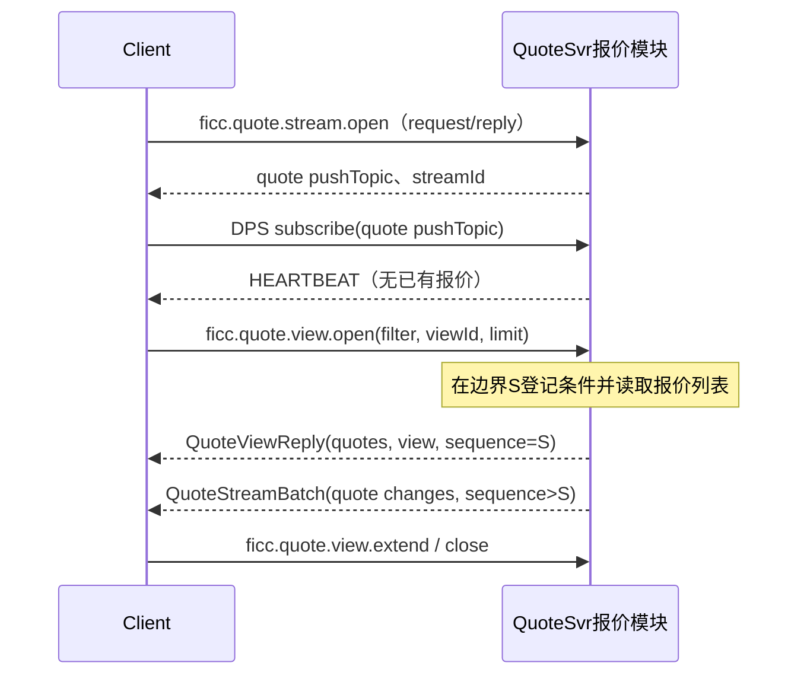
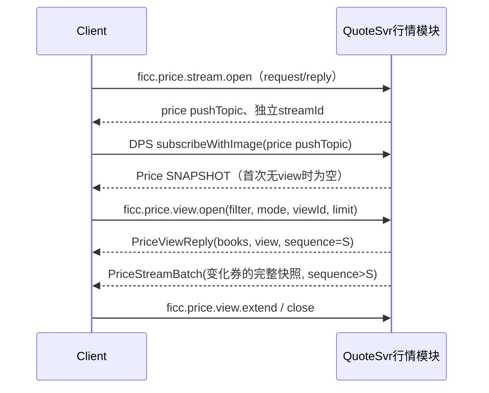

# FICC服务API规范（v2评审稿：报价与行情通道分离）

日期：2026-09-13。用于继续评审；本文是新设计，不表示接口已实现或已覆盖全部产品要求。

本次修订：Quote与Price分别使用`ficc.quote.*`和`ficc.price.*`接口、DTO及推送通道；去掉前端view的dataset参数。报价订阅只推事件，初始报价列表通过显式查询获得；市场价格提供按券快照。第4.1节按行情中心页面列出调用顺序，第13节标明未完成的需求覆盖。

## 1．范围与依据

本稿以[当前架构](ficc-sales-trading-architecture.zh-CN.md)、[核心ER](models/core-data-model-er.zh-CN.md)、[行情模型](models/market-data-model.zh-CN.md)为设计依据，独立列出接口、模型和消息规则。旧API及看板协议不作为补充契约；不要从旧稿复制未在本文列出的topic。

| 服务／组件 | 本版接口范围 |
| --- | --- |
| QuoteSvr | 报价生命周期、查询、历史、来源接入、价格簿、用户分组、报价及行情订阅 |
| NotificationSvr | 四类提醒、开关、已读状态、通知查询、通知筛选及订阅 |
| SearchSvr | 内部DSL搜索、属性读取、处理位置；消费源事件，不维护用户订阅 |
| ParseSvr | 自然语言识别并返回候选Quote，不自动落正式报价 |
| 基础资料层 | 统一资料查询与变化通知；可由现有BaseSvr适配模块承载，不要求新增独立进程 |
| qtrade-intake / ideal-intake | 外部协议转为QuoteSvr统一接入请求，无前端API |
| LoginSvr / CalSvr / STC MarketSvr | 复用既有服务，不重写其对外契约；接入约定见后文 |
| RecommendSvr | 按当前架构留待后续，无本版handler或订阅 |

QuoteSvr内部维护报价、行情条目和价格簿；不再单独部署FICC MarketSvr。新handler、topic、错误码和默认限额为本次评审提案；尚未确定的业务规则集中列于最后，不隐藏在示例中。

## 2．STC／DPS接入方式

### 2.1 STC的请求、事件订阅与行情订阅

同一进程可以同时处理订单／报价和生成价格簿，但模型与通信路径分别定义。STC InnerSvr的ExecutionReport发布在stc.inner.o.*，行情MarketDataSnapshotFullRefresh发布在stc.inner.p.*；MarketHandler.snapshot仅处理行情初始image。FICC不因共享过滤算法而合并这两类API。

| 通信方式 | 实现与调用 | 本稿用途 |
| --- | --- | --- |
| 请求/应答 | ContentHandler.handle；BaseApi.requestSync | 报价操作、列表查询、登记条件、显式初始化与补事件 |
| 普通订阅/发布 | BaseApi.subscribe；业务Publisher发布 | QuoteReport、QuoteEvent及通知事件；不调用业务snapshot，不自动返回已有报价集合 |
| 带image订阅/发布 | BaseApi.subscribeWithImage；ContentHandler.snapshot | Price频道；先返回当前市场快照，再按券发送完整刷新 |

```java
BaseApi.requestSync("SERVER.QuoteSvr", "ficc.quote.get",
    requestJson, QuoteGetReply.class, false, false, true);
// quoteListener接收JSON字符串，交给独立QuoteStreamBatch DTO解析。
BaseApi.subscribe("SERVER.QuoteSvr", quotePushTopic, quoteListener);
BaseApi.subscribeWithImage("SERVER.QuoteSvr", "QuoteSvr", pricePushTopic,
    priceListener, PriceStreamBatch.class, false);
BaseApi.unSubscribeWithImage("SERVER.QuoteSvr", "QuoteSvr", pricePushTopic, priceListener);
```

示例为共享Java库的真实调用形状；C#客户端经GW的DPS封装须对应普通subscribe和subscribeWithImage两种能力。报价Publisher不是ContentHandler.snapshot的别名，不给纯发布topic虚构snapshot Handler。鉴权应在GW/消息订阅入口完成，不能假设普通subscribe会执行ContentHandler。

本次源码中BaseApi.unSubscribe的底层调用被注释，带Class的unSubscribeWithImage也为空；前者需在客户端适配层补齐实际退订，后者使用四参数重载及原typed listener。不能把方法调用成功当成已退订；引用的CedaClientWrapper实现提供底层退订路径。本文不修改共享库源码。

复杂条件使用业务view.open登记，不将DSL拼入topic。Quote和Price分别stream.open、分别订阅，拥有独立streamId、sequence和客户端缓存。服务仍为QuoteSvr／SERVER.QuoteSvr。框架SIGNAL_SRL等控制字段不进入业务DTO；只有行情snapshot按STC方式将序列化内容放在返回Map的topic键下。

### 2.2 消息封装及身份

```json
{"requestId":"R-001","quoteId":"Q-001"}
```

```json
{"Code":"0000","Msg":"成功","requestId":"R-001","Data":{"quoteId":"Q-001"}}
```

`Code`、`Msg`沿用STC写法；`Data`是本规范统一结果包装，业务字段使用lowerCamelCase，STC行情报文保持原大写字段。`requestId`为业务关联及写入幂等键，DPS自身请求关联仍由其封装处理。本文不用额外batchId。

用户身份从可信GW/DPS上下文解析，再由LoginSvrClient取得STC userid。客户端请求不能自行声明operatorUserId；普通创建的ownerUserId取当前用户。服务调用通过服务身份和授权范围认证；代用户查询的actorUserId只允许受信业务服务设置，不能由客户端绕过。

私有topic中的sessionId为服务分配的路由标识，不是登录sid，也不是凭证。服务必须校验订阅者与路由标识绑定关系；拒绝客户端订阅他人topic或内部通配topic。登出／权限变化撤销或重建相应结果集。

| Code | error.type | 含义及调用方行为 |
| --- | --- | --- |
| 0000 | 无 | 请求成功；批量操作还需逐项查看结果 |
| 1001 | VALIDATION_FAILED | 字段、格式或状态组合错误，按error.field修正 |
| 1002 | NOT_FOUND | 记录不存在或不可见，不泄露权限外记录 |
| 1003 | FORBIDDEN | 身份有效但无操作权限 |
| 1004 | REVISION_CONFLICT | 重新读取后由用户决定，不能盲目覆盖 |
| 1005 | INVALID_STATE | 当前生命周期不允许该动作 |
| 1006 | IDEMPOTENCY_CONFLICT | 同requestId携带不同内容 |
| 1007 | RESET_REQUIRED | 游标、流位置或视图失效，重新取快照 |
| 1008 | RESOURCE_LIMIT | 请求超限，显式缩小范围 |
| 1009 | NOT_READY | 索引、资料或价格簿尚未就绪，可稍后重试 |
| 1010 | UNSUPPORTED | 本版未支持的报价类型、清算等 |
| 1099 | INTERNAL_ERROR | 服务内部错误，返回traceId，不返回堆栈 |

### 2.3 写入约束

1. 每个写入携带requestId；去重范围为“服务＋认证主体＋topic＋requestId”。重试同内容返回同一结果，不重复报价或审计；同键不同内容报1006。成功记录与幂等结果在业务事务内保存。stream/view等临时连接操作按领域连接幂等，不沿用业务写入跨连接的持久化重试承诺。
2. 修改已有Quote必须带expectedRevision。它只校验源报价版本；成功后revision加1。新建revision为1；Refer/Unrefer保留quoteId。
3. 批量使用quotes数组，每条独立事务，顺序对应results；顶层0000仅表示批量请求完成。单批不允许重复quoteId/clientQuoteId。失败项不更新版本、不发布成功QuoteReport。
4. update/confirm未传字段保留；null只清除可空字段；false明确关闭标记。不接受客户端修改status、revision和审计时间。
5. 一条操作的Quote、QuoteHistory及待发布事件原子提交；提交后推进本地价格簿。内存更新或网络发布不代替持久化成功。回复可能先于推送到达，也可能晚于推送。
6. 业务超时不是操作失败证明：使用原requestId重试。幂等数据保留期必须覆盖约定重试窗口，配置窗口外不能承诺安全重试。

## 3．统一模型与字典

各领域DTO独立定义，不用Object或dataset判别的通用消息承载所有业务。可以共用Code/Msg、基础条件和序列辅助类型，但请求校验与业务载荷分开。

| 领域 | 请求/应答DTO示例 | 发布DTO | 业务载荷 |
| --- | --- | --- | --- |
| Quote | QuoteViewOpenRequest / QuoteViewReply | QuoteStreamBatch、QuoteEventBatch | quotes / reports；QuoteView成员为quoteId |
| Price | PriceViewOpenRequest / PriceViewReply | PriceStreamBatch、PriceFeedBatch | books / prices，内部为PriceResult及STC行情模型；PriceView成员为securityId |
| Notification | NotificationViewOpenRequest / NotificationViewReply | NotificationStreamBatch | notifications / preference；成员为notificationId |

### 3.1 Quote及生命周期

| 字段组 | 字段及约束 |
| --- | --- |
| 标识 | quoteId服务端生成；clientQuoteId客户端创建关联，用户内唯一；sourceMessageId可空；source为来源信息 |
| 身份 | ownerUserId、securityId、institutionId、contactId；机构／联系人可空，确认时债券必须确定 |
| 对手名称 | institutionName、contactName；待确认可仅有名称，确认前由用户从CRM手动选定对应ID |
| 状态 | revision为十进制整数字符串；status取下表 |
| 报价 | side、quoteType、yieldType、price、quantity、quantityUnit、currency、tradeDate、settlType |
| 标记 | urgent、recommended、whole、oco、packing为boolean，默认false；oco与packing互斥 |
| 说明 | remark可空；reason是操作原因，单独写入审计，不是remark别名 |
| 审计 | createdBy、updatedBy、confirmedBy、createTime、updateTime、quoteTime、confirmTime均由服务端维护 |

| 当前状态 | 允许动作 | 结果 |
| --- | --- | --- |
| 无 | create／clone／首次来源接入 | PENDING_CONFIRM |
| PENDING_CONFIRM | update、confirm、delete | 原状态、ACTIVE、DELETED |
| ACTIVE | update、refer | ACTIVE、REFERRED |
| REFERRED | unrefer、delete | ACTIVE、DELETED |
| DELETED | get、history.query | 只读 |

clone是复制输入生成新Quote，不是恢复旧ID。confirm可在同一条请求中提交修正字段；校验合并后的结果再一次性确认。重复requestId幂等；新的requestId重复执行不合法状态动作报1005。

| 字典 | 值 |
| --- | --- |
| side | 1买入，2卖出；报价方视角 |
| quoteType | 1收益率，2净价，3全价 |
| yieldType | 1到期，2行权；quoteType不为1时必须为null |
| quantityUnit / currency | WAN（万单位面值）／CNY |
| settlType | 1=T+0，2=T+1，3=明+0，4=明+1；3/4及远期日期依据仍须评审 |
| source.type（本稿建议） | MANUAL、QT、IDEAL；source含externalQuoteId、externalRevision和sourceTime |

价格和数量使用十进制字符串；收益率为百分数且输入最多4位小数，超过直接拒绝。时间用带时区ISO 8601，日期YYYY-MM-DD。价格/报量能否在确认时为空、其他精度等见最终评审项；示例使用可确认的完整数值。未知正式报价类型不能静默转成收益率。

quoteTime在首次确认前为null，确认、ACTIVE报价修改及unrefer时更新；updateTime反映最近一次事实变更，createTime永不改写。contactId与institutionId同时提供时必须属于同一机构；ownerUserId是我方STC用户，不能用对手联系人ID代替。

QuoteHistory为eventId、quoteId、revision、action、operatorUserId、operationTime、before、after、reason；before/after是完整报价事实，不混入当前评级或估值。create的before=null。系统动作使用独立actorService字段且operatorUserId=null，不伪造STC用户；这是待评审的审计模型补充。

### 3.2 行情消息

每券PriceBook保存该券全部有效MarketDataEntry的买卖侧集合，每条行情条目关联一条Quote。报价入簿、移出及修改由QuoteSvr内部完成；价格簿处理位置与quoteRevision不同。首版按收益率比较，含权债用行权收益率；Bid升序、Ofr降序，同价按Quote.updateTime降序和quoteId升序。

行情返回PriceResult：`securityId、bookRevision、marketData、quoteRefs`。marketData为共享MarketDataSnapshotFullRefresh；quoteRefs是按MDEntryID关联quoteId及quoteRevision的FICC包装字段，不塞入STC Info1等扩展字段。STC直连行情topic只发送marketData，FICC查询和面板流发送完整PriceResult。

| 行情字段 | 本稿约定 |
| --- | --- |
| MarketIndicator | 示例沿用InnerSvr配置的市场代码4，不以securityId的IB后缀代替代码；渠道编码见R6 |
| SecurityID / NoMDEntries | 债券ID / 所选范围内完整条目数组 |
| MDEntryID | 建议FICC:quoteId，保持恢复前后稳定 |
| MDEntryType | 0=Bid、1=Ofr，由Quote.side映射 |
| MDEntryPx | 比较用收益率；PriceType=3，ExerciseFlag=0行权／1到期 |
| Yield / YieldToExecution | 到期收益率／行权收益率，均为百分数 |
| NetPrice / DirtyPrice | 净价／全价，缺失省略，不填0 |
| MDEntrySize | 本稿FICC渠道约定为WAN面值；接入其他STC渠道必须显式核对及转换单位 |
| UserID | FICC渠道内映射ownerUserId；客盘InstitutionID/TraderID另映射 |
| MDEntryDate / MDEntryTime | 报价updateTime在业务时区拆为yyyyMMdd和HH:mm:ss.SSS |
| MDPriceLevel | STC兼容输出仍用每侧条目顺序号；不同价格档先在服务端算完，再按depth截取全部成员 |

mode=BEST取各侧第一价格档；DEPTH需depth正整数；FULL不按档数截断。先过滤再分档，不按quote条数截断同价档。无清算条件时混合T+0/T+1/远期；具体远期输入字典不在本稿臆造。

最优排行所需计算值尚未就绪时，price.query/view.open返回1009，不默默使用错误排序。对价提醒需要无价格依赖的同券反向报价关系，QuoteSvr内部事件流仍提供完整有效Quote成员；不能因价格计算未完成漏掉它们。计算异常处理的最终业务口径仍列入评审项。

### 3.3 查询、筛选与滚动

QuoteFilter与PriceFilter是独立DTO，共享已定义的基础条件类型与过滤库；不存在带dataset判别的通用前端请求。客户端filter使用结构化业务条件：`market、conditions、watchlistIds、filterGroupIds`。conditions每项为field/operator/value；同字段OR、跨字段AND；不同已选filterGroup取并集，再与临时条件及关注债券成员范围相交。空选中列表表示未启用该类限制；显式选中的空关注分组匹配空集。FilterSubgroup仅为编辑器组织结构，查询前拍平。

query为一次性查询：首请求带filter、limit，后续只带cursor。cursor绑定用户权限、查询条件、数据及基础资料快照；过期1007，不拼接两个时点结果。历史日期范围使用[fromDate,toDate]，不建立订阅。返回nextCursor=null表示结束。此游标用于滚动续取，不提供页码或客户端排序参数。

QuoteView为报价记录列表，PriceView为按券组织的行情列表，分别使用对应业务前缀。view为实时面板：默认加载匹配结果前200条，view.extend扩大已加载前缀。服务端保存完整匹配集合并更新已加载范围；插入、移出或移动需补齐边界，不能只推新命中的报价而遗漏被挤出的行。Quote固定updateTime降序；通知按updateTime降序；价格面板债券行按最新报价时间降序，券内按价格簿规则。

### 3.4 分组、通知及资料

Watchlist包含watchlistId、name、market、scope、displayOrder、securities[]；成员为securityId、displayOrder。FilterGroup包含filterGroupId、name、market、scope、displayOrder、subgroups[]；子组含subgroupId和conditions[]，条件为conditionId、field、operator、value、displayOrder。保存为完整替换，服务端生成缺省子ID并丢弃空子组；调用者只能改自己的分组。

为支持多端编辑，本稿建议为分组及NotificationPreference补充revision，save携带expectedRevision；这是ER尚未列出的技术字段。通知筛选组由NotificationSvr管理，scope=NOTIFICATION；行情及历史分组由QuoteSvr管理，scope=MARKET/HISTORY。分组所有者userId由服务端写入。

Notification包含notificationId、userId、securityId、reasons[]、content、quoteIds[]、readTime、createTime、updateTime。reasons项为type、groupIds、text；type取WATCHLIST、FILTER_GROUP、COUNTER_QUOTE、MY_BEST。非对价同券原因可合并，对价独立；通知拥有唯一用户，不能复用其他用户的已读状态。

个人偏好为watchlistEnabled、filterGroupEnabled、counterQuoteEnabled、myBestEnabled四个开关。关注/筛选提醒匹配用户该市场的全部行情分组，不受面板当前点选影响。我的最优用同侧最优档（含并列）；对价只检查同券、相反方向、本人与他人，不要求价格交叉或清算相同。生成/退出通知由事件驱动，客户端没有notification.create/delete接口。

资料返回稳定FICC模型Security、Issuer、Institution、Contact、DailyValuation，使用统一ID。当前评级与最新可用日估值用于历史报价筛选及显示，原Quote审计不随资料变化改写。未定稿的供应商字段在适配层补齐，不能把供应商整表DTO变成对前端契约。

## 4．接口目录

### 4.0 请求Handler与发布频道

| 编号 | 服务 | topic | Handler | 用途 |
| --- | --- | --- | --- | --- |
| H01 | QuoteSvr | `ficc.quote.create` | `QuoteCreateHandler` | 创建／批量创建报价 |
| H02 | QuoteSvr | `ficc.quote.confirm` | `QuoteConfirmHandler` | 确认报价并允许同时修正 |
| H03 | QuoteSvr | `ficc.quote.update` | `QuoteUpdateHandler` | 修改报价 |
| H04 | QuoteSvr | `ficc.quote.refer` | `QuoteReferHandler` | 撤销报价 |
| H05 | QuoteSvr | `ficc.quote.unrefer` | `QuoteUnreferHandler` | 恢复报价 |
| H06 | QuoteSvr | `ficc.quote.delete` | `QuoteDeleteHandler` | 删除报价 |
| H07 | QuoteSvr | `ficc.quote.clone` | `QuoteCloneHandler` | 克隆报价 |
| H08 | QuoteSvr | `ficc.quote.get` | `QuoteGetHandler` | 读取单条报价 |
| H09 | QuoteSvr | `ficc.quote.query` | `QuoteQueryHandler` | 当前报价搜索 |
| H10 | QuoteSvr | `ficc.quote.history.query` | `QuoteHistoryHandler` | 单条报价变更历史 |
| H11 | QuoteSvr | `ficc.quote.history.search` | `QuoteHistorySearchHandler` | 跨日期历史报价搜索 |
| H12 | QuoteSvr | `ficc.quote.sourceMessage.query` | `QuoteSourceMessageQueryHandler` | 来源原文及候选关联查询 |
| H13 | QuoteSvr | `ficc.price.query` | `PriceQueryHandler` | 单券／多券行情查询 |
| H14 | QuoteSvr | `ficc.quote.dictionary.query` | `QuoteDictionaryHandler` | 业务字典与可用筛选字段 |
| H15 | QuoteSvr | `ficc.quote.stream.open` | `QuoteStreamOpenHandler` | 取得当前连接的私有推送topic |
| H16 | QuoteSvr | `ficc.quote.view.open` | `QuoteViewOpenHandler` | 登记条件并查询初始列表 |
| H17 | QuoteSvr | `ficc.quote.view.extend` | `QuoteViewExtendHandler` | 滚动扩大已加载范围 |
| H18 | QuoteSvr | `ficc.quote.view.close` | `QuoteViewCloseHandler` | 关闭实时面板 |
| H19 | QuoteSvr | `ficc.watchlist.query` | `WatchlistQueryHandler` | 读取个人关注分组 |
| H20 | QuoteSvr | `ficc.watchlist.save` | `WatchlistSaveHandler` | 保存关注分组及全部成员 |
| H21 | QuoteSvr | `ficc.watchlist.delete` | `WatchlistDeleteHandler` | 删除关注分组 |
| H22 | QuoteSvr | `ficc.filterGroup.query` | `FilterGroupQueryHandler` | 读取个人筛选分组 |
| H23 | QuoteSvr | `ficc.filterGroup.save` | `FilterGroupSaveHandler` | 保存筛选组及全部条件 |
| H24 | QuoteSvr | `ficc.filterGroup.delete` | `FilterGroupDeleteHandler` | 删除筛选分组 |
| H25 | NotificationSvr | `ficc.notification.stream.open` | `NotificationStreamOpenHandler` | 取得当前连接的私有推送topic |
| H26 | NotificationSvr | `ficc.notification.view.open` | `NotificationViewOpenHandler` | 登记条件并查询初始列表 |
| H27 | NotificationSvr | `ficc.notification.view.extend` | `NotificationViewExtendHandler` | 滚动扩大已加载范围 |
| H28 | NotificationSvr | `ficc.notification.view.close` | `NotificationViewCloseHandler` | 关闭实时面板 |
| H29 | NotificationSvr | `ficc.notification.query` | `NotificationQueryHandler` | 读取当前通知 |
| H30 | NotificationSvr | `ficc.notification.read` | `NotificationReadHandler` | 标记已读／未读 |
| H31 | NotificationSvr | `ficc.notification.preference.get` | `NotificationPreferenceGetHandler` | 读取个人提醒开关 |
| H32 | NotificationSvr | `ficc.notification.preference.save` | `NotificationPreferenceSaveHandler` | 保存个人提醒开关 |
| H33 | NotificationSvr | `ficc.notification.filterGroup.query` | `FilterGroupQueryHandler` | 读取个人筛选分组 |
| H34 | NotificationSvr | `ficc.notification.filterGroup.save` | `FilterGroupSaveHandler` | 保存筛选组及全部条件 |
| H35 | NotificationSvr | `ficc.notification.filterGroup.delete` | `FilterGroupDeleteHandler` | 删除筛选分组 |
| H36 | SearchSvr | `ficc.search.query` | `SearchQueryHandler` | 内部DSL查询 |
| H37 | SearchSvr | `ficc.search.attributes.get` | `SearchAttributesGetHandler` | 取得完整搜索属性 |
| H38 | SearchSvr | `ficc.search.fields.query` | `SearchFieldsQueryHandler` | 读取模型的筛选字段目录 |
| H39 | SearchSvr | `ficc.search.status.get` | `SearchStatusGetHandler` | 查询索引及持久化处理位置 |
| H40 | ParseSvr | `ficc.quote.recognize` | `QuoteRecognizeHandler` | 自然语言识别为候选报价 |
| H41 | QuoteSvr | `ficc.quote.intake.apply` | `QuoteIntakeHandler` | QT／IDEAL统一来源接入 |
| H42 | BaseSvr适配模块 | `ficc.base.get` | `ReferenceGetHandler` | 按ID批量读取统一基础资料 |
| H43 | BaseSvr适配模块 | `ficc.base.query` | `ReferenceQueryHandler` | 基础资料输入联想与查找 |
| H44 | QuoteSvr | `ficc.quote.state.query` | `StateQueryHandler` | 显式读取内部初始化记录 |
| H45 | QuoteSvr | `ficc.quote.event.query` | `EventReplayQueryHandler` | 按位置补取内部事件 |
| H46 | NotificationSvr | `ficc.notification.state.query` | `StateQueryHandler` | 显式读取内部初始化记录 |
| H47 | NotificationSvr | `ficc.notification.event.query` | `EventReplayQueryHandler` | 按位置补取内部事件 |
| H48 | BaseSvr适配模块 | `ficc.base.state.query` | `StateQueryHandler` | 显式读取内部初始化记录 |
| H49 | BaseSvr适配模块 | `ficc.base.event.query` | `EventReplayQueryHandler` | 按位置补取内部事件 |
| H50 | QuoteSvr | `ficc.price.stream.open` | `PriceStreamOpenHandler` | 取得独立的行情推送topic |
| H51 | QuoteSvr | `ficc.price.view.open` | `PriceViewOpenHandler` | 登记行情条件并取得当前价格簿 |
| H52 | QuoteSvr | `ficc.price.view.extend` | `PriceViewExtendHandler` | 滚动扩大行情加载范围 |
| H53 | QuoteSvr | `ficc.price.view.close` | `PriceViewCloseHandler` | 关闭行情view |
| H54 | QuoteSvr | `ficc.price.dictionary.query` | `PriceDictionaryHandler` | 读取行情字典与可用筛选字段 |

| 编号 | 服务 | 订阅topic | 模式及组件 |
| --- | --- | --- | --- |
| S01 | QuoteSvr | `ficc.quote.report.<sessionId>` | 普通subscribe；QuoteReportPublisher |
| S02 | NotificationSvr | `ficc.notification.report.<sessionId>` | 普通subscribe；NotificationReportPublisher |
| S03 | QuoteSvr | `ficc.price.book.<securityId>` | subscribeWithImage；PriceSnapshotHandler |
| S04 | QuoteSvr | `ficc.quote.events` | 普通subscribe；QuoteEventPublisher |
| S05 | NotificationSvr | `ficc.notification.events` | 普通subscribe；NotificationEventPublisher |
| S06 | BaseSvr适配模块 | `ficc.base.events` | 普通subscribe；ReferenceEventPublisher |
| S07 | SearchSvr | `ficc.search.attributes.events` | 普通subscribe；SearchAttributesPublisher |
| S08 | QuoteSvr | `ficc.price.report.<sessionId>` | subscribeWithImage；PriceReportHandler |
| S09 | QuoteSvr | `ficc.price.snapshots` | subscribeWithImage；PriceFeedHandler |

只有Price频道带业务image；其余频道是纯发布。Topic的ACL、路由及Publisher绑定仍需配置，但不为纯发布topic注册不存在的ContentHandler.snapshot。

### 4.1 行情中心与报价管理调用图

| 页面／动作 | 前端调用 | 模型与接收频道 |
| --- | --- | --- |
| 行情中心：信用全部／利率全部 | price.stream.open → DPS带image订阅 → price.view.open，market=CREDIT/RATE、mode=FULL | PriceViewReply／PriceStreamBatch；ficc.price.report.<sessionId> |
| 行情中心：信用最优／利率最优 | 同上，mode=BEST | 同券Bid/Ofr价格簿，保留最优档全部并列报价 |
| 行情中心：滚动／改变条件／离开 | price.view.extend／close后新ID open／price.view.close | 只操作PriceView，limit按债券行计数 |
| 报价管理：当前报价 | quote.stream.open → DPS普通订阅 → quote.view.open | QuoteViewReply／QuoteStreamBatch；ficc.quote.report.<sessionId> |
| 报价管理：历史报价 | quote.history.search，后续cursor续取 | 一次性查询，无订阅 |
| 行情中心：字段、关注债券、筛选组 | price.dictionary.query、watchlist.query、filterGroup.query | 分组保存仍由QuoteSvr管理；不因此混合Quote/Price数据通道 |
| 行情中心：债券详情／报价操作 | base.get/query；quote.get/create/confirm/update/refer | 报价操作应答及报告走Quote协议；行情变化另外走Price协议 |
| 行情中心：报价提醒 | notification.stream.open → 普通订阅 → notification.view.open；read及preference.get/save | 独立Notification频道 |

正文topic均带ficc前缀。行情中心只浏览行情时无需开Quote流；从行情中心发起报价操作时，请求使用Quote接口，若需实时操作报告再建立Quote订阅。报价写入不以Quote订阅存在为前提。前端不直接调用SearchSvr，也不订阅内部quote.events或price.snapshots。

未报价债券、跨侧价差/偏离条件及模糊报价的完整契约未完成，见R7—R9；上表不宣称覆盖这些功能。Price原始S03是兼容适配入口，不取代前端条件PriceView。

## 5．QuoteSvr请求接口

### H01 创建／批量创建报价

服务：`QuoteSvr`；topic：`ficc.quote.create`；handler：`QuoteCreateHandler.handle`。

quotes必填，1至100条；每条须有clientQuoteId。创建PENDING_CONFIRM，不自动确认。Source及owner由服务端确定；不能假冒QT接入。单条也是quotes数组。

待确认可先保存机构／联系人名称，ID为空；后端不自动按名称匹配。此例先录入名称，H02由用户从CRM列表手动选定记录后，UI补齐ID并提交确认。

请求：

```json
{
  "requestId": "R-001",
  "quotes": [
    {
      "clientQuoteId": "CQ-001",
      "securityId": "250001.IB",
      "institutionId": null,
      "institutionName": "机构简称（待选择CRM记录）",
      "contactId": null,
      "contactName": "联系人姓名（待选择CRM记录）",
      "side": "1",
      "quoteType": "1",
      "yieldType": "1",
      "price": "2.5000",
      "quantity": "1000",
      "quantityUnit": "WAN",
      "currency": "CNY",
      "tradeDate": "2026-09-14",
      "settlType": "2"
    }
  ]
}
```

应答：

```json
{
  "Code": "0000",
  "Msg": "成功",
  "requestId": "R-001",
  "Data": {
    "results": [
      {
        "clientQuoteId": "CQ-001",
        "quoteId": "Q-001",
        "revision": "1",
        "Code": "0000",
        "Msg": "成功"
      }
    ]
  }
}
```

### H02 确认报价并允许同时修正

服务：`QuoteSvr`；topic：`ficc.quote.confirm`；handler：`QuoteConfirmHandler.handle`。

quotes中quoteId、expectedRevision必填；允许附带第3节可编辑字段。确认与修正一次事务，只生成一次CONFIRM审计。

UI让用户从CRM列表选择已有机构及联系人，将institutionId、contactId填入Quote并随本请求提交。后端校验ID和联系人归属，不执行名称猜测或自动消歧；按所选ID返回标准名称。有institutionName却无institutionId，或有contactName却无contactId时拒绝确认：单项Code=1001，error.type=UNRESOLVED_COUNTERPARTY，error.field指出待补齐的ID；状态和revision保持不变。全部对手信息未提供时仍可按原规则确认。原始输入名称保存在报价历史，名称与ID使用相同权限。

请求：

```json
{
  "requestId": "R-002",
  "quotes": [
    {
      "quoteId": "Q-001",
      "expectedRevision": "1",
      "institutionId": "I-001",
      "institutionName": "示例对手机构",
      "contactId": "C-001",
      "contactName": "示例联系人",
      "price": "2.5000"
    }
  ]
}
```

应答：

```json
{
  "Code": "0000",
  "Msg": "成功",
  "requestId": "R-002",
  "Data": {
    "results": [
      {
        "quoteId": "Q-001",
        "revision": "2",
        "Code": "0000",
        "Msg": "成功"
      }
    ]
  }
}
```

### H03 修改报价

服务：`QuoteSvr`；topic：`ficc.quote.update`；handler：`QuoteUpdateHandler.handle`。

quotes中quoteId、expectedRevision必填，其余仅提交要修改的字段；支持PENDING_CONFIRM或ACTIVE。

请求：

```json
{
  "requestId": "R-003",
  "quotes": [
    {
      "quoteId": "Q-001",
      "expectedRevision": "2",
      "price": "2.4900",
      "urgent": true
    }
  ]
}
```

应答：

```json
{
  "Code": "0000",
  "Msg": "成功",
  "requestId": "R-003",
  "Data": {
    "results": [
      {
        "quoteId": "Q-001",
        "revision": "3",
        "Code": "0000",
        "Msg": "成功"
      }
    ]
  }
}
```

### H04 撤销报价

服务：`QuoteSvr`；topic：`ficc.quote.refer`；handler：`QuoteReferHandler.handle`。

仅ACTIVE可撤销；移出当前行情，Quote事实及quoteId保留。 quotes中quoteId和expectedRevision必填，reason可选。示例是独立分支，不要求三个例子连续执行。

请求：

```json
{
  "requestId": "R-004",
  "quotes": [
    {
      "quoteId": "Q-001",
      "expectedRevision": "3",
      "reason": "用户操作"
    }
  ]
}
```

应答：

```json
{
  "Code": "0000",
  "Msg": "成功",
  "requestId": "R-004",
  "Data": {
    "results": [
      {
        "quoteId": "Q-001",
        "revision": "4",
        "Code": "0000",
        "Msg": "成功"
      }
    ]
  }
}
```

### H05 恢复报价

服务：`QuoteSvr`；topic：`ficc.quote.unrefer`；handler：`QuoteUnreferHandler.handle`。

仅REFERRED可恢复；重新校验后以同一quoteId入簿，不以今天重解释原日期。 quotes中quoteId和expectedRevision必填，reason可选。示例是独立分支，不要求三个例子连续执行。

请求：

```json
{
  "requestId": "R-005",
  "quotes": [
    {
      "quoteId": "Q-001",
      "expectedRevision": "4",
      "reason": "用户操作"
    }
  ]
}
```

应答：

```json
{
  "Code": "0000",
  "Msg": "成功",
  "requestId": "R-005",
  "Data": {
    "results": [
      {
        "quoteId": "Q-001",
        "revision": "5",
        "Code": "0000",
        "Msg": "成功"
      }
    ]
  }
}
```

### H06 删除报价

服务：`QuoteSvr`；topic：`ficc.quote.delete`；handler：`QuoteDeleteHandler.handle`。

仅PENDING_CONFIRM或REFERRED可逻辑删除；ACTIVE需先refer，DELETED不可恢复。 quotes中quoteId和expectedRevision必填，reason可选。示例是独立分支，不要求三个例子连续执行。

请求：

```json
{
  "requestId": "R-006",
  "quotes": [
    {
      "quoteId": "Q-001",
      "expectedRevision": "4",
      "reason": "用户操作"
    }
  ]
}
```

应答：

```json
{
  "Code": "0000",
  "Msg": "成功",
  "requestId": "R-006",
  "Data": {
    "results": [
      {
        "quoteId": "Q-001",
        "revision": "5",
        "Code": "0000",
        "Msg": "成功"
      }
    ]
  }
}
```

### H07 克隆报价

服务：`QuoteSvr`；topic：`ficc.quote.clone`；handler：`QuoteCloneHandler.handle`。

quotes中sourceQuoteId、clientQuoteId、expectedRevision必填，expectedRevision校验复制来源版本；允许附带可编辑字段覆盖。新记录归当前用户、状态PENDING_CONFIRM、revision=1；来源审计记录clonedFromQuoteId，不沿用旧Source身份。

请求：

```json
{
  "requestId": "R-007",
  "quotes": [
    {
      "sourceQuoteId": "Q-001",
      "expectedRevision": "2",
      "clientQuoteId": "CQ-002",
      "side": "2"
    }
  ]
}
```

应答：

```json
{
  "Code": "0000",
  "Msg": "成功",
  "requestId": "R-007",
  "Data": {
    "results": [
      {
        "clientQuoteId": "CQ-002",
        "quoteId": "Q-002",
        "revision": "1",
        "Code": "0000",
        "Msg": "成功"
      }
    ]
  }
}
```

### H08 读取单条报价

服务：`QuoteSvr`；topic：`ficc.quote.get`；handler：`QuoteGetHandler.handle`。

quoteId必填；直接读报价事实，可读取本用户有权限的逻辑删除记录。返回完整Quote；用于冲突处理与操作后校验，不受搜索索引落后影响。

请求：

```json
{
  "requestId": "R-008",
  "quoteId": "Q-001"
}
```

应答：

```json
{
  "Code": "0000",
  "Msg": "成功",
  "requestId": "R-008",
  "Data": {
    "quote": {
      "quoteId": "Q-001",
      "clientQuoteId": "CQ-001",
      "sourceMessageId": null,
      "source": {
        "type": "MANUAL"
      },
      "ownerUserId": "U-001",
      "securityId": "250001.IB",
      "institutionId": "I-001",
      "contactId": "C-001",
      "revision": "2",
      "status": "ACTIVE",
      "side": "1",
      "quoteType": "1",
      "yieldType": "1",
      "price": "2.5000",
      "quantity": "1000",
      "quantityUnit": "WAN",
      "currency": "CNY",
      "tradeDate": "2026-09-14",
      "settlType": "2",
      "urgent": false,
      "recommended": false,
      "whole": false,
      "oco": false,
      "packing": false,
      "remark": null,
      "createdBy": "U-001",
      "updatedBy": "U-001",
      "confirmedBy": "U-001",
      "createTime": "2026-09-14T09:00:00+08:00",
      "updateTime": "2026-09-14T09:01:00+08:00",
      "quoteTime": "2026-09-14T09:01:00+08:00",
      "confirmTime": "2026-09-14T09:01:00+08:00"
    }
  }
}
```

### H09 当前报价搜索

服务：`QuoteSvr`；topic：`ficc.quote.query`；handler：`QuoteQueryHandler.handle`。

filter可空；status和ownerScope为可选查询约束，ownerScope=MINE或VISIBLE；不允许指定任意他人userid来扩大权限。首请求limit可选，续取只传cursor。默认ACTIVE及当前权限可见范围。

请求：

```json
{
  "requestId": "R-009",
  "filter": {
    "market": "RATE",
    "conditions": [
      {
        "field": "bondRating",
        "operator": "IN",
        "value": [
          "AAA",
          "AA+"
        ]
      }
    ],
    "watchlistIds": [],
    "filterGroupIds": []
  },
  "status": [
    "ACTIVE"
  ],
  "ownerScope": "VISIBLE",
  "limit": 200
}
```

应答：

```json
{
  "Code": "0000",
  "Msg": "成功",
  "requestId": "R-009",
  "Data": {
    "quotes": [
      {
        "quoteId": "Q-001",
        "clientQuoteId": "CQ-001",
        "sourceMessageId": null,
        "source": {
          "type": "MANUAL"
        },
        "ownerUserId": "U-001",
        "securityId": "250001.IB",
        "institutionId": "I-001",
        "contactId": "C-001",
        "revision": "2",
        "status": "ACTIVE",
        "side": "1",
        "quoteType": "1",
        "yieldType": "1",
        "price": "2.5000",
        "quantity": "1000",
        "quantityUnit": "WAN",
        "currency": "CNY",
        "tradeDate": "2026-09-14",
        "settlType": "2",
        "urgent": false,
        "recommended": false,
        "whole": false,
        "oco": false,
        "packing": false,
        "remark": null,
        "createdBy": "U-001",
        "updatedBy": "U-001",
        "confirmedBy": "U-001",
        "createTime": "2026-09-14T09:00:00+08:00",
        "updateTime": "2026-09-14T09:01:00+08:00",
        "quoteTime": "2026-09-14T09:01:00+08:00",
        "confirmTime": "2026-09-14T09:01:00+08:00"
      }
    ],
    "reference": {
      "250001.IB": {
        "securityName": "示例国债",
        "bondRating": "AAA",
        "referenceVersion": "B-18"
      }
    },
    "totalCount": 1,
    "nextCursor": null
  }
}
```

### H10 单条报价变更历史

服务：`QuoteSvr`；topic：`ficc.quote.history.query`；handler：`QuoteHistoryHandler.handle`。

quoteId必填，limit/cursor用于滚动；按revision升序。用于报价日志，区别于跨日期历史行情搜索。完整before/after按原始事实保存；本例为CREATE记录。

请求：

```json
{
  "requestId": "R-010",
  "quoteId": "Q-001",
  "limit": 100
}
```

应答：

```json
{
  "Code": "0000",
  "Msg": "成功",
  "requestId": "R-010",
  "Data": {
    "quoteId": "Q-001",
    "records": [
      {
        "eventId": "QE-001",
        "quoteId": "Q-001",
        "revision": "1",
        "action": "CREATE",
        "operatorUserId": "U-001",
        "actorService": null,
        "operationTime": "2026-09-14T09:00:00+08:00",
        "before": null,
        "after": {
          "quoteId": "Q-001",
          "clientQuoteId": "CQ-001",
          "sourceMessageId": null,
          "source": {
            "type": "MANUAL"
          },
          "ownerUserId": "U-001",
          "securityId": "250001.IB",
          "institutionId": "I-001",
          "contactId": "C-001",
          "revision": "1",
          "status": "PENDING_CONFIRM",
          "side": "1",
          "quoteType": "1",
          "yieldType": "1",
          "price": "2.5000",
          "quantity": "1000",
          "quantityUnit": "WAN",
          "currency": "CNY",
          "tradeDate": "2026-09-14",
          "settlType": "2",
          "urgent": false,
          "recommended": false,
          "whole": false,
          "oco": false,
          "packing": false,
          "remark": null,
          "createdBy": "U-001",
          "updatedBy": "U-001",
          "confirmedBy": null,
          "createTime": "2026-09-14T09:00:00+08:00",
          "updateTime": "2026-09-14T09:00:00+08:00",
          "quoteTime": null,
          "confirmTime": null
        },
        "reason": null
      }
    ],
    "nextCursor": null
  }
}
```

### H11 跨日期历史报价搜索

服务：`QuoteSvr`；topic：`ficc.quote.history.search`；handler：`QuoteHistorySearchHandler.handle`。

fromDate、toDate必填，filter/limit可选；无订阅。当前评级和最新日估值参与筛选。rowKey由服务端分配；历史记录粒度见评审R1，本接口不默认使用QuoteHistory所有变更记录。

请求：

```json
{
  "requestId": "R-011",
  "fromDate": "2026-09-01",
  "toDate": "2026-09-14",
  "filter": {
    "conditions": [
      {
        "field": "bondRating",
        "operator": "EQ",
        "value": "AAA"
      }
    ]
  },
  "limit": 200
}
```

应答：

```json
{
  "Code": "0000",
  "Msg": "成功",
  "requestId": "R-011",
  "Data": {
    "rows": [
      {
        "rowKey": "HQ-001",
        "businessDate": "2026-09-14",
        "quote": {
          "quoteId": "Q-001",
          "clientQuoteId": "CQ-001",
          "sourceMessageId": null,
          "source": {
            "type": "MANUAL"
          },
          "ownerUserId": "U-001",
          "securityId": "250001.IB",
          "institutionId": "I-001",
          "contactId": "C-001",
          "revision": "2",
          "status": "ACTIVE",
          "side": "1",
          "quoteType": "1",
          "yieldType": "1",
          "price": "2.5000",
          "quantity": "1000",
          "quantityUnit": "WAN",
          "currency": "CNY",
          "tradeDate": "2026-09-14",
          "settlType": "2",
          "urgent": false,
          "recommended": false,
          "whole": false,
          "oco": false,
          "packing": false,
          "remark": null,
          "createdBy": "U-001",
          "updatedBy": "U-001",
          "confirmedBy": "U-001",
          "createTime": "2026-09-14T09:00:00+08:00",
          "updateTime": "2026-09-14T09:01:00+08:00",
          "quoteTime": "2026-09-14T09:01:00+08:00",
          "confirmTime": "2026-09-14T09:01:00+08:00"
        },
        "reference": {
          "securityName": "示例国债",
          "bondRating": "AAA",
          "valuationDate": "2026-09-14",
          "valuationSource": "CHINABOND",
          "yield": "2.4800"
        }
      }
    ],
    "nextCursor": null
  }
}
```

### H12 来源原文及候选关联查询

服务：`QuoteSvr`；topic：`ficc.quote.sourceMessage.query`；handler：`QuoteSourceMessageQueryHandler.handle`。

sourceMessageId或筛选条件sourceType/fromTime/toTime至少一种；用于报价确认页定位来源原文及解析候选，不是正式报价搜索。原文仅返回授权用户可见范围。

请求：

```json
{
  "requestId": "R-012",
  "sourceMessageId": "SM-001",
  "limit": 20
}
```

应答：

```json
{
  "Code": "0000",
  "Msg": "成功",
  "requestId": "R-012",
  "Data": {
    "sourceMessages": [
      {
        "sourceMessageId": "SM-001",
        "sourceType": "QT",
        "externalMessageId": "QT-M-9001",
        "sourceTime": "2026-09-14T08:59:00+08:00",
        "text": "示例国债买入2.50，1000万，今+1",
        "quoteIds": [
          "Q-010"
        ]
      }
    ],
    "nextCursor": null
  }
}
```

### H13 单券／多券行情查询

服务：`QuoteSvr`；topic：`ficc.price.query`；handler：`PriceQueryHandler.handle`。

securityIds必填，最多100券；mode必填BEST/DEPTH/FULL；DEPTH必须有depth。filter用于成员筛选，先过滤后分档。返回每券完整选中范围；空簿用NoMDEntries=[]，不是沿用旧值。

请求：

```json
{
  "requestId": "R-013",
  "securityIds": [
    "250001.IB"
  ],
  "mode": "DEPTH",
  "depth": 2,
  "filter": {
    "conditions": [
      {
        "field": "settlType",
        "operator": "IN",
        "value": [
          "1",
          "2"
        ]
      }
    ]
  }
}
```

应答：

```json
{
  "Code": "0000",
  "Msg": "成功",
  "requestId": "R-013",
  "Data": {
    "prices": [
      {
        "securityId": "250001.IB",
        "bookRevision": "7",
        "marketData": {
          "SecurityID": "250001.IB",
          "Symbol": "示例国债",
          "MarketIndicator": "4",
          "VenueTypeGW": "FICC",
          "Venues": "FICC",
          "NoMDEntries": [
            {
              "MDEntryID": "FICC:Q-001",
              "MDEntryType": "0",
              "MDEntryPx": "2.5000",
              "MDEntrySize": "1000",
              "Yield": "2.5000",
              "PriceType": "3",
              "ExerciseFlag": "1",
              "SettlType": "2",
              "UserID": "U-001",
              "MDPriceLevel": "1",
              "MDEntryDate": "20260914",
              "MDEntryTime": "09:01:00.000"
            }
          ]
        },
        "quoteRefs": {
          "FICC:Q-001": {
            "quoteId": "Q-001",
            "quoteRevision": "2"
          }
        }
      }
    ]
  }
}
```

### H14 业务字典与可用筛选字段

服务：`QuoteSvr`；topic：`ficc.quote.dictionary.query`；handler：`QuoteDictionaryHandler.handle`。

names可选，缺省返回本版全部业务字典；此接口只返回Quote字典及筛选字段；Price使用ficc.price.dictionary.query。动态筛选字段目录由业务服务在SearchSvr目录基础上按权限裁剪。尚未支持的值标注enabled=false，不能只存在于文档。

请求：

```json
{
  "requestId": "R-014",
  "names": [
    "side",
    "quoteType",
    "yieldType"
  ]
}
```

应答：

```json
{
  "Code": "0000",
  "Msg": "成功",
  "requestId": "R-014",
  "Data": {
    "dictionaries": {
      "side": [
        {
          "value": "1",
          "label": "买入"
        },
        {
          "value": "2",
          "label": "卖出"
        }
      ],
      "quoteType": [
        {
          "value": "1",
          "label": "收益率"
        },
        {
          "value": "2",
          "label": "净价"
        },
        {
          "value": "3",
          "label": "全价"
        }
      ],
      "yieldType": [
        {
          "value": "1",
          "label": "到期"
        },
        {
          "value": "2",
          "label": "行权"
        }
      ]
    }
  }
}
```

## 6．QuoteSvr面板与分组接口

### H15 取得当前连接的私有推送topic

服务：`QuoteSvr`；topic：`ficc.quote.stream.open`；handler：`QuoteStreamOpenHandler.handle`。

空业务参数，身份来自可信会话；按用户及客户端连接复用本领域临时流。仅分配ficc.quote.report路由，不执行DPS订阅，不返回已有业务记录。客户端用普通subscribe订阅后，等待带相同streamId的首个HEARTBEAT确认可收到消息，再open view。写入请求不依赖订阅已建立；无推送时仍返回正常应答，可通过get/query读取结果。

请求：

```json
{
  "requestId": "R-015"
}
```

应答：

```json
{
  "Code": "0000",
  "Msg": "成功",
  "requestId": "R-015",
  "Data": {
    "sessionId": "S-001",
    "pushTopic": "ficc.quote.report.S-001",
    "streamId": "E-001"
  }
}
```

### H16 登记条件并查询初始列表

服务：`QuoteSvr`；topic：`ficc.quote.view.open`；handler：`QuoteViewOpenHandler.handle`。

viewId由客户端生成且在本领域连接内永不复用；filter、limit可选。status及ownerScope与quote.query一致；禁止dataset、mode、depth及行情模型字段。 本领域report订阅就绪后调用。服务登记条件并通过本次应答返回初始列表及边界sequence；这不是订阅image。按第10节缓冲应答前到达的变化。

请求：

```json
{
  "requestId": "R-016",
  "viewId": "V-001",
  "filter": {
    "conditions": []
  },
  "limit": 200
}
```

应答：

```json
{
  "Code": "0000",
  "Msg": "成功",
  "requestId": "R-016",
  "Data": {
    "streamId": "E-001",
    "sequence": "10",
    "view": {
      "viewId": "V-001",
      "limit": 200,
      "totalCount": 1,
      "ids": [
        "Q-001"
      ]
    },
    "quotes": [
      {
        "quoteId": "Q-001",
        "clientQuoteId": "CQ-001",
        "sourceMessageId": null,
        "source": {
          "type": "MANUAL"
        },
        "ownerUserId": "U-001",
        "securityId": "250001.IB",
        "institutionId": "I-001",
        "contactId": "C-001",
        "revision": "2",
        "status": "ACTIVE",
        "side": "1",
        "quoteType": "1",
        "yieldType": "1",
        "price": "2.5000",
        "quantity": "1000",
        "quantityUnit": "WAN",
        "currency": "CNY",
        "tradeDate": "2026-09-14",
        "settlType": "2",
        "urgent": false,
        "recommended": false,
        "whole": false,
        "oco": false,
        "packing": false,
        "remark": null,
        "createdBy": "U-001",
        "updatedBy": "U-001",
        "confirmedBy": "U-001",
        "createTime": "2026-09-14T09:00:00+08:00",
        "updateTime": "2026-09-14T09:01:00+08:00",
        "quoteTime": "2026-09-14T09:01:00+08:00",
        "confirmTime": "2026-09-14T09:01:00+08:00"
      }
    ]
  }
}
```

### H17 滚动扩大已加载范围

服务：`QuoteSvr`；topic：`ficc.quote.view.extend`；handler：`QuoteViewExtendHandler.handle`。

viewId、limit必填；limit是新的总加载条数，必须大于当前值。服务重新返回该view在边界sequence上的完整已加载列表。这是显式查询应答，不是报价订阅快照。不修改筛选；改变条件先close旧view，再以新viewId open。

请求：

```json
{
  "requestId": "R-017",
  "viewId": "V-001",
  "limit": 400
}
```

应答：

```json
{
  "Code": "0000",
  "Msg": "成功",
  "requestId": "R-017",
  "Data": {
    "streamId": "E-001",
    "sequence": "15",
    "view": {
      "viewId": "V-001",
      "limit": 400,
      "totalCount": 1,
      "ids": [
        "Q-001"
      ]
    },
    "quotes": [
      {
        "quoteId": "Q-001",
        "clientQuoteId": "CQ-001",
        "sourceMessageId": null,
        "source": {
          "type": "MANUAL"
        },
        "ownerUserId": "U-001",
        "securityId": "250001.IB",
        "institutionId": "I-001",
        "contactId": "C-001",
        "revision": "2",
        "status": "ACTIVE",
        "side": "1",
        "quoteType": "1",
        "yieldType": "1",
        "price": "2.5000",
        "quantity": "1000",
        "quantityUnit": "WAN",
        "currency": "CNY",
        "tradeDate": "2026-09-14",
        "settlType": "2",
        "urgent": false,
        "recommended": false,
        "whole": false,
        "oco": false,
        "packing": false,
        "remark": null,
        "createdBy": "U-001",
        "updatedBy": "U-001",
        "confirmedBy": "U-001",
        "createTime": "2026-09-14T09:00:00+08:00",
        "updateTime": "2026-09-14T09:01:00+08:00",
        "quoteTime": "2026-09-14T09:01:00+08:00",
        "confirmTime": "2026-09-14T09:01:00+08:00"
      }
    ]
  }
}
```

### H18 关闭实时面板

服务：`QuoteSvr`；topic：`ficc.quote.view.close`；handler：`QuoteViewCloseHandler.handle`。

viewId必填；已关闭重复调用成功，释放成员和条件缓存。关闭一个view不退订整个连接的report topic。已关闭view的在途消息忽略。

请求：

```json
{
  "requestId": "R-018",
  "viewId": "V-001"
}
```

应答：

```json
{
  "Code": "0000",
  "Msg": "成功",
  "requestId": "R-018",
  "Data": {
    "viewId": "V-001",
    "closed": true
  }
}
```

### H19 读取个人关注分组

服务：`QuoteSvr`；topic：`ficc.watchlist.query`；handler：`WatchlistQueryHandler.handle`。

market/scope可选，watchlistId可选；只读当前用户。每组同时返回完整债券成员。

请求：

```json
{
  "requestId": "R-019",
  "market": "RATE",
  "scope": "MARKET"
}
```

应答：

```json
{
  "Code": "0000",
  "Msg": "成功",
  "requestId": "R-019",
  "Data": {
    "watchlists": [
      {
        "watchlistId": "W-001",
        "userId": "U-001",
        "revision": "1",
        "name": "常看国债",
        "market": "RATE",
        "scope": "MARKET",
        "displayOrder": 0,
        "securities": [
          {
            "securityId": "250001.IB",
            "displayOrder": 0
          }
        ]
      }
    ]
  }
}
```

### H20 保存关注分组及全部成员

服务：`QuoteSvr`；topic：`ficc.watchlist.save`；handler：`WatchlistSaveHandler.handle`。

新建不传watchlistId、expectedRevision；更新两者必填。name、market、scope、securities必填，完整替换；同券去重，用户不能修改userId。

请求：

```json
{
  "requestId": "R-020",
  "name": "常看国债",
  "market": "RATE",
  "scope": "MARKET",
  "displayOrder": 0,
  "securities": [
    {
      "securityId": "250001.IB",
      "displayOrder": 0
    }
  ]
}
```

应答：

```json
{
  "Code": "0000",
  "Msg": "成功",
  "requestId": "R-020",
  "Data": {
    "watchlist": {
      "watchlistId": "W-001",
      "userId": "U-001",
      "revision": "1",
      "name": "常看国债",
      "market": "RATE",
      "scope": "MARKET",
      "displayOrder": 0,
      "securities": [
        {
          "securityId": "250001.IB",
          "displayOrder": 0
        }
      ]
    }
  }
}
```

### H21 删除关注分组

服务：`QuoteSvr`；topic：`ficc.watchlist.delete`；handler：`WatchlistDeleteHandler.handle`。

watchlistId和expectedRevision必填；删除成员关系，不删除债券或Quote。生效后事件通知提醒服务与相关view；引用已删除分组的view进入RESET_REQUIRED，不能自动变成不限制。

请求：

```json
{
  "requestId": "R-021",
  "watchlistId": "W-001",
  "expectedRevision": "1"
}
```

应答：

```json
{
  "Code": "0000",
  "Msg": "成功",
  "requestId": "R-021",
  "Data": {
    "watchlistId": "W-001",
    "deleted": true
  }
}
```

### H22 读取个人筛选分组

服务：`QuoteSvr`；topic：`ficc.filterGroup.query`；handler：`FilterGroupQueryHandler.handle`。

market/scope/filterGroupId可选；返回组、子组及条件，不返回固定命中债券成员。

请求：

```json
{
  "requestId": "R-022",
  "market": "RATE",
  "scope": "MARKET"
}
```

应答：

```json
{
  "Code": "0000",
  "Msg": "成功",
  "requestId": "R-022",
  "Data": {
    "filterGroups": [
      {
        "filterGroupId": "FG-001",
        "userId": "U-001",
        "revision": "1",
        "name": "高评级债券",
        "market": "RATE",
        "scope": "MARKET",
        "displayOrder": 0,
        "subgroups": [
          {
            "subgroupId": "SG-001",
            "displayOrder": 0,
            "conditions": [
              {
                "conditionId": "FC-001",
                "field": "bondRating",
                "operator": "IN",
                "value": [
                  "AAA",
                  "AA+"
                ],
                "displayOrder": 0
              }
            ]
          }
        ]
      }
    ]
  }
}
```

### H23 保存筛选组及全部条件

服务：`QuoteSvr`；topic：`ficc.filterGroup.save`；handler：`FilterGroupSaveHandler.handle`。

新建不传filterGroupId、expectedRevision；更新必填。name、market、scope、subgroups必填；整组替换并校验字段及操作。通知分组仅筛选通知列表，不改变四类提醒的生成条件。

请求：

```json
{
  "requestId": "R-023",
  "name": "高评级债券",
  "market": "RATE",
  "scope": "MARKET",
  "subgroups": [
    {
      "conditions": [
        {
          "field": "bondRating",
          "operator": "IN",
          "value": [
            "AAA",
            "AA+"
          ]
        }
      ]
    }
  ]
}
```

应答：

```json
{
  "Code": "0000",
  "Msg": "成功",
  "requestId": "R-023",
  "Data": {
    "filterGroup": {
      "filterGroupId": "FG-001",
      "userId": "U-001",
      "revision": "1",
      "name": "高评级债券",
      "market": "RATE",
      "scope": "MARKET",
      "displayOrder": 0,
      "subgroups": [
        {
          "subgroupId": "SG-001",
          "displayOrder": 0,
          "conditions": [
            {
              "conditionId": "FC-001",
              "field": "bondRating",
              "operator": "IN",
              "value": [
                "AAA",
                "AA+"
              ],
              "displayOrder": 0
            }
          ]
        }
      ]
    }
  }
}
```

### H24 删除筛选分组

服务：`QuoteSvr`；topic：`ficc.filterGroup.delete`；handler：`FilterGroupDeleteHandler.handle`。

filterGroupId、expectedRevision必填；同时移除子组及条件，不修改已保存Quote。引用已删除组的view失效并明确提示，不放宽查询。

请求：

```json
{
  "requestId": "R-024",
  "filterGroupId": "FG-001",
  "expectedRevision": "1"
}
```

应答：

```json
{
  "Code": "0000",
  "Msg": "成功",
  "requestId": "R-024",
  "Data": {
    "filterGroupId": "FG-001",
    "deleted": true
  }
}
```

### 6.1 独立Price接口

行情接口与报价接口由同一QuoteSvr托管，但使用不同Handler、DTO、topic、缓存和序列。以下编号接续原目录，方便比较评审。

### H50 取得独立的行情推送topic

服务：`QuoteSvr`；topic：`ficc.price.stream.open`；handler：`PriceStreamOpenHandler.handle`。

按认证用户与客户端连接分配独立Price流；不能复用Quote的pushTopic或sequence。客户端通过subscribeWithImage订阅后等待Price初始image，再打开行情view；尚无view时image为views=[]、books=[]。

请求：

```json
{
  "requestId": "R-050"
}
```

应答：

```json
{
  "Code": "0000",
  "Msg": "成功",
  "requestId": "R-050",
  "Data": {
    "sessionId": "PS-001",
    "streamId": "PE-001",
    "pushTopic": "ficc.price.report.PS-001"
  }
}
```

### H51 登记行情条件并取得当前价格簿

服务：`QuoteSvr`；topic：`ficc.price.view.open`；handler：`PriceViewOpenHandler.handle`。

viewId、mode必填；filter和limit可选。mode取BEST/FULL/DEPTH，DEPTH必须有正整数depth，其他mode禁止depth。不接受dataset、Quote状态或ownerScope参数。limit按债券行计数；权限与清算等已支持的条目条件先过滤，再按价格档计算。返回独立PriceViewReply；禁止quotes/reports字段。跨侧价差等未完成的过滤语义见R8。

请求：

```json
{
  "requestId": "R-051",
  "viewId": "PV-001",
  "filter": {
    "market": "RATE",
    "conditions": [],
    "watchlistIds": [],
    "filterGroupIds": []
  },
  "mode": "BEST",
  "limit": 200
}
```

应答：

```json
{
  "Code": "0000",
  "Msg": "成功",
  "requestId": "R-051",
  "Data": {
    "streamId": "PE-001",
    "sequence": "10",
    "view": {
      "viewId": "PV-001",
      "limit": 200,
      "totalCount": 1,
      "ids": [
        "250001.IB"
      ]
    },
    "books": [
      {
        "viewId": "PV-001",
        "securityId": "250001.IB",
        "bookRevision": "7",
        "marketData": {
          "SecurityID": "250001.IB",
          "Symbol": "示例国债",
          "MarketIndicator": "4",
          "VenueTypeGW": "FICC",
          "Venues": "FICC",
          "NoMDEntries": [
            {
              "MDEntryID": "FICC:Q-001",
              "MDEntryType": "0",
              "MDEntryPx": "2.5000",
              "MDEntrySize": "1000",
              "Yield": "2.5000",
              "PriceType": "3",
              "ExerciseFlag": "1",
              "SettlType": "2",
              "UserID": "U-001",
              "MDPriceLevel": "1",
              "MDEntryDate": "20260914",
              "MDEntryTime": "09:01:00.000"
            }
          ]
        },
        "quoteRefs": {
          "FICC:Q-001": {
            "quoteId": "Q-001",
            "quoteRevision": "2"
          }
        }
      }
    ]
  }
}
```

### H52 滚动扩大行情加载范围

服务：`QuoteSvr`；topic：`ficc.price.view.extend`；handler：`PriceViewExtendHandler.handle`。

viewId、limit必填；limit为新的债券行总数，必须大于原值。返回该时点完整已加载债券列表及每券快照；首版会重发已加载部分，不称为仅追加增量。mode/depth及filter保持不变；改条件使用新viewId重新open。

请求：

```json
{
  "requestId": "R-052",
  "viewId": "PV-001",
  "limit": 400
}
```

应答：

```json
{
  "Code": "0000",
  "Msg": "成功",
  "requestId": "R-052",
  "Data": {
    "streamId": "PE-001",
    "sequence": "12",
    "view": {
      "viewId": "PV-001",
      "limit": 400,
      "totalCount": 1,
      "ids": [
        "250001.IB"
      ]
    },
    "books": [
      {
        "viewId": "PV-001",
        "securityId": "250001.IB",
        "bookRevision": "7",
        "marketData": {
          "SecurityID": "250001.IB",
          "Symbol": "示例国债",
          "MarketIndicator": "4",
          "VenueTypeGW": "FICC",
          "Venues": "FICC",
          "NoMDEntries": [
            {
              "MDEntryID": "FICC:Q-001",
              "MDEntryType": "0",
              "MDEntryPx": "2.5000",
              "MDEntrySize": "1000",
              "Yield": "2.5000",
              "PriceType": "3",
              "ExerciseFlag": "1",
              "SettlType": "2",
              "UserID": "U-001",
              "MDPriceLevel": "1",
              "MDEntryDate": "20260914",
              "MDEntryTime": "09:01:00.000"
            }
          ]
        },
        "quoteRefs": {
          "FICC:Q-001": {
            "quoteId": "Q-001",
            "quoteRevision": "2"
          }
        }
      }
    ]
  }
}
```

### H53 关闭行情view

服务：`QuoteSvr`；topic：`ficc.price.view.close`；handler：`PriceViewCloseHandler.handle`。

viewId必填。仅关闭本Price频道的view，已关闭重复请求返回成功；不会关闭同客户端的QuoteView。其他用户的view不得操作。

请求：

```json
{
  "requestId": "R-053",
  "viewId": "PV-001"
}
```

应答：

```json
{
  "Code": "0000",
  "Msg": "成功",
  "requestId": "R-053",
  "Data": {
    "viewId": "PV-001",
    "closed": true
  }
}
```

### H54 读取行情字典与可用筛选字段

服务：`QuoteSvr`；topic：`ficc.price.dictionary.query`；handler：`PriceDictionaryHandler.handle`。

names可选，缺省返回当前已实现且该用户可用的行情字典和filterFields；不使用dataset选择Quote模型。filterFields必须标明条件作用层级：SECURITY债券、ENTRY单条行情、BOOK价格簿。本例只展示已定义字段；跨侧价差/偏离等未定稿字段不得以enabled=true返回。

请求：

```json
{
  "requestId": "R-054"
}
```

应答：

```json
{
  "Code": "0000",
  "Msg": "成功",
  "requestId": "R-054",
  "Data": {
    "dictionaries": {
      "mode": [
        {
          "value": "BEST",
          "label": "最优"
        },
        {
          "value": "FULL",
          "label": "全部"
        },
        {
          "value": "DEPTH",
          "label": "指定档数"
        }
      ],
      "market": [
        {
          "value": "CREDIT",
          "label": "信用"
        },
        {
          "value": "RATE",
          "label": "利率"
        }
      ]
    },
    "filterFields": [
      {
        "field": "securityId",
        "type": "string",
        "operators": [
          "EQ",
          "IN"
        ],
        "scope": "SECURITY",
        "enabled": true
      },
      {
        "field": "settlType",
        "type": "enum",
        "operators": [
          "EQ",
          "IN"
        ],
        "scope": "ENTRY",
        "enabled": true
      }
    ]
  }
}
```

## 7．NotificationSvr请求接口

### H25 取得当前连接的私有推送topic

服务：`NotificationSvr`；topic：`ficc.notification.stream.open`；handler：`NotificationStreamOpenHandler.handle`。

空业务参数，身份来自可信会话；按用户及客户端连接复用本领域临时流。仅分配ficc.notification.report路由，不执行DPS订阅，不返回已有业务记录。客户端用普通subscribe订阅后，等待带相同streamId的首个HEARTBEAT确认可收到消息，再open view。写入请求不依赖订阅已建立；无推送时仍返回正常应答，可通过get/query读取结果。

请求：

```json
{
  "requestId": "R-025"
}
```

应答：

```json
{
  "Code": "0000",
  "Msg": "成功",
  "requestId": "R-025",
  "Data": {
    "sessionId": "S-001",
    "pushTopic": "ficc.notification.report.S-001",
    "streamId": "NE-001"
  }
}
```

### H26 登记条件并查询初始列表

服务：`NotificationSvr`；topic：`ficc.notification.view.open`；handler：`NotificationViewOpenHandler.handle`。

viewId由客户端生成且在本领域连接内永不复用；filter、limit可选。可传readState=ALL/READ/UNREAD；禁止dataset和行情参数。 本领域report订阅就绪后调用。服务登记条件并通过本次应答返回初始列表及边界sequence；这不是订阅image。按第10节缓冲应答前到达的变化。

请求：

```json
{
  "requestId": "R-026",
  "viewId": "V-001",
  "filter": {
    "conditions": []
  },
  "limit": 200
}
```

应答：

```json
{
  "Code": "0000",
  "Msg": "成功",
  "requestId": "R-026",
  "Data": {
    "streamId": "E-001",
    "sequence": "10",
    "view": {
      "viewId": "V-001",
      "limit": 200,
      "totalCount": 1,
      "ids": [
        "N-001"
      ]
    },
    "notifications": [
      {
        "notificationId": "N-001",
        "userId": "U-001",
        "securityId": "250001.IB",
        "reasons": [
          {
            "type": "WATCHLIST",
            "groupIds": [
              "W-001"
            ],
            "text": "命中关注分组：常看国债"
          }
        ],
        "content": "关注债券有新报价",
        "quoteIds": [
          "Q-001"
        ],
        "readTime": null,
        "createTime": "2026-09-14T09:01:00+08:00",
        "updateTime": "2026-09-14T09:01:00+08:00"
      }
    ]
  }
}
```

### H27 滚动扩大已加载范围

服务：`NotificationSvr`；topic：`ficc.notification.view.extend`；handler：`NotificationViewExtendHandler.handle`。

viewId、limit必填；limit是新的总加载条数，必须大于当前值。服务重新返回该view在边界sequence上的完整已加载列表。这是显式查询应答，不是通知订阅image。不修改筛选；改变条件先close旧view，再以新viewId open。

请求：

```json
{
  "requestId": "R-027",
  "viewId": "V-001",
  "limit": 400
}
```

应答：

```json
{
  "Code": "0000",
  "Msg": "成功",
  "requestId": "R-027",
  "Data": {
    "streamId": "E-001",
    "sequence": "15",
    "view": {
      "viewId": "V-001",
      "limit": 400,
      "totalCount": 1,
      "ids": [
        "N-001"
      ]
    },
    "notifications": [
      {
        "notificationId": "N-001",
        "userId": "U-001",
        "securityId": "250001.IB",
        "reasons": [
          {
            "type": "WATCHLIST",
            "groupIds": [
              "W-001"
            ],
            "text": "命中关注分组：常看国债"
          }
        ],
        "content": "关注债券有新报价",
        "quoteIds": [
          "Q-001"
        ],
        "readTime": null,
        "createTime": "2026-09-14T09:01:00+08:00",
        "updateTime": "2026-09-14T09:01:00+08:00"
      }
    ]
  }
}
```

### H28 关闭实时面板

服务：`NotificationSvr`；topic：`ficc.notification.view.close`；handler：`NotificationViewCloseHandler.handle`。

viewId必填；已关闭重复调用成功，释放成员和条件缓存。关闭一个view不退订整个连接的report topic。已关闭view的在途消息忽略。

请求：

```json
{
  "requestId": "R-028",
  "viewId": "V-001"
}
```

应答：

```json
{
  "Code": "0000",
  "Msg": "成功",
  "requestId": "R-028",
  "Data": {
    "viewId": "V-001",
    "closed": true
  }
}
```

### H29 读取当前通知

服务：`NotificationSvr`；topic：`ficc.notification.query`；handler：`NotificationQueryHandler.handle`。

filter、readState可选，readState=ALL/READ/UNREAD，默认ALL；limit/cursor用于一次性滚动。用户只能读取自己的通知。本版没有历史通知收件箱API。

请求：

```json
{
  "requestId": "R-029",
  "readState": "UNREAD",
  "limit": 200
}
```

应答：

```json
{
  "Code": "0000",
  "Msg": "成功",
  "requestId": "R-029",
  "Data": {
    "notifications": [
      {
        "notificationId": "N-001",
        "userId": "U-001",
        "securityId": "250001.IB",
        "reasons": [
          {
            "type": "WATCHLIST",
            "groupIds": [
              "W-001"
            ],
            "text": "命中关注分组：常看国债"
          }
        ],
        "content": "关注债券有新报价",
        "quoteIds": [
          "Q-001"
        ],
        "readTime": null,
        "createTime": "2026-09-14T09:01:00+08:00",
        "updateTime": "2026-09-14T09:01:00+08:00"
      }
    ],
    "nextCursor": null
  }
}
```

### H30 标记已读／未读

服务：`NotificationSvr`；topic：`ficc.notification.read`；handler：`NotificationReadHandler.handle`。

notificationIds、read必填；read=true由服务端写readTime，false清空。显式ID数组避免“全部已读”误覆盖调用后新通知。逐项返回结果，不存在或不可见项报1002。

请求：

```json
{
  "requestId": "R-030",
  "notificationIds": [
    "N-001"
  ],
  "read": true
}
```

应答：

```json
{
  "Code": "0000",
  "Msg": "成功",
  "requestId": "R-030",
  "Data": {
    "results": [
      {
        "notificationId": "N-001",
        "Code": "0000",
        "Msg": "成功",
        "readTime": "2026-09-14T09:02:00+08:00"
      }
    ]
  }
}
```

### H31 读取个人提醒开关

服务：`NotificationSvr`；topic：`ficc.notification.preference.get`；handler：`NotificationPreferenceGetHandler.handle`。

无业务参数；缺少设置返回默认对象revision=0，默认值建议全部开启，待评审。

请求：

```json
{
  "requestId": "R-031"
}
```

应答：

```json
{
  "Code": "0000",
  "Msg": "成功",
  "requestId": "R-031",
  "Data": {
    "preference": {
      "userId": "U-001",
      "revision": "1",
      "watchlistEnabled": true,
      "filterGroupEnabled": true,
      "counterQuoteEnabled": true,
      "myBestEnabled": true,
      "updateTime": "2026-09-14T09:00:00+08:00"
    }
  }
}
```

### H32 保存个人提醒开关

服务：`NotificationSvr`；topic：`ficc.notification.preference.save`；handler：`NotificationPreferenceSaveHandler.handle`。

expectedRevision及四个boolean必填，完整替换；成功后重评当前提醒并推送。不能因关闭开关清除用户此前已读状态。

请求：

```json
{
  "requestId": "R-032",
  "expectedRevision": "1",
  "watchlistEnabled": true,
  "filterGroupEnabled": true,
  "counterQuoteEnabled": false,
  "myBestEnabled": true
}
```

应答：

```json
{
  "Code": "0000",
  "Msg": "成功",
  "requestId": "R-032",
  "Data": {
    "preference": {
      "userId": "U-001",
      "revision": "2",
      "watchlistEnabled": true,
      "filterGroupEnabled": true,
      "counterQuoteEnabled": false,
      "myBestEnabled": true,
      "updateTime": "2026-09-14T09:02:00+08:00"
    }
  }
}
```

### H33 读取个人筛选分组

服务：`NotificationSvr`；topic：`ficc.notification.filterGroup.query`；handler：`FilterGroupQueryHandler.handle`。

market/scope/filterGroupId可选；返回组、子组及条件，不返回固定命中债券成员。

请求：

```json
{
  "requestId": "R-033",
  "market": "RATE",
  "scope": "NOTIFICATION"
}
```

应答：

```json
{
  "Code": "0000",
  "Msg": "成功",
  "requestId": "R-033",
  "Data": {
    "filterGroups": [
      {
        "filterGroupId": "FG-001",
        "userId": "U-001",
        "revision": "1",
        "name": "高评级债券",
        "market": "RATE",
        "scope": "NOTIFICATION",
        "displayOrder": 0,
        "subgroups": [
          {
            "subgroupId": "SG-001",
            "displayOrder": 0,
            "conditions": [
              {
                "conditionId": "FC-001",
                "field": "bondRating",
                "operator": "IN",
                "value": [
                  "AAA",
                  "AA+"
                ],
                "displayOrder": 0
              }
            ]
          }
        ]
      }
    ]
  }
}
```

### H34 保存筛选组及全部条件

服务：`NotificationSvr`；topic：`ficc.notification.filterGroup.save`；handler：`FilterGroupSaveHandler.handle`。

新建不传filterGroupId、expectedRevision；更新必填。name、market、scope、subgroups必填；整组替换并校验字段及操作。通知分组仅筛选通知列表，不改变四类提醒的生成条件。

请求：

```json
{
  "requestId": "R-034",
  "name": "高评级债券",
  "market": "RATE",
  "scope": "NOTIFICATION",
  "subgroups": [
    {
      "conditions": [
        {
          "field": "bondRating",
          "operator": "IN",
          "value": [
            "AAA",
            "AA+"
          ]
        }
      ]
    }
  ]
}
```

应答：

```json
{
  "Code": "0000",
  "Msg": "成功",
  "requestId": "R-034",
  "Data": {
    "filterGroup": {
      "filterGroupId": "FG-001",
      "userId": "U-001",
      "revision": "1",
      "name": "高评级债券",
      "market": "RATE",
      "scope": "NOTIFICATION",
      "displayOrder": 0,
      "subgroups": [
        {
          "subgroupId": "SG-001",
          "displayOrder": 0,
          "conditions": [
            {
              "conditionId": "FC-001",
              "field": "bondRating",
              "operator": "IN",
              "value": [
                "AAA",
                "AA+"
              ],
              "displayOrder": 0
            }
          ]
        }
      ]
    }
  }
}
```

### H35 删除筛选分组

服务：`NotificationSvr`；topic：`ficc.notification.filterGroup.delete`；handler：`FilterGroupDeleteHandler.handle`。

filterGroupId、expectedRevision必填；同时移除子组及条件，不修改已保存Quote。引用已删除组的view失效并明确提示，不放宽查询。

请求：

```json
{
  "requestId": "R-035",
  "filterGroupId": "FG-001",
  "expectedRevision": "1"
}
```

应答：

```json
{
  "Code": "0000",
  "Msg": "成功",
  "requestId": "R-035",
  "Data": {
    "filterGroupId": "FG-001",
    "deleted": true
  }
}
```

## 8．内部搜索、资料、解析与接入接口

### H36 内部DSL查询

服务：`SearchSvr`；topic：`ficc.search.query`；handler：`SearchQueryHandler.handle`。

仅认证业务服务可用。collection必填QUOTE/MARKET_ENTRY/NOTIFICATION/HISTORY_QUOTE，where为最小DSL，actorUserId为代查用户；调用服务提供经校验的权限约束，SearchSvr再次限制服务可读集合及字段。limit/cursor续取；minPositions可选，未追上返回1009。输出row为该集合完整模型，禁止调用者指定任意数据库表或脚本。此collection为内部存储DSL参数，不是前端Quote/Price接口合并的dataset。MARKET_ENTRY由独立price.snapshots拆入；位置校验分别使用quote的epoch/sequence与price的streamId/sequence。

请求：

```json
{
  "requestId": "R-036",
  "collection": "QUOTE",
  "actorUserId": "U-001",
  "where": {
    "$and": [
      {
        "status": {
          "$eq": "ACTIVE"
        }
      },
      {
        "bondRating": {
          "$in": [
            "AAA",
            "AA+"
          ]
        }
      }
    ]
  },
  "limit": 200,
  "minPositions": {
    "quote": {
      "epoch": "QEPOCH-1",
      "sequence": "20"
    }
  }
}
```

应答：

```json
{
  "Code": "0000",
  "Msg": "成功",
  "requestId": "R-036",
  "Data": {
    "rows": [
      {
        "quoteId": "Q-001",
        "clientQuoteId": "CQ-001",
        "sourceMessageId": null,
        "source": {
          "type": "MANUAL"
        },
        "ownerUserId": "U-001",
        "securityId": "250001.IB",
        "institutionId": "I-001",
        "contactId": "C-001",
        "revision": "2",
        "status": "ACTIVE",
        "side": "1",
        "quoteType": "1",
        "yieldType": "1",
        "price": "2.5000",
        "quantity": "1000",
        "quantityUnit": "WAN",
        "currency": "CNY",
        "tradeDate": "2026-09-14",
        "settlType": "2",
        "urgent": false,
        "recommended": false,
        "whole": false,
        "oco": false,
        "packing": false,
        "remark": null,
        "createdBy": "U-001",
        "updatedBy": "U-001",
        "confirmedBy": "U-001",
        "createTime": "2026-09-14T09:00:00+08:00",
        "updateTime": "2026-09-14T09:01:00+08:00",
        "quoteTime": "2026-09-14T09:01:00+08:00",
        "confirmTime": "2026-09-14T09:01:00+08:00"
      }
    ],
    "nextCursor": null,
    "positions": {
      "quote": {
        "epoch": "QEPOCH-1",
        "sequence": "20"
      },
      "base": {
        "epoch": "BEPOCH-1",
        "sequence": "18"
      }
    },
    "attributeVersion": "18"
  }
}
```

### H37 取得完整搜索属性

服务：`SearchSvr`；topic：`ficc.search.attributes.get`；handler：`SearchAttributesGetHandler.handle`。

securityIds必填；minAttributeVersion可选。返回按券补齐的当前债券、发行人、评级、估值属性；缺失ID在missingIds返回，不能当作空对象参与“不匹配”判断。

请求：

```json
{
  "requestId": "R-037",
  "securityIds": [
    "250001.IB"
  ],
  "minAttributeVersion": "18"
}
```

应答：

```json
{
  "Code": "0000",
  "Msg": "成功",
  "requestId": "R-037",
  "Data": {
    "attributes": [
      {
        "securityId": "250001.IB",
        "securityName": "示例国债",
        "issuerId": "IS-001",
        "issuerType": "GOVERNMENT",
        "bondRating": "AAA",
        "issuerRating": null,
        "province": null,
        "valuationDate": "2026-09-14",
        "valuationSource": "CHINABOND",
        "valuationYield": "2.4800"
      }
    ],
    "missingIds": [],
    "attributeVersion": "18"
  }
}
```

### H38 读取模型的筛选字段目录

服务：`SearchSvr`；topic：`ficc.search.fields.query`；handler：`SearchFieldsQueryHandler.handle`。

collection必填；返回field/type/operators及枚举或单位。前端通过对应业务服务dictionary接口获取权限裁剪结果，不直连SearchSvr。

请求：

```json
{
  "requestId": "R-038",
  "collection": "QUOTE"
}
```

应答：

```json
{
  "Code": "0000",
  "Msg": "成功",
  "requestId": "R-038",
  "Data": {
    "fields": [
      {
        "field": "bondRating",
        "type": "string",
        "operators": [
          "EQ",
          "IN"
        ],
        "values": [
          "AAA",
          "AA+"
        ]
      },
      {
        "field": "price",
        "type": "decimal",
        "operators": [
          "EQ",
          "GT",
          "GTE",
          "LT",
          "LTE",
          "BETWEEN"
        ],
        "unit": "由quoteType决定"
      }
    ]
  }
}
```

### H39 查询索引及持久化处理位置

服务：`SearchSvr`；topic：`ficc.search.status.get`；handler：`SearchStatusGetHandler.handle`。

仅服务运维或源服务；无业务参数。appliedPositions是可查询位置，persistedPositions是已落搜索库位置，不得混用；异步落库位置只在成功提交后推进。

请求：

```json
{
  "requestId": "R-039"
}
```

应答：

```json
{
  "Code": "0000",
  "Msg": "成功",
  "requestId": "R-039",
  "Data": {
    "ready": true,
    "appliedPositions": {
      "quote": {
        "epoch": "QEPOCH-1",
        "sequence": "20"
      },
      "price": {
        "streamId": "MDE-001",
        "sequence": "30"
      }
    },
    "persistedPositions": {
      "quote": {
        "epoch": "QEPOCH-1",
        "sequence": "18"
      },
      "price": {
        "streamId": "MDE-001",
        "sequence": "30"
      }
    },
    "attributeVersion": "18"
  }
}
```

### H40 自然语言识别为候选报价

服务：`ParseSvr`；topic：`ficc.quote.recognize`；handler：`QuoteRecognizeHandler.handle`。

text必填，默认最大20000字符；sourceMessageId与context可选。只返回候选，不生成正式quoteId，不写QuoteSvr；客户端校正后调用quote.create。不能识别的字段返回issues，不用估值替用户输入价格。

请求：

```json
{
  "requestId": "R-040",
  "text": "示例国债买入2.50，1000万，今+1",
  "context": {
    "tradeDate": "2026-09-14"
  }
}
```

应答：

```json
{
  "Code": "0000",
  "Msg": "成功",
  "requestId": "R-040",
  "Data": {
    "quotes": [
      {
        "securityId": "250001.IB",
        "side": "1",
        "quoteType": "1",
        "yieldType": "1",
        "price": "2.5000",
        "quantity": "1000",
        "quantityUnit": "WAN",
        "currency": "CNY",
        "tradeDate": "2026-09-14",
        "settlType": "2",
        "candidateId": "PC-001"
      }
    ],
    "issues": [],
    "referenceVersion": "18"
  }
}
```

### H41 QT／IDEAL统一来源接入

服务：`QuoteSvr`；topic：`ficc.quote.intake.apply`；handler：`QuoteIntakeHandler.handle`。

仅对应intake服务可调用；sourceType、externalMessageId、sourceTime、text和quotes必填。按(sourceType,externalMessageId)去重原文，按(sourceType,externalQuoteId)关联Quote；首次创建PENDING_CONFIRM。现有人工确认报价与来源更新冲突见评审R4，不允许直接覆盖。sourceUserId须经服务器映射到ownerUserId，映射失败逐项报错。

请求：

```json
{
  "requestId": "R-041",
  "sourceType": "QT",
  "externalMessageId": "QT-M-9001",
  "sourceTime": "2026-09-14T08:59:00+08:00",
  "sourceUserId": "QT-U-88",
  "text": "示例国债买入2.50，1000万，今+1",
  "quotes": [
    {
      "externalQuoteId": "QT-Q-81",
      "externalRevision": "1",
      "action": "NEW",
      "securityId": "250001.IB",
      "institutionId": "I-001",
      "contactId": "C-001",
      "side": "1",
      "quoteType": "1",
      "yieldType": "1",
      "price": "2.5000",
      "quantity": "1000",
      "quantityUnit": "WAN",
      "currency": "CNY",
      "tradeDate": "2026-09-14",
      "settlType": "2"
    }
  ]
}
```

应答：

```json
{
  "Code": "0000",
  "Msg": "成功",
  "requestId": "R-041",
  "Data": {
    "sourceMessageId": "SM-001",
    "results": [
      {
        "externalQuoteId": "QT-Q-81",
        "quoteId": "Q-010",
        "revision": "1",
        "Code": "0000",
        "Msg": "成功"
      }
    ]
  }
}
```

### H42 按ID批量读取统一基础资料

服务：`BaseSvr适配模块`；topic：`ficc.base.get`；handler：`ReferenceGetHandler.handle`。

kind及ids必填；kind=SECURITY/ISSUER/INSTITUTION/CONTACT/DAILY_VALUATION。DAILY_VALUATION的ids为securityId，valuationSource可选，返回各来源最新可用日记录；其他kind的ids是对应统一主键。该逻辑接口由BaseSvrClient封装；不要求新建BaseSvr进程。

请求：

```json
{
  "requestId": "R-042",
  "kind": "SECURITY",
  "ids": [
    "250001.IB"
  ]
}
```

应答：

```json
{
  "Code": "0000",
  "Msg": "成功",
  "requestId": "R-042",
  "Data": {
    "records": [
      {
        "securityId": "250001.IB",
        "securityName": "示例国债",
        "issuerId": "IS-001",
        "bondRating": "AAA"
      }
    ],
    "missingIds": [],
    "referenceVersion": "18"
  }
}
```

### H43 基础资料输入联想与查找

服务：`BaseSvr适配模块`；topic：`ficc.base.query`；handler：`ReferenceQueryHandler.handle`。

kind、text必填，kind为SECURITY/ISSUER/INSTITUTION/CONTACT；limit/cursor可选；CONTACT可增加institutionId。查询按用户/服务权限执行，适配层不保证当前未知的联系人供应商已存在。

请求：

```json
{
  "requestId": "R-043",
  "kind": "SECURITY",
  "text": "250001",
  "limit": 20
}
```

应答：

```json
{
  "Code": "0000",
  "Msg": "成功",
  "requestId": "R-043",
  "Data": {
    "records": [
      {
        "securityId": "250001.IB",
        "securityName": "示例国债",
        "issuerId": "IS-001",
        "bondRating": "AAA"
      }
    ],
    "nextCursor": null,
    "referenceVersion": "18"
  }
}
```

### H44 显式读取内部初始化记录

服务：`QuoteSvr`；topic：`ficc.quote.state.query`；handler：`StateQueryHandler.handle`。

仅内部消费者。首次请求cursor=null，由本次请求建立一致读取边界epoch/sequence；后续只用返回的nextCursor续取该边界的记录。无stateToken，不依赖订阅image；这是单独的数据加载请求，不改变事件订阅语义。done=true才完成初始化。游标过期返回1007并重新开始；块中未出现的集合不代表删除其他块记录。

请求：

```json
{
  "requestId": "R-044",
  "cursor": null,
  "limit": 500
}
```

应答：

```json
{
  "Code": "0000",
  "Msg": "成功",
  "requestId": "R-044",
  "Data": {
    "epoch": "QEPOCH-1",
    "sequence": "20",
    "records": {
      "quotes": [
        {
          "quoteId": "Q-001",
          "clientQuoteId": "CQ-001",
          "sourceMessageId": null,
          "source": {
            "type": "MANUAL"
          },
          "ownerUserId": "U-001",
          "securityId": "250001.IB",
          "institutionId": "I-001",
          "contactId": "C-001",
          "revision": "2",
          "status": "ACTIVE",
          "side": "1",
          "quoteType": "1",
          "yieldType": "1",
          "price": "2.5000",
          "quantity": "1000",
          "quantityUnit": "WAN",
          "currency": "CNY",
          "tradeDate": "2026-09-14",
          "settlType": "2",
          "urgent": false,
          "recommended": false,
          "whole": false,
          "oco": false,
          "packing": false,
          "remark": null,
          "createdBy": "U-001",
          "updatedBy": "U-001",
          "confirmedBy": "U-001",
          "createTime": "2026-09-14T09:00:00+08:00",
          "updateTime": "2026-09-14T09:01:00+08:00",
          "quoteTime": "2026-09-14T09:01:00+08:00",
          "confirmTime": "2026-09-14T09:01:00+08:00"
        }
      ],
      "watchlists": [],
      "filterGroups": []
    },
    "nextCursor": null,
    "done": true
  }
}
```

### H45 按位置补取内部事件

服务：`QuoteSvr`；topic：`ficc.quote.event.query`；handler：`EventReplayQueryHandler.handle`。

仅内部消费者；epoch、afterSequence必填，limit可选，返回严格大于该位置的事件。无缺口保留区间才返回0000，否则1007并重新调用对应state.query初始化。seenSequence是可用尾位置；空数组不代表可以跳过任何缺失位置。

请求：

```json
{
  "requestId": "R-045",
  "epoch": "QEPOCH-1",
  "afterSequence": "20",
  "limit": 500
}
```

应答：

```json
{
  "Code": "0000",
  "Msg": "成功",
  "requestId": "R-045",
  "Data": {
    "epoch": "QEPOCH-1",
    "events": [],
    "nextSequence": "20",
    "seenSequence": "20",
    "hasMore": false
  }
}
```

### H46 显式读取内部初始化记录

服务：`NotificationSvr`；topic：`ficc.notification.state.query`；handler：`StateQueryHandler.handle`。

仅内部消费者。首次请求cursor=null，由本次请求建立一致读取边界epoch/sequence；后续只用返回的nextCursor续取该边界的记录。无stateToken，不依赖订阅image；这是单独的数据加载请求，不改变事件订阅语义。done=true才完成初始化。游标过期返回1007并重新开始；块中未出现的集合不代表删除其他块记录。

请求：

```json
{
  "requestId": "R-046",
  "cursor": null,
  "limit": 500
}
```

应答：

```json
{
  "Code": "0000",
  "Msg": "成功",
  "requestId": "R-046",
  "Data": {
    "epoch": "NEPOCH-1",
    "sequence": "9",
    "records": {
      "notifications": [
        {
          "notificationId": "N-001",
          "userId": "U-001",
          "securityId": "250001.IB",
          "reasons": [
            {
              "type": "WATCHLIST",
              "groupIds": [
                "W-001"
              ],
              "text": "命中关注分组：常看国债"
            }
          ],
          "content": "关注债券有新报价",
          "quoteIds": [
            "Q-001"
          ],
          "readTime": null,
          "createTime": "2026-09-14T09:01:00+08:00",
          "updateTime": "2026-09-14T09:01:00+08:00"
        }
      ],
      "preferences": [],
      "filterGroups": []
    },
    "nextCursor": null,
    "done": true
  }
}
```

### H47 按位置补取内部事件

服务：`NotificationSvr`；topic：`ficc.notification.event.query`；handler：`EventReplayQueryHandler.handle`。

仅内部消费者；epoch、afterSequence必填，limit可选，返回严格大于该位置的事件。无缺口保留区间才返回0000，否则1007并重新调用对应state.query初始化。seenSequence是可用尾位置；空数组不代表可以跳过任何缺失位置。

请求：

```json
{
  "requestId": "R-047",
  "epoch": "NEPOCH-1",
  "afterSequence": "9",
  "limit": 500
}
```

应答：

```json
{
  "Code": "0000",
  "Msg": "成功",
  "requestId": "R-047",
  "Data": {
    "epoch": "NEPOCH-1",
    "events": [],
    "nextSequence": "9",
    "seenSequence": "9",
    "hasMore": false
  }
}
```

### H48 显式读取内部初始化记录

服务：`BaseSvr适配模块`；topic：`ficc.base.state.query`；handler：`StateQueryHandler.handle`。

仅内部消费者。首次请求cursor=null，由本次请求建立一致读取边界epoch/sequence；后续只用返回的nextCursor续取该边界的记录。无stateToken，不依赖订阅image；这是单独的数据加载请求，不改变事件订阅语义。done=true才完成初始化。游标过期返回1007并重新开始；块中未出现的集合不代表删除其他块记录。

请求：

```json
{
  "requestId": "R-048",
  "cursor": null,
  "limit": 500
}
```

应答：

```json
{
  "Code": "0000",
  "Msg": "成功",
  "requestId": "R-048",
  "Data": {
    "epoch": "BEPOCH-1",
    "sequence": "18",
    "records": {
      "securities": [
        {
          "securityId": "250001.IB",
          "securityName": "示例国债",
          "issuerId": "IS-001",
          "bondRating": "AAA"
        }
      ],
      "issuers": [],
      "valuations": []
    },
    "nextCursor": null,
    "done": true
  }
}
```

### H49 按位置补取内部事件

服务：`BaseSvr适配模块`；topic：`ficc.base.event.query`；handler：`EventReplayQueryHandler.handle`。

仅内部消费者；epoch、afterSequence必填，limit可选，返回严格大于该位置的事件。无缺口保留区间才返回0000，否则1007并重新调用对应state.query初始化。seenSequence是可用尾位置；空数组不代表可以跳过任何缺失位置。

请求：

```json
{
  "requestId": "R-049",
  "epoch": "BEPOCH-1",
  "afterSequence": "18",
  "limit": 500
}
```

应答：

```json
{
  "Code": "0000",
  "Msg": "成功",
  "requestId": "R-049",
  "Data": {
    "epoch": "BEPOCH-1",
    "events": [],
    "nextSequence": "18",
    "seenSequence": "18",
    "hasMore": false
  }
}
```

## 9．订阅及发布接口

### S01 `ficc.quote.report.<sessionId>`

发布服务：QuoteSvr；发布组件：`QuoteReportPublisher`，普通subscribe，无业务snapshot Handler。

仅绑定用户与连接可订阅；只承载报价操作报告及QuoteView变化，绝不包含PriceResult、books或marketData。初始报价由quote.view.open或quote.query应答提供。quotes是本批完整报价对象并集，每个quoteId只发送一次；views引用quoteId。成功操作可以报告不在任何view内的报价，以clientQuoteId关联本地编辑行。失败操作通过请求应答返回，不冒充成功事件。

发布示例：

```json
{
  "Code": "0000",
  "Msg": "成功",
  "kind": "UPDATE",
  "streamId": "E-001",
  "sequence": "11",
  "quotes": [
    {
      "quoteId": "Q-001",
      "clientQuoteId": "CQ-001",
      "sourceMessageId": null,
      "source": {
        "type": "MANUAL"
      },
      "ownerUserId": "U-001",
      "securityId": "250001.IB",
      "institutionId": "I-001",
      "contactId": "C-001",
      "revision": "3",
      "status": "ACTIVE",
      "side": "1",
      "quoteType": "1",
      "yieldType": "1",
      "price": "2.4900",
      "quantity": "1000",
      "quantityUnit": "WAN",
      "currency": "CNY",
      "tradeDate": "2026-09-14",
      "settlType": "2",
      "urgent": false,
      "recommended": false,
      "whole": false,
      "oco": false,
      "packing": false,
      "remark": null,
      "createdBy": "U-001",
      "updatedBy": "U-001",
      "confirmedBy": "U-001",
      "createTime": "2026-09-14T09:00:00+08:00",
      "updateTime": "2026-09-14T09:03:00+08:00",
      "quoteTime": "2026-09-14T09:03:00+08:00",
      "confirmTime": "2026-09-14T09:01:00+08:00"
    }
  ],
  "reports": [
    {
      "eventId": "QE-021",
      "requestId": "R-WRITE-21",
      "clientQuoteId": "CQ-001",
      "quoteId": "Q-001",
      "revision": "3",
      "action": "UPDATE",
      "operatorUserId": "U-001",
      "operationTime": "2026-09-14T09:03:00+08:00"
    }
  ],
  "views": [
    {
      "viewId": "V-001",
      "totalCount": 1,
      "removeIds": [],
      "place": [
        {
          "id": "Q-001",
          "index": 0
        }
      ]
    }
  ]
}
```

### S02 `ficc.notification.report.<sessionId>`

发布服务：NotificationSvr；发布组件：`NotificationReportPublisher`，普通subscribe，无业务snapshot Handler。

只承载本人的通知、偏好及通知view变化。初始列表使用notification.view.open/query，初始偏好使用preference.get。read操作可使通知退出UNREAD列表；退出不等于已读。preference变化发送完整对象，通知频道不携带报价或行情模型。

发布示例：

```json
{
  "Code": "0000",
  "Msg": "成功",
  "kind": "UPDATE",
  "streamId": "NE-001",
  "sequence": "9",
  "notifications": [
    {
      "notificationId": "N-001",
      "userId": "U-001",
      "securityId": "250001.IB",
      "reasons": [
        {
          "type": "WATCHLIST",
          "groupIds": [
            "W-001"
          ],
          "text": "命中关注分组：常看国债"
        }
      ],
      "content": "关注债券有新报价",
      "quoteIds": [
        "Q-001"
      ],
      "readTime": "2026-09-14T09:02:00+08:00",
      "createTime": "2026-09-14T09:01:00+08:00",
      "updateTime": "2026-09-14T09:02:00+08:00"
    }
  ],
  "views": [
    {
      "viewId": "NV-001",
      "totalCount": 0,
      "removeIds": [
        "N-001"
      ],
      "place": []
    }
  ]
}
```

### S03 `ficc.price.book.<securityId>`

发布服务：QuoteSvr；`PriceSnapshotHandler.snapshot`提供初始image，后续由业务事件处理器发布。

STC兼容的原始整券行情topic，仅开放给被授权读取该完整FICC渠道的STC适配服务；前端有权限及条件过滤时走price.query/view，不直接订阅此原始topic。示例实际topic为ficc.price.book.250001.IB。每次NoMDEntries均完整替换该券前值，空簿必须发布空数组。此兼容流不承担可靠事件日志用途；丢失后重新subscribeWithImage，不能凭MDPriceLevel推断消息连续性。

初始image：

```json
{
  "SecurityID": "250001.IB",
  "Symbol": "示例国债",
  "MarketIndicator": "4",
  "VenueTypeGW": "FICC",
  "Venues": "FICC",
  "NoMDEntries": [
    {
      "MDEntryID": "FICC:Q-001",
      "MDEntryType": "0",
      "MDEntryPx": "2.5000",
      "MDEntrySize": "1000",
      "Yield": "2.5000",
      "PriceType": "3",
      "ExerciseFlag": "1",
      "SettlType": "2",
      "UserID": "U-001",
      "MDPriceLevel": "1",
      "MDEntryDate": "20260914",
      "MDEntryTime": "09:01:00.000"
    }
  ]
}
```

后续发布：

```json
{
  "SecurityID": "250001.IB",
  "Symbol": "示例国债",
  "MarketIndicator": "4",
  "VenueTypeGW": "FICC",
  "Venues": "FICC",
  "NoMDEntries": []
}
```

### S04 `ficc.quote.events`

发布服务：QuoteSvr；发布组件：`QuoteEventPublisher`，普通subscribe，无业务snapshot Handler。

内部报价事实事件，不自动返回已有报价、不返回初始化游标。消费者自行调用quote.state.query加载记录，再用quote.event.query补齐并衔接事件。type只含QUOTE、WATCHLIST、FILTER_GROUP；不含MARKET_ENTRY或价格快照。已有的QuoteEventHandler.snapshot设计撤销，纯发布不需要该Handler。

发布示例：

```json
{
  "Code": "0000",
  "Msg": "成功",
  "kind": "EVENTS",
  "epoch": "QEPOCH-1",
  "fromSequence": "21",
  "toSequence": "21",
  "events": [
    {
      "sequence": "21",
      "eventId": "QEPOCH-1-EV-21",
      "type": "QUOTE",
      "action": "UPDATE",
      "quoteId": "Q-001",
      "quote": {
        "quoteId": "Q-001",
        "clientQuoteId": "CQ-001",
        "sourceMessageId": null,
        "source": {
          "type": "MANUAL"
        },
        "ownerUserId": "U-001",
        "securityId": "250001.IB",
        "institutionId": "I-001",
        "contactId": "C-001",
        "revision": "3",
        "status": "ACTIVE",
        "side": "1",
        "quoteType": "1",
        "yieldType": "1",
        "price": "2.4900",
        "quantity": "1000",
        "quantityUnit": "WAN",
        "currency": "CNY",
        "tradeDate": "2026-09-14",
        "settlType": "2",
        "urgent": false,
        "recommended": false,
        "whole": false,
        "oco": false,
        "packing": false,
        "remark": null,
        "createdBy": "U-001",
        "updatedBy": "U-001",
        "confirmedBy": "U-001",
        "createTime": "2026-09-14T09:00:00+08:00",
        "updateTime": "2026-09-14T09:03:00+08:00",
        "quoteTime": "2026-09-14T09:03:00+08:00",
        "confirmTime": "2026-09-14T09:01:00+08:00"
      },
      "operatorUserId": "U-001",
      "operationTime": "2026-09-14T09:03:00+08:00"
    }
  ]
}
```

### S05 `ficc.notification.events`

发布服务：NotificationSvr；发布组件：`NotificationEventPublisher`，普通subscribe，无业务snapshot Handler。

内部通知及偏好/通知分组变更；无初始image。初始化与缺口恢复分别调用notification.state.query和notification.event.query。

发布示例：

```json
{
  "Code": "0000",
  "Msg": "成功",
  "kind": "EVENTS",
  "epoch": "NEPOCH-1",
  "fromSequence": "9",
  "toSequence": "9",
  "events": [
    {
      "sequence": "9",
      "eventId": "NEPOCH-1-EV-9",
      "type": "NOTIFICATION",
      "action": "UPSERT",
      "notification": {
        "notificationId": "N-001",
        "userId": "U-001",
        "securityId": "250001.IB",
        "reasons": [
          {
            "type": "WATCHLIST",
            "groupIds": [
              "W-001"
            ],
            "text": "命中关注分组：常看国债"
          }
        ],
        "content": "关注债券有新报价",
        "quoteIds": [
          "Q-001"
        ],
        "readTime": null,
        "createTime": "2026-09-14T09:01:00+08:00",
        "updateTime": "2026-09-14T09:01:00+08:00"
      }
    }
  ]
}
```

### S06 `ficc.base.events`

发布服务：BaseSvr适配模块；发布组件：`ReferenceEventPublisher`，普通subscribe，无业务snapshot Handler。

统一基础资料变更；无初始image。初始化及补事件使用base.state.query和base.event.query，供应商DTO不进入本topic。

发布示例：

```json
{
  "Code": "0000",
  "Msg": "成功",
  "kind": "EVENTS",
  "epoch": "BEPOCH-1",
  "fromSequence": "18",
  "toSequence": "18",
  "events": [
    {
      "sequence": "18",
      "eventId": "BEPOCH-1-EV-18",
      "type": "SECURITY",
      "action": "UPSERT",
      "record": {
        "securityId": "250001.IB",
        "securityName": "示例国债",
        "issuerId": "IS-001",
        "bondRating": "AAA"
      }
    }
  ]
}
```

### S07 `ficc.search.attributes.events`

发布服务：SearchSvr；发布组件：`SearchAttributesPublisher`，普通subscribe，无业务snapshot Handler。

仅广播属性失效。首次订阅或重连时消费者主动清空旧缓存并读取search.status.get/attributes.get，不等待image。INVALIDATE列出影响securityIds；无法列全时发布INVALIDATE_ALL。发布版本必须已能由attributes.get读取；定期HEARTBEAT携带当前attributeVersion，检测漏掉的尾部变化。

发布示例：

```json
{
  "Code": "0000",
  "Msg": "成功",
  "kind": "INVALIDATE",
  "streamId": "AE-001",
  "sequence": "2",
  "attributeVersion": "19",
  "securityIds": [
    "250001.IB"
  ]
}
```

### S08 `ficc.price.report.<sessionId>`

发布服务：QuoteSvr；`PriceReportHandler.snapshot`提供Price初始image；`PriceReportPublisher`发布后续整券刷新。此频道只允许PriceStreamBatch DTO，不允许QuoteStreamBatch、quotes或报价操作reports。

通过subscribeWithImage建立订阅。首次尚未open任何view时返回views=[]、books=[]；以下展示已有view重订阅时的当前快照。每条books以viewId＋securityId为键，表示该view条件下该券的完整PriceResult；同券不同条件的结果不混在一起。行情缓存、序列、重连和退订与Quote频道独立。

初始image／重订阅快照：

```json
{
  "Code": "0000",
  "Msg": "成功",
  "kind": "SNAPSHOT",
  "streamId": "PE-001",
  "sequence": "10",
  "books": [
    {
      "viewId": "PV-001",
      "securityId": "250001.IB",
      "bookRevision": "7",
      "marketData": {
        "SecurityID": "250001.IB",
        "Symbol": "示例国债",
        "MarketIndicator": "4",
        "VenueTypeGW": "FICC",
        "Venues": "FICC",
        "NoMDEntries": [
          {
            "MDEntryID": "FICC:Q-001",
            "MDEntryType": "0",
            "MDEntryPx": "2.5000",
            "MDEntrySize": "1000",
            "Yield": "2.5000",
            "PriceType": "3",
            "ExerciseFlag": "1",
            "SettlType": "2",
            "UserID": "U-001",
            "MDPriceLevel": "1",
            "MDEntryDate": "20260914",
            "MDEntryTime": "09:01:00.000"
          }
        ]
      },
      "quoteRefs": {
        "FICC:Q-001": {
          "quoteId": "Q-001",
          "quoteRevision": "2"
        }
      }
    }
  ],
  "views": [
    {
      "viewId": "PV-001",
      "limit": 200,
      "totalCount": 1,
      "ids": [
        "250001.IB"
      ]
    }
  ]
}
```

后续发布（UPDATE表示批次发生变化，其中每券仍为完整快照）：

```json
{
  "Code": "0000",
  "Msg": "成功",
  "kind": "UPDATE",
  "streamId": "PE-001",
  "sequence": "11",
  "books": [
    {
      "viewId": "PV-001",
      "securityId": "250001.IB",
      "bookRevision": "8",
      "marketData": {
        "SecurityID": "250001.IB",
        "Symbol": "示例国债",
        "MarketIndicator": "4",
        "VenueTypeGW": "FICC",
        "Venues": "FICC",
        "NoMDEntries": [
          {
            "MDEntryID": "FICC:Q-001",
            "MDEntryType": "0",
            "MDEntryPx": "2.4900",
            "MDEntrySize": "1000",
            "Yield": "2.4900",
            "PriceType": "3",
            "ExerciseFlag": "1",
            "SettlType": "2",
            "UserID": "U-001",
            "MDPriceLevel": "1",
            "MDEntryDate": "20260914",
            "MDEntryTime": "09:03:00.000"
          }
        ]
      },
      "quoteRefs": {
        "FICC:Q-001": {
          "quoteId": "Q-001",
          "quoteRevision": "3"
        }
      }
    }
  ],
  "views": [
    {
      "viewId": "PV-001",
      "totalCount": 1,
      "removeIds": [],
      "place": [
        {
          "id": "250001.IB",
          "index": 0
        }
      ]
    }
  ]
}
```

空簿用NoMDEntries=[]清除原条目；券退出筛选或已加载范围时由views.removeIds移除。无其他view引用后回收对应缓存。多Price面板的不同过滤结果暂不承诺跨面板去重；不影响Quote频道的同批报价去重。

### S09 `ficc.price.snapshots`

发布服务：QuoteSvr；`PriceFeedHandler.snapshot`提供内部全渠道当前行情，`PriceFeedPublisher`发布后续整券快照。仅SearchSvr、NotificationSvr等受信服务使用；前端无权限直接订阅。

使用subscribeWithImage；prices为完整PriceResult数组，不含Quote事实事件。初始image结束后以其券集合替换旧行情集合；之后按securityId替换变化券，空NoMDEntries必须清空该券。quotePosition表示整个行情状态已处理到的报价事实事件位置，供跨频道关联；它不是行情sequence，报价与行情两个位置不互相比较数值大小。QuoteSvr须按确定顺序处理报价事件并保持该水位真实，计算未完成时不能宣称已追平。

初始image：

```json
{
  "Code": "0000",
  "Msg": "成功",
  "kind": "SNAPSHOT",
  "streamId": "MDE-001",
  "sequence": "30",
  "quotePosition": {
    "epoch": "QEPOCH-1",
    "sequence": "20"
  },
  "prices": [
    {
      "securityId": "250001.IB",
      "bookRevision": "7",
      "marketData": {
        "SecurityID": "250001.IB",
        "Symbol": "示例国债",
        "MarketIndicator": "4",
        "VenueTypeGW": "FICC",
        "Venues": "FICC",
        "NoMDEntries": [
          {
            "MDEntryID": "FICC:Q-001",
            "MDEntryType": "0",
            "MDEntryPx": "2.5000",
            "MDEntrySize": "1000",
            "Yield": "2.5000",
            "PriceType": "3",
            "ExerciseFlag": "1",
            "SettlType": "2",
            "UserID": "U-001",
            "MDPriceLevel": "1",
            "MDEntryDate": "20260914",
            "MDEntryTime": "09:01:00.000"
          }
        ]
      },
      "quoteRefs": {
        "FICC:Q-001": {
          "quoteId": "Q-001",
          "quoteRevision": "2"
        }
      }
    }
  ]
}
```

后续发布：

```json
{
  "Code": "0000",
  "Msg": "成功",
  "kind": "UPDATE",
  "streamId": "MDE-001",
  "sequence": "31",
  "quotePosition": {
    "epoch": "QEPOCH-1",
    "sequence": "21"
  },
  "prices": [
    {
      "securityId": "250001.IB",
      "bookRevision": "8",
      "marketData": {
        "SecurityID": "250001.IB",
        "Symbol": "示例国债",
        "MarketIndicator": "4",
        "VenueTypeGW": "FICC",
        "Venues": "FICC",
        "NoMDEntries": [
          {
            "MDEntryID": "FICC:Q-001",
            "MDEntryType": "0",
            "MDEntryPx": "2.4900",
            "MDEntrySize": "1000",
            "Yield": "2.4900",
            "PriceType": "3",
            "ExerciseFlag": "1",
            "SettlType": "2",
            "UserID": "U-001",
            "MDPriceLevel": "1",
            "MDEntryDate": "20260914",
            "MDEntryTime": "09:03:00.000"
          }
        ]
      },
      "quoteRefs": {
        "FICC:Q-001": {
          "quoteId": "Q-001",
          "quoteRevision": "3"
        }
      }
    }
  ]
}
```

价格簿是可重建的当前状态，此流不承担Quote历史或报价事件重放。丢号、换streamId或重启时重新取Price image，SearchSvr重建当前行情索引及其持久化副本；Quote历史仍由quote.events维护。单条NoMDEntries缺失与空数组含义不同，禁止省略数组表示删除。

全渠道image可能超过单条消息上限；必须实现有开始/结束边界的分块image后才能用于大市场，不能截断或将未完成image当成功。完整分块线格式仍列为R6评审项，本例只示例一个债券。原生STC适配仍使用S03，不将本包装冒充共享FIX模型。

## 10．独立频道的初始化、更新与恢复

### 10.1 Quote频道：普通订阅与显式查询



普通subscribe调用返回不代表已收到服务数据。stream.open开始为该路由周期发布HEARTBEAT，客户端收到同streamId的首个心跳后才建立view；不把它当作报价snapshot。未订阅、未就绪或断线时仍可提交报价操作，通过应答及quote.get确认结果。建议5秒心跳、15秒无消息进入恢复，这些是FICC配置提案，非DPS已有保证。

客户端发view.open/extend前按viewId缓冲消息。查询与登记必须在同一边界S完成，不能先查询再无边界地开始推送。SearchSvr落后时应追平或用保留的报价事件补齐；不能让初始结果和后续事件中间出现空档。

### 10.2 QuoteView变化与恢复

- QuoteStreamBatch仅包含quotes、reports、views及可选settingsChanged。每批quoteId只出现一次；多个QuoteView引用同一对象。不能出现books或MarketDataSnapshotFullRefresh。
- UPDATE先替换完整Quote对象，再更新view成员。removeIds先执行；随后按place顺序，若id已存在先移除，再插入index位置。index从0开始，最终列表必须等于服务端维护的已加载范围。客户端不重新排序。
- view.open/extend应答只替换目标view的列表，以sequence=S为对象读取边界；较新的>S对象不能被旧应答覆盖。按序接续该view缓冲的>S变化；应答不倒退整个Quote流位置。
- 每个Quote流有独立streamId和严格递增sequence；相同代次重复序号丢弃。缺号或换代次时停止应用不连续变化，重新取得quote.stream.open及有效心跳，关闭仍存在的旧view，以新viewId逐个open重读列表。不存在的旧view可幂等关闭；不能用subscribeWithImage恢复Quote。
- 恢复时只保留本地未提交编辑和请求关联，旧服务器缓存暂不作为最新状态显示。已经提交但结果不明的操作按原requestId重试，或quote.get/history.query核实；重新查询列表不保证重放错过的操作报告。
- 某Quote退出一个view不代表事实被删除，也不代表可以清掉其他view仍引用的对象。DELETED报告可用于操作反馈；当前有效列表移除该记录。没有view或编辑引用时才回收缓存。
- 关闭后的viewId在该领域连接内不复用；忽略其在途成员变化。改变条件采用新viewId，避免旧查询覆盖新结果。服务重启不要求恢复临时view，持久化分组仍保留。

Quote心跳示例（无quotes数组，无初始报价集合）：

```json
{"Code":"0000","Msg":"成功","kind":"HEARTBEAT","streamId":"E-001","sequence":"12"}
```

### 10.3 Price频道：价格簿快照



PriceView每行是一只债券，ids为securityId；books以viewId＋securityId为键。limit是债券行数，mode/depth决定每券价格档：FULL全部、BEST每侧最佳档、DEPTH每侧N个不同价格档；同价档成员不能按条数截掉。

PriceViewReply只含Price领域数据；PriceStreamBatch也不含quotes、QuoteReport或报价操作确认。价格条目使用STC MarketDataSnapshotFullRefresh/GNoMDEntries，quoteRefs用于关联Quote身份及版本，不把Quote事实DTO嵌入行情。不同view的过滤结果可以不同，独立缓存；内部可共享计算与条目对象，但线上契约分开。

Price UPDATE携带变化券的完整簿，客户端替换该view下该券前值；视图成员增删和位置仍按removeIds/place处理。Price SNAPSHOT替换本Price频道全部view及其books；重新安装后只接续边界之后连续更新。image与在途发布交错时先缓冲；view.open/extend同样使用回复边界衔接，不覆盖其他view或较新数据。

Price流独立sequence，不与Quote sequence合并；连接缺号重订阅Price image即可。服务重启后image若views=[]，客户端按本地行情条件重新price.view.open。Price流也周期发布独立HEARTBEAT以发现尾部缺口，心跳不改变任何价格簿。空NoMDEntries表示清空该券；券离开当前筛选范围另由view成员移除。完整image分块规则未完成时，不允许截断后宣称恢复成功，见R6。

### 10.4 内部事件与价格数据分别恢复

| 频道 | 数据 | 初始化／恢复 | 消费者 |
| --- | --- | --- | --- |
| ficc.quote.events | QUOTE、WATCHLIST、FILTER_GROUP事件；绝无MARKET_ENTRY | 普通subscribe；quote.state.query显式加载，quote.event.query补事件 | SearchSvr、NotificationSvr |
| ficc.price.snapshots | PriceResult当前整券快照；独立行情流 | subscribeWithImage；缺号重新获取行情image，无报价历史重放语义 | SearchSvr、NotificationSvr |
| ficc.notification.events | NOTIFICATION、PREFERENCE、FILTER_GROUP事件 | 普通subscribe；notification.state.query、notification.event.query | SearchSvr |
| ficc.base.events | SECURITY、ISSUER、INSTITUTION、CONTACT、DAILY_VALUATION事件 | 普通subscribe；base.state.query、base.event.query | SearchSvr及授权资料缓存 |

事件流初始化：先普通subscribe并缓冲，再显式state.query取得边界S和记录；通过nextCursor读完同一边界的数据，然后event.query补齐>S事件，去重并接续现场消息。订阅过程中可能漏掉的消息由事件日志覆盖，不能只假设subscribe已经生效。done=true及追平前不对外宣布ready。断点仍在日志保留范围内时直接补事件；1007时重新显式加载。上述读取一致性是存储实现保证，不是给事件订阅增加snapshot。

事件消费者以epoch＋sequence去重，fromSequence至toSequence必须连续；不关心的type也推进位置。事件心跳只报告currentSequence，不产生虚构持久化记录；消费者发现尾部落后也需补取。Quote事实、审计及对应事件原子提交。日志和读取边界由FICC实现，不假设DPS自动可靠重放；同一逻辑事件流需要统一的序列分配者，副本不能独立从1计数。

SearchSvr分别保存报价、通知、基础资料的已应用与已持久化事件位置；重启从已落库位置补事件。价格来源单独保存streamId/sequence及当前整券状态，失效后使用S09重建行情索引，再异步覆盖其搜索存储副本。S09的NoMDEntries转为内部MarketDataEntry索引时，按整券替换，删除该券不再出现的旧条目；不会把同券报价历史覆盖成一个价格快照。

Quote与Price频道无跨频道到达顺序保证。NotificationSvr分别维护报价状态与行情状态；以S09的quotePosition及条目quoteRefs确认已对齐的报价版本后评估我的最优。价格计算未就绪时不使用旧簿冒充最新最优。对价提醒依据同券、反方向、本人/他人的有效Quote关系，不要求价格交叉、同清算或只看最佳档；不因价格计算延迟漏掉这些关系。通知结果及对应事件原子提交。

SearchSvr属性失效流使用普通subscribe；建立或重连时主动清缓存并读当前attributeVersion，后续失效/心跳通知发现落后则刷新。attributeVersion为持久化递增资料版本，不能被旧查询响应覆盖；minAttributeVersion要求尚未满足时返回1009。相关资料变化后必须重评view成员与显示数据，不能只改文本。不同模型仍复用FilterEngine代码，不复用业务频道。

### 10.5 个人设置及资源释放

Watchlist/FilterGroup变更用settingsChanged通知该用户的在线频道；只开Price频道的行情中心也必须能收到。可在QuoteStreamBatch或PriceStreamBatch中携带同一设置失效元数据，但不能把另一领域的业务数据混入。字段type=WATCHLIST/FILTER_GROUP、action=UPSERT/REMOVE、id、revision；收到后重查对应分组query。首次进入及恢复时主动查询分组，查询期间缓冲失效通知。分组改变引起的匹配结果分别由QuoteView与PriceView计算和推送。

```json
{"Code":"0000","Msg":"成功","kind":"UPDATE","streamId":"PE-001","sequence":"13","books":[],"views":[],"settingsChanged":[{"type":"WATCHLIST","action":"UPSERT","id":"W-001","revision":"2"}]}
```

NotificationPreference仅走Notification频道，变化发送完整preference；初始/重连通过preference.get读取，并按revision防止旧应答覆盖已收到的新值。NotificationView普通订阅和显式列表加载沿用Quote的流程，但使用独立DTO、topic及sequence。

各领域的view.close只释放对应view。所有view关闭后是否保留Quote操作报告订阅由客户端决定；注销必须分别释放Quote、Price、Notification的订阅与临时流。断线临时流使用可配置TTL清理，不能仅凭无view立即停掉仍需报价操作报告的流。退订适配的源码问题见第2.1节，未完成前不得宣称客户端资源已正确释放。

## 11．字段补充、校验和错误例子

### 11.1 最小DSL

SearchSvr where支持$and/$or，字段操作$eq/$in/$gt/$gte/$lt/$lte/$exists。客户端EQ/IN等由业务服务转换；BETWEEN转换为同一字段的闭区间$gte和$lte，不能因为跨条件拍平而变成上下界OR。区间条件本身是一个谓词，同字段多个完整谓词之间OR。空where表示授权范围内全部。

```json
{"$and":[{"issuerType":{"$eq":"BANK"}},{"remainingYears":{"$gte":"1","$lte":"3"}}]}
```

字段值必须匹配目录类型；decimal用十进制数值比较，禁止字符串字典序。未知字段、未知操作、$where/脚本、任意正则、跨集合JOIN均报1001/1010。敏感字段即使只用于过滤也需授权，不能允许借筛选探测不可见资料。客户端filter不直接透传为数据库SQL。

索引记录由源数据与当前参考属性组装。SearchSvr回复positions＋attributeVersion固定了初始结果依据；SearchSvrClient不得用混合资料版本静默接续。无法保留一致快照时返回1009或重新建view，不返回看似成功的部分结果。

### 11.2 请求字段通则

- 每项示例请求所示业务字段按该接口说明判定必填/可选；不接受未列出的写入字段。查询续取只需requestId、cursor，不重复传条件。
- Quote可编辑字段为securityId、institutionId、contactId、side、quoteType、yieldType、price、quantity、quantityUnit、currency、tradeDate、settlType、五个标记及remark；来源信息及审计字段由服务端维护。
- 分组查询返回userId、revision、createTime、updateTime；示例省略的时间字段由服务端实际生成。成员及子组displayOrder缺省按请求数组顺序生成；新子ID由服务端生成，更新保留已有ID。
- Reference.get输出records按kind使用对应模型；记录顺序不保证与ids相同，按ID关联。资料缺失在missingIds返回；不是业务不存在的Quote，也不应映射成价格0。
- DAILY_VALUATION至少包含valuationId、securityId、valuationDate、valuationSource、dataVendor、valuationBasis以及可用yield/cleanPrice/fullPrice。valuationSource提案CHINABOND/CSI，dataVendor提案SUMSCOPE/DM；两者互不替代。
- 来源原文记录最小模型为sourceMessageId、sourceType、externalMessageId、sourceTime、text、ownerUserId、quoteIds；Quote.source为sourceType对应来源及外部报价标识。原文去重与Quote匹配使用不同键，不以requestId当永久来源标识。
- QuoteIntake首版NEW创建待确认，UPDATE仅更新同来源的待确认报价且检查externalRevision较新。外部引用序号如何规范化由intake处理；对于ACTIVE/REFERRED报价的外部UPDATE/REFER/UNREFER/DELETE，在R4确认前返回1010并保留原文待处理，不自动覆盖人工操作。这是一项显式待评审限制。

### 11.3 版本冲突与部分失败

```json
{"Code":"0000","Msg":"批量处理完成","requestId":"R-CONFLICT","Data":{"results":[{"quoteId":"Q-001","Code":"1004","Msg":"报价已被更新，请重新读取","error":{"type":"REVISION_CONFLICT","quoteId":"Q-001","expectedRevision":"2","currentRevision":"3"}}]}}
```

```json
{"Code":"0000","Msg":"批量处理完成","requestId":"R-BATCH","Data":{"results":[{"clientQuoteId":"CQ-A","quoteId":"Q-101","revision":"1","Code":"0000","Msg":"成功"},{"clientQuoteId":"CQ-B","Code":"1001","Msg":"收益率最多4位小数","error":{"type":"VALIDATION_FAILED","field":"price"}}]}}
```

无权限时不返回当前报价版本或字段值。requestId相同的批量重试返回原完整results；只重试失败项时使用新的requestId。

### 11.4 建议初始限额

| 项目 | 建议默认／上限 | 超限行为 |
| --- | --- | --- |
| 批量报价写入 | 100条 | 1008；不拆成不可见的多批事务 |
| 一次性query | 默认200、最大1000条 | 使用nextCursor续取 |
| price.query | 最大100券 | 显式缩小securityIds |
| view初始加载 | 默认200，单次最多1000行 | 后续view.extend扩大前缀 |
| view加载总量 | 单view最多10000行，按部署配置调整 | 1008并保留当前view；用户可缩小条件 |
| 单连接view数 | 20 | 1008 |
| state/event批量 | 默认500、最大1000 | 按cursor或sequence继续 |
| 消息字节上限／慢消费者 | 部署必须配置；建议先1 MiB业务消息 | 超限拒绝或显式RESET_REQUIRED，不能静默截断同价报价 |
| requestId记录保留 | 建议至少一个交易日并覆盖客户端重试窗口 | 窗口外先查询状态，不能声称无限幂等 |

以上仅配置建议，未通过性能测试。恢复快照需按记录大小控制块容量；某单券完整行情超出消息上限时需在开发前确定DPS分片方案，不能切掉同价成员。行情模式FULL的压力应逐步验证。

## 12．既有STC接入及Handler注册

### 12.1 外部服务与共享库

| 依赖 | 复用点 | 本版边界 |
| --- | --- | --- |
| LoginSvr | LoginSvrClient.get(sid)，SYS.ATS.LOGIN登录/登出/更新 | 不新建FICC登录、密码、会话主库；实际登录handler沿用STC部署 |
| CalSvr | CalSvrClient.calBond，stc.broker.calbond请求/应答，stc.cal.clear失效通知 | QuoteSvr行情模块调用；输出收益率/净价/全价，清理通知刷新计算缓存 |
| STC BaseSvr | 现有BaseSvr2Client、stc.base.info.query等 | FICC BaseSvrClient对外返回统一模型；新ficc.base.*为适配入口，不宣称现有BaseSvr已支持 |
| STC MarketSvr | 既有外部行情订阅路径 | 继续由GW/现有适配接入，不自动纳入FICC最优比较 |
| QT／IDEAL | intake内部读取供应商消息 | 统一转为quote.intake.apply；不是前端订阅topic |

基础资料逻辑服务在配置中绑定到适配模块实际所在服务键；可以是既有BaseSvr部署的扩展，也可以是独立适配进程。调用者依赖BaseSvrClient，不硬编码供应商名。机构/联系人供应商及权限映射尚未确认时，相应查询返回NOT_READY，不用债券发行人表替代客盘机构。

本规范不新增前端创建通知、修改行情条目、写SearchSvr任意集合、执行成交或管理STC用户的接口。SearchSvr数据写入来自受信发布者的领域事件及独立行情快照；其消费入口是订阅回调，不是另一个暴露给前端的save handler。

### 12.2 Handler注册与纯发布路由

```ini
[CedaServerResouce]
serverKey=SERVER.QuoteSvr
handlerList=QuoteGetHandler,QuoteViewOpenHandler,PriceViewOpenHandler,PriceSnapshotHandler,PriceReportHandler,PriceFeedHandler
handler.QuoteGetHandler.topic=ficc.quote.get
handler.QuoteGetHandler.class=ficc.quote.handler.QuoteGetHandler
handler.QuoteViewOpenHandler.topic=ficc.quote.view.open
handler.QuoteViewOpenHandler.class=ficc.quote.handler.QuoteViewOpenHandler
handler.PriceViewOpenHandler.topic=ficc.price.view.open
handler.PriceViewOpenHandler.class=ficc.price.handler.PriceViewOpenHandler
handler.PriceSnapshotHandler.topic=ficc.price.book.**
handler.PriceSnapshotHandler.class=ficc.price.handler.PriceSnapshotHandler
handler.PriceReportHandler.topic=ficc.price.report.*
handler.PriceReportHandler.class=ficc.price.handler.PriceReportHandler
handler.PriceFeedHandler.topic=ficc.price.snapshots
handler.PriceFeedHandler.class=ficc.price.handler.PriceFeedHandler
```

这是注册形式示例，不是完整可启动配置。第4节列54个请求Handler与9个订阅topic；其中只有3个Price订阅入口提供业务snapshot Handler，其余6个由领域Publisher发布。纯发布topic仍需要正确的DPS路由及ACL配置，但不为QuoteEventPublisher或QuoteReportPublisher注册虚构的snapshot方法。

普通Quote订阅与Price带image订阅、鉴权、连接关联及实际退订必须在目标STC/GW适配中分别验证。价格与报价的topic前缀互不覆盖；ficc.price.book.**不匹配ficc.price.query请求。

### 12.3 源码依据

- [ContentHandler](D:/workspace/GitHub/ats-app-ym-foundation/src/main/java/ats/app/ym/ceda/server/ContentHandler.java:60)：有内容进入handle，无内容进入snapshot。
- [InnerSvr QueryOrderHandler](D:/workspace/GitHub/sc-app-stc-innersvr/src/main/java/sc/app/stc/inner/handler/QueryOrderHandler.java:16)：Code/Msg式请求应答。
- [InnerSvr MarketHandler](D:/workspace/GitHub/sc-app-stc-innersvr/src/main/java/sc/app/stc/inner/handler/MarketHandler.java:34)：订阅初始image按topic返回行情。
- [InnerSvr sendAllMD](D:/workspace/GitHub/sc-app-stc-innersvr/src/main/java/sc/app/stc/inner/service/impl/OrderResource.java:221)：MarketDataSnapshotFullRefresh/NoMDEntries发布。
- [BaseApi普通订阅与退订](D:/workspace/GitHub/sc-app-stc/src/main/java/ats/app/api/BaseApi.java:270)：普通subscribe已实现，unSubscribe底层调用被注释；不能只使用带image订阅。
- [BaseApi行情订阅](D:/workspace/GitHub/sc-app-stc/src/main/java/ats/app/api/BaseApi.java:251)：subscribeWithImage与退订重载；带Class退订方法为空。
- [底层退订实现](D:/workspace/GitHub/ats-app-ym-foundation/src/main/java/ats/app/ym/ceda/CedaClientWrapper.java:59)：底层CedaClientWrapper的unSubscribe会调用连接客户端退订。
- [InnerSvr订单报告发布](D:/workspace/GitHub/sc-app-stc-innersvr/src/main/java/sc/app/stc/inner/service/impl/OrderResource.java:404)：ExecutionReport发布到stc.inner.o.*，与行情p.*分离。
- [InnerSvr市场代码](D:/workspace/GitHub/sc-app-stc-innersvr/src/main/java/sc/app/stc/inner/common/Consts.java:11)：MarketIndicator使用4。
- [共享行情模型](D:/workspace/GitHub/sc-app-stc/src/main/java/sc/app/stc/fix/message/MarketDataSnapshotFullRefresh.java:388)：YieldToExecution、DirtyPrice、UserID等实际已有字段。
- [LoginSvrClient](D:/workspace/GitHub/sc-app-stc/src/main/java/sc/app/stc/utils/LoginSvrClient.java:121)、[CalSvrClient](D:/workspace/GitHub/sc-app-stc/src/main/java/sc/app/stc/utils/CalSvrClient.java:47)：身份及计算服务复用。

STC源码证明通信形式、订单/行情分离及可复用模型，不证明新topic、恢复日志、权限校验或本稿业务语义已经实现。

## 13．最终评审项及实现边界

| 编号 | 需确认内容 | 影响接口／可先实现的部分 |
| --- | --- | --- |
| R1 | 历史报价按每日终态还是任意时点记录检索 | history.search及历史库入库规则；不影响单Quote的history.query |
| R2 | 确认时价格/报量是否可空、CalSvr计算输出的精度及失败处理 | confirm、price.query和入簿资格；DTO可空，不能把示例数值当最终必填规则 |
| R3 | 明+0/明+1及远期的日期基准、存储字段、合法代码 | confirm/unrefer/历史显示；先实现已确认的T+0/T+1 |
| R4 | QT/IDEAL对已人工确认报价的更新、撤销和恢复优先级；外部用户映射 | intake.apply；待确认报价NEW/UPDATE可先实现，其余显式拒绝并保留原文 |
| R5 | 角色对报价、客盘机构/联系人、内部归属的可见及操作权限；基础资料来源完整映射 | 所有查询/订阅/操作；先做统一鉴权接口，不能先开放全部再补权限 |
| R6 | FICC渠道及单位映射；单券/多券image的分块、开始/结束及超限恢复 | S03/S08/S09；当前单券例子不能证明大规模初始化可用 |
| R7 | 未报价债券视图契约缺失 | 当前PriceView只列有匹配条目的债券，需基于完整债券池补充未报价查询及后续变化；不能用空NoMDEntries代替全券池搜索 |
| R8 | Bid/Ofr、估值偏离、跨侧价差条件的字段及计算层级未完整定义 | PriceFilter须明确SECURITY/ENTRY/BOOK作用域、先后顺序和空值口径；未定义字段不得返回enabled=true |
| R9 | 模糊报价的模型、录入、查询及事件接口未完成 | 不能把quoteType=UNKNOWN或price=null当作已经实现该功能 |
| R10 | 目标C#客户端/GW普通订阅、行情image、ACL、连接身份及实际退订 | Java源码已确认模式；接入适配未验证，不能假设与目标客户端封装自动兼容 |

通知规则还需确认退出后再次进入时是否沿用notificationId和readTime；当前API允许服务端明确发布REMOVE后再UPSERT，不让客户端自行猜测。

本稿新增的技术约定一并评审：Code/Msg/Data封装、分组及偏好revision、actorService系统审计字段、source最小模型、view前缀加载、Price面板整券替换、独立内部价格快照频道与quotePosition、内部epoch/sequence日志、初始限额。它们是为实现补齐的提案，不声称均已由此前产品讨论确认。

第4.1节页面映射覆盖已定义的当前报价和有报价行情主流程，不宣称上述缺口已解决。建议先评审模型与topic边界，再确定缺口契约；不能仅凭JSON可解析就批准整页开发。

建议实施顺序：通用DTO/鉴权/幂等 → Quote事实及审计 → 本地价格簿及STC适配 → 当前查询与view订阅 → 分组与ParseSvr → 内部恢复与SearchSvr → NotificationSvr → 历史搜索及供应商接入。每一步仍需有基本异常与恢复验证；本次仅写规范，未启动服务、编译或运行性能测试。
