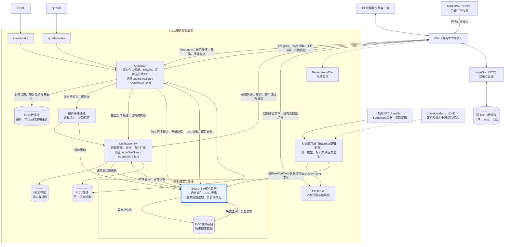
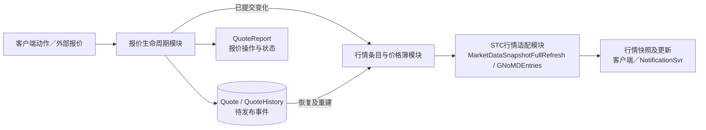
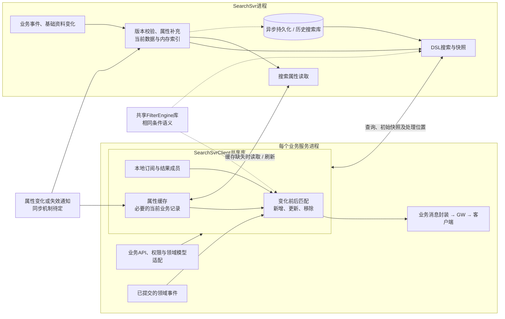

# FICC销售交易系统架构（讨论稿）

> 当前handler、订阅及消息评审稿见[FICC服务API规范（v2：报价与行情分离）](ficc-api-spec.zh-CN.md)。旧API草稿不再作为本轮接口契约；新增技术约定及待确认规则在新稿中单独标明。

基于本轮架构图及讨论整理，更新日期：2026-09-13。本文确定服务职责和数据流，不展开部署规格及完整API。

代码实现遵循 [STC 服务开发原则与实现约定](stc-development-principles.zh-CN.md)，包括标准启动、服务发现、公共 Client/API、Handler、Stream 和 control 配置。

## 1．总体架构

**QuoteSvr合并报价处理与FICC行情服务职责，在一个服务内维护报价生命周期、行情条目和价格簿，提供报价及价格查询、条件订阅和推送。NotificationSvr独立负责通知；两者内置SearchSvrClient执行实时过滤。SearchSvr只提供内部搜索存储、查询和属性获取能力，不保存业务服务的订阅条件或结果成员。** SearchSvr与SearchSvrClient复用同一FilterEngine库，保证初始搜索与实时过滤的条件含义一致。

Quote与Price的接口、模型和频道独立，分别使用ficc.quote.*和ficc.price.*；报价事件订阅不返回已有报价集合，初始列表通过显式查询取得，行情订阅提供价格簿快照。共享过滤代码不意味着共享外部协议。

QuoteSvr内部按报价生命周期、价格簿、STC行情转换拆分代码模块，当前不单独部署FICC MarketSvr。报价事实及审计持久化，价格簿可从已保存的报价状态重建；需要加快恢复时再增加可重建检查点。接收报价并发布行情不意味着本阶段新增自动撮合或成交执行功能。

SearchSvr仍是低延迟搜索的核心组件：接收报价、价格、通知和基础资料更新，当前数据使用内存对象与索引，历史搜索使用异步维护的数据库，并可独立扩容。实时订阅计算与推送负载由业务服务承担。DSL参考MongoDB的结构化查询表达方式，不代表选定MongoDB，也不承诺兼容其完整语法。

历史报价搜索仅使用请求/应答，不建立订阅。查询保留原报价业务值，使用当前债项评级等属性及最新一日估值进行筛选和展示；已返回页面不会随这些数据变化自动刷新。

**FICC使用独立逻辑数据库，不向既有STC业务schema添加FICC业务表；用户、认证和会话继续复用STC。** 是否部署独立数据库实例尚未决定，逻辑隔离与物理部署分开处理。

FICC 内部业务服务共用一个业务 schema，无需每个服务单独创建 schema。当前原型统一使用 `ficc_demo`；各服务的事件、幂等记录等通过不同表名区分，业务进程拆分不要求数据库 schema 同步拆分。

**基础资料通过BaseSvrClient统一访问，业务代码使用FICC模型与字典，不依赖供应商表名或字段。** 初期复用既有STC BaseSvr提供的Sumscope数据，待DM接口文档及适配器就绪后切换；供应商差异在基础资料层集中处理。

页面统一使用滚动浏览。报价固定按updateTime从新到旧显示，时间相同时用quoteId保持稳定顺序；客户端采用虚拟化列表，只创建可见区域的行控件。

QuoteSvr价格簿模块按securityId维护每券一个统一PriceBook，提供最优、完整快照和限定深度视图。客户端选择清算过滤或不过滤，服务端先落实权限与过滤条件，再按收益率分档排序，最后按深度返回；无清算过滤时T+0、T+1及远期报价可共同参与，各报价保留原清算条件，不要求统一交收日期。首版使用到期收益率，含权债使用行权收益率；所需换算结果由CalSvr提供，保留Quote原始输入，净价排序后续支持。depth=N表示当前视图各买卖侧N个不同价格档，保留所选档全部报价；完整快照也限定于当前权限及过滤范围。价格档按Bid收益率升序、Ofr收益率降序排列，档内Quote按updateTime降序，同时间以quoteId升序保持稳定。这是价格簿内部规则，报价列表仍按上述更新时间展示，不增加客户端自由排序功能。收益率最多4位小数，超精度用户输入直接拒绝；计算结果舍入、行权依据、计算缺失处理及远期日期字典待细化，模型关系见核心ER图。



图中的数据库表示逻辑存储职责，不要求分别部署实例。报价事件通道不预设消息产品，也不表示现有DPS已经具备持久化重放保证。SearchSvrClient是嵌入业务服务的共享Java库，不是独立进程；QuoteSvr与NotificationSvr使用同一份代码，各自维护实例和内存。属性变化需同步到SearchSvr及各业务服务缓存，机制在第4节说明。

## 2．服务职责与数据归属

| 服务 | 负责什么 | 数据归属 |
| --- | --- | --- |
| `ideal-intake / qtrade-intake` | 外部来源适配、消息关联和重复接入处理 | 保留来源信息，报价状态由QuoteSvr决定 |
| `QuoteSvr` | 报价生命周期与审计；同进程维护行情条目及价格簿；报价和价格查询、条件订阅、STC兼容行情发布；管理关注债券及报价/价格筛选设置 | 报价事实及审计是持久化依据；行情条目、价格簿及搜索数据为衍生数据 |
| `NotificationSvr` | 消费QuoteSvr报价事件及行情更新，结合个人偏好生成提醒；已读/未读操作、通知查询、条件订阅和筛选设置 | 通知、规则及用户已读状态的业务负责方；复用QuoteSvr价格簿生成我的最优报价和对价提醒 |
| `SearchSvr` | 内部搜索存储：多源数据接入、资料补充、内存索引、DSL查询、属性读取及历史搜索 | 保存可重建的搜索数据；不维护业务服务的订阅，不决定报价状态 |
| `SearchSvrClient`（共享库） | 属性缓存、本地订阅管理、变化前后过滤、结果增量及恢复 | 位于业务服务进程内，持有本实例的订阅、必要业务记录及结果状态 |
| `LoginSvrClient`（既有STC共享库） | STC会话用户查询、本地SID缓存、登录/登出/用户更新消息处理 | 复用STC身份；不是FICC用户主库，也不代替FICC业务权限判断 |
| `FilterEngine`（共享库） | 条件表达式、类型比较和单条记录匹配 | SearchSvr与SearchSvrClient共用规则；不负责会话或业务权限决策 |
| `BaseSvr` | 提供债券、发行人、机构等基础资料及变化 | 为解析、校验和搜索补充提供依据 |
| `BaseSvrClient`（共享库） | 统一基础资料访问、必要缓存及更新处理，返回FICC模型与字典 | 隔离调用方与供应商；不管理面板订阅，也不是基础资料主库 |
| `ParseSvr` | 根据基础资料，把自然语言转为报价结构 | 识别结果是候选，识别成功不等于确认生效 |
| `RecommendSvr` | 智能推荐 | 本轮暂不展开 |

业务服务负责字段含义、权限和对外消息，通过模型适配器接入共享库。SearchSvr执行初始及历史查询；SearchSvrClient在业务服务本地处理实时变化。共享的是过滤语义和通用处理代码：SearchSvr可用索引筛选候选，客户端库逐条计算受影响记录，不要求两侧采用相同执行方式。

用户保存的筛选条件属于对应业务服务，必须持久化后应答，不能与可重建索引一起丢失。物理存储可以共用，是否复用SearchSvr底层存储能力后续确定。

### 依赖价格簿的提醒

NotificationSvr同时消费QuoteSvr的报价事件与组簿后的行情更新。QuoteSvr价格簿模块负责按同券、同买卖方向计算最优价格档，并保留全部并列最优quoteId；NotificationSvr根据报价ownerUserId和个人提醒开关判断“我的最优报价”。最优档成员变化也需发布，即使最优价格数值没有变化。

对价提醒同样使用QuoteSvr提供的价格簿成员：按当前产品要求，查找同券、反方向、分别属于本人和他人的有效报价。这里只要求存在对手方向报价，不要求价格交叉，也不要求计价方式或清算速度相同。参与对价的报价不必处于最优档，因此该提醒需要可见范围内的完整相关成员，不能只订阅最优Bid/Ofr；当前行情协议采用独立的按券完整快照；报价成员的生命周期变化由独立报价事件补充，不将两种载荷放进同一topic。

这两类提醒以QuoteSvr完成组簿后的结果为依据，不在收到原始报价事件时使用尚未更新的价格簿判定，也不在NotificationSvr另写一套价格排序逻辑。本人报价未变时，其他人的新增、修改或撤销同样可能改变本人的最优资格或对价关系，NotificationSvr应随之重新评估提醒；QuoteSvr事件仍用于报价生命周期及其他提醒处理。

两类提醒统一从QuoteSvr取得FICC价格簿数据；比较范围遵守相应权限口径，不自动包含图外STC MarketSvr的外部行情。服务间使用DPS订阅/发布，首次接入或恢复时取得所需价格簿快照；行情消息需能关联securityId、side、quoteId及用户归属，并区分完整成员和最优档成员。报价与价格两个频道的到达顺序不保证一致，NotificationSvr按处理位置关联；对价的同券反向关系可由完整有效Quote事实判定，不因计算值未就绪漏掉。具体topic与版本交接见API评审稿。

### 数据库边界

| 数据 | 所属边界 |
| --- | --- |
| 用户、凭据、角色、登录会话 | 既有STC用户体系；FICC不另建账号或认证体系 |
| 报价、操作审计、通知、规则、筛选设置 | FICC独立数据库，独立管理schema迁移、访问账号和备份恢复 |
| 搜索副本、历史搜索数据与索引 | FICC搜索存储；是否与FICC业务库共用实例或数据库后续确定 |
| 用户显示信息缓存 | 可选的STC数据副本，只缓存必要信息；不复制密码或独立决定权限 |

- FICC的ownerUserId及人工审计用户字段保存STC的userid。它们是跨系统逻辑引用，不建立到STC数据库的物理外键，不依赖跨库JOIN完成日常业务查询。
- 用户身份与权限通过STC服务、认证会话及约定的缓存机制取得。缓存同步、有效期和权限变更处理在接入协议中细化，显示缓存不替代鉴权。
- 报价变更、对应审计及待发布事件在FICC本地事务中提交；搜索副本异步维护，不要求STC与FICC之间的分布式事务。
- 用户停用、改名不改写历史用户ID，不级联删除FICC报价或审计。历史显示信息缺失时保留身份引用。
- 初期可在同一数据库实例上使用分开的逻辑数据库与访问账号；这样不具备实例级资源或故障隔离，是否独立部署由容量和可用性要求决定。

核心实体及STC外部身份的逻辑关系见[核心数据模型ER图](models/core-data-model-er.zh-CN.md)。

### QuoteSvr内部模块



以上模块同属QuoteSvr进程，内部调用不经过DPS；服务对外仍使用DPS。价格簿按同券有序应用变化，报价报告与行情更新保留可关联的quoteId。共享消息和转换接口便于后续STC接入或按实际负载拆分模块；当前合并不要求立即修改STC既有服务。行情条目字段及字典映射见[行情模型](models/market-data-model.zh-CN.md)。

### 基础资料接入与供应商切换

BaseSvr表示基础资料的逻辑职责，不要求为本次适配新增独立进程。FICC使用的BaseSvrClient可复用既有STC客户端的通信能力，但对业务代码返回自己的稳定模型；不能直接透出BondInfoView、p_issuer_info或供应商字段。

```text
FICC服务 → BaseSvrClient（统一接口、模型、必要缓存）
         → 基础资料层
           → STC/Sumscope适配器 → 既有STC BaseSvr（初期）
           → DM适配器 → DM数据服务（后续）
```

接口方向示例：`getBond(securityId)`、`getIssuer(issuerId)`、`getLatestValuation(securityId, valuationSource)`。valuationSource表示中债或中证，数据供应商另记为Sumscope或DM；具体方法及字典编码后续定义。

| 边界 | 职责 |
| --- | --- |
| BaseSvrClient | 封装通信、缓存及资料更新处理；调用方使用统一字段，不选择供应商表或转换枚举 |
| 供应商适配器 | 转换债券/发行人标识、字段、字典、日期和单位，保留来源信息；集中处理缺失值及数据覆盖差异 |
| SearchSvr | 通过统一资料补齐业务记录并维护搜索属性与索引，不自行解释供应商字段 |
| SearchSvrClient | 继续从SearchSvr获取搜索属性，管理本地过滤缓存和订阅；不另行按供应商取数 |

ParseSvr、QuoteSvr等需要直接识别债券或校验基础资料时使用BaseSvrClient。实时过滤仍走SearchSvrClient现有缓存路径，不为每条报价重复远程查询基础资料。两种库使用同一基础资料来源和版本依据，不各自维护不同的字段转换规则；属性变化与快照的衔接仍按第4节处理。

源码已确认的初期数据入口：

| 资料 | 既有STC表及主要字段 |
| --- | --- |
| 债券、挂牌及债项评级 | bond、bond_list_info；Bond_Key、Bond_ID、Listed_Market、Rating_Current、Rating_Institution_Code、Rating_Date |
| 发行人、主体评级及地域 | p_issuer_info、p_institution_rating、p_province_info；bond.Issuer_Code关联发行人institution_code；发行人含province、city，bond也含Issuer_Rating_Current |
| 发行条款 | bond中的发行日期、票息、含权类型、行权日期及回售等字段；具体接口覆盖需逐项映射 |
| 中债/中证估值 | cdc_valuation、sdb_csi_bond_valuation；另有stc_tbook_valuation_info统一结构，保留估值日期及到期/行权口径 |

沿用现有STC服务查询，不要求FICC业务代码直接连接其数据库。已有债券、发行人及结构化估值查询接口可作为适配器入口；不以旧CSI接口拼接的收益率字符串作为统一估值模型。

- securityId继续使用债券代码及市场后缀；供应商Bond_Key、发行人代码保留为映射，不作为切换后必须改变的FICC标识。发行人issuerId与报价对手机构institutionId分别建模，不能仅因源字段叫institution_code就视为同一身份。
- 债项评级、主体评级、中债隐含评级、中证隐含评级分别保存含义，并保留相应评级来源及日期；不合并成一个无口径的rating字段。
- 切换前比较标识映射、字段含义、单位、估值日期/口径及缺失值；差异在适配层解决或明确业务规则，不能用DM空值无条件覆盖已有数据。历史搜索仍使用当前参考属性与最新日估值，不改变原报价及审计。
- 当前确认的是源码中的表、模型和访问能力，尚未验证部署数据覆盖率及更新及时性。DM具体映射待其文档就绪；历史搜索还需确保已到期债券的基础资料可获取，不能仅依赖当前有效债券缓存。

实现依据：[表查询定义](D:/workspace/GitHub/sc-app-stc-basesvr/src/main/java/sc/app/stc/base/utils/Consts.java:38)、[发行人模型](D:/workspace/GitHub/sc-app-stc/src/main/java/sc/app/stc/api/base/po/TIssuerInfo.java:16)、[既有客户端基础资料查询](D:/workspace/GitHub/sc-app-stc/src/main/java/sc/app/stc/utils/BaseSvr2Client.java:662)。这里定义FICC接入边界，不表示已改造既有客户端或实现DM适配器。

## 3．主要数据流

### 当前数据查询与按条件订阅

```text
客户端提交筛选条件 → GW → 对应业务服务
  → 校验权限，在本地SearchSvrClient登记订阅并开始缓冲相关变化
  → 调用SearchSvr的DSL查询，取得初始快照及处理位置
  → SearchSvrClient安装快照，接续快照之后的变化
  → 业务服务经GW返回快照，随后推送本地计算的结果增量
```

- 客户端使用业务接口，不直接提交任意DSL。业务服务把权限范围加入过滤条件，本地实时过滤使用同样的条件；SearchSvr限制调用服务可访问的集合、字段及资源。
- 订阅注册、取消、会话绑定、结果成员及顺序均由业务服务内的SearchSvrClient维护，不逐事件向SearchSvr发送所有订阅做远程匹配。
- 初始快照必须与业务事件及属性版本衔接。业务服务在查询前建立缓冲/可重放位置，安装快照后只接续其后的变化，不能直接用查询结束时间划界；具体处理位置协议待定。
- 多面板共用业务对象和属性缓存，各订阅维护自己的有序ID列表；业务服务与GW合并重复报价内容。跨业务服务的去重边界后续细化。

### 历史报价查询

`客户端 → GW → QuoteSvr → SearchSvr → 历史报价业务数据 + 当前搜索属性 + 最新日估值 → 原路返回`。

此路径不在SearchSvrClient登记订阅，也不建立实时快照到增量的接续流程。用户再次查询或手动刷新时，重新使用当时可用的最新属性和日估值；日期口径见第4.3节。

### 报价处理与实时更新

```text
客户端动作 / 外部报价接入
  → QuoteSvr校验并提交报价、审计、待发布事件
  → 在QuoteSvr内按同券顺序将已提交变化应用到行情条目及价格簿
  → 报价及组簿后的行情变化交给本地SearchSvrClient
  → 从本地属性缓存补齐搜索字段，比较变化前后与订阅条件
  → 计算新增、更新、移除及位置变化
  → QuoteSvr → GW → 客户端

QuoteSvr报价及行情变化 → SearchSvr更新搜索存储
                       → NotificationSvr评估通知并发布通知变化
```

QuoteSvr对报价和行情条目使用不同模型适配器，复用同一SearchSvrClient模式；NotificationSvr对通知使用该模式。两者把变化送入SearchSvr存储。通知已读状态由NotificationSvr保存；不能只修改搜索副本。各路径通过版本处理重复和乱序，实时过滤不要求每条记录先远程读取属性或等待SearchSvr完成落库。

同进程合并消除了报价服务与价格服务之间的网络交接，但不自动提供数据库与内存的原子提交。以已提交报价及其处理位置为准推进价格簿和行情发布；崩溃后从报价状态及可恢复事件重建，检查点仅用于加速。价格簿未追上对应处理位置前，不把旧行情作为本次报价变更的结果。具体机制后续实现，不引入第二份独立价格业务主库。

| 变化前匹配 | 变化后匹配 | 本地订阅结果 |
| --- | --- | --- |
| 否 | 是 | 新增 |
| 是 | 是 | 更新，必要时调整位置 |
| 是 | 否 | 移除 |
| 否 | 否 | 无变化 |

新报价的before为空；Refer、Unrefer、Delete均沿用上述处理。库需保留旧搜索状态或已有成员关系，不能只检查更新后的记录，否则会遗漏移除。

报价使用统一quoteId与revision；确认、Refer、Unrefer不更换quoteId。操作应答报告逐条成功/失败，QuoteReport描述动作及执行后的报价。创建结果通过clientQuoteId关联本地行，即使报价不匹配面板也必须返回发起客户端；客户端不能因应答和推送各到达一次而重复新增行。

报价变更后按updateTime调整位置，包含价格、状态及急/荐等属性变化。客户端保留当前可见内容的位置，避免滚动被打断。搜索副本异步更新时，业务操作成功不等于查询副本已追平；需要立即回读本次写入时，由业务服务返回已提交结果或等待搜索应用到对应位置。

### 文本识别

建议路径：`客户端 → GW → ParseSvr → 客户端校正 → GW → QuoteSvr保存/确认`。解析结果由客户端提交，还是由服务端编排保存为待确认报价，尚未最终确定；业务持久化及状态变化始终归QuoteSvr。

## 4．SearchSvr与共享客户端库

### 4.1 内部接口与DSL

SearchSvr接收数据更新，提供DSL搜索及按securityId等键获取搜索属性的请求/应答接口。它不提供逐业务订阅的注册、取消或结果推送接口。写入用于维护搜索副本，不作为业务操作入口；具体传输方式另行确定。

DSL先覆盖集合选择、字段比较、集合包含、AND/OR等组合条件；本地FilterEngine复用同一条件表达式。以下仅示意结构，不是已定稿协议，用户和债券代码均为示例：

```json
{
  "collection": "quotes",
  "filter": {
    "$and": [
      {"ownerUserId": {"$eq": "USER-002"}},
      {"securityId": {"$in": ["180210.IB", "242993.SH"]}},
      {"side": {"$eq": "1"}},
      {"status": {"$eq": "ACTIVE"}}
    ]
  }
}
```

示例ownerUserId条件假设该用户仅可查看本人报价，实际权限由业务服务生成。SearchSvr校验字段、类型、允许的操作符及复杂度，不执行任意脚本。缺失值、null、日期、字符串枚举和数值比较由共享FilterEngine统一，不能因执行位置不同而改变结果；搜索和客户端库部署时需保持兼容的规则版本。

### 4.2 共享代码与属性缓存



参考BaseSvrClient封装通信和缓存的方式，采用可管理的库实例，不直接照搬公共static缓存。业务服务仅提供模型适配、权限和发布逻辑，订阅管理、过滤及属性缓存共用代码。

| 能力 | 设计方向 |
| --- | --- |
| 属性缓存 | 按securityId缓存债券及其发行人等搜索属性，多个订阅复用；缓存未命中时异步获取，同一键的并发请求合并，按容量设置边界 |
| 搜索对象组装 | 债券属性与单条报价/价格/通知字段组合；方向、价格、状态及报价对手机构来自具体业务记录，不从债券缓存替代。机构、用户等关联属性按各自键补充 |
| 缓存更新 | 属性携带版本，通过变更/失效通知刷新；断连后校验或重建。缺失或版本不满足时缓冲相关变化并补齐，不能静默当作“不匹配” |
| 资料变化重算 | 对当前实时订阅，即使报价未变，债项评级、发行人类型等属性变化也要重新匹配。用反向关联定位受影响业务记录；不能只检查当前已匹配记录，必要时按securityId从SearchSvr补取完整候选范围。历史查询结果不参与订阅重算 |
| 本地过滤 | 维护条件依赖，定位候选订阅，比较变化前后值；相同条件可共享计算，但必须包含权限范围。每个事件不必遍历所有订阅 |
| 搜索索引 | SearchSvr按常用字段建立索引并返回一致快照；索引选出的候选与本地匹配使用相同条件规则 |
| 队列与顺序 | 相关记录等待属性期间保留事件顺序；过滤及推送采用有界队列，超限时明确重建，不能阻塞报价提交或静默漏事件 |

属性缓存与SearchSvr使用相同字段补充规则及版本依据。若SearchSvr已按新属性查询、本地仍按旧属性匹配，会导致结果不一致；快照交接与属性刷新协议必须覆盖这种情况。SearchSvr仍不保存每个业务订阅的条件，属性变化通知不等于替业务服务维护面板结果。

### 4.3 持久化与恢复

实时数据先补充资料并更新内存搜索状态，数据库写入异步执行。历史查询由业务服务调用SearchSvr，再访问搜索数据库；不要求全部历史驻留内存。

**历史报价的业务值与查询时使用的参考属性分开管理。**

| 数据 | 历史查询口径 |
| --- | --- |
| 原报价价格、报量、方向、状态及操作信息 | 使用对应历史记录保存的业务值，不被当前参考数据覆盖 |
| 债项评级等债券属性 | 使用查询时可用的最新值；此处评级指债项评级，不是收益率 |
| 估值 | 使用最新可用的一日估值，显示估值日期；不是报价发生日的估值。估值按日生成，同一估值日内不变化 |
| 页面结果 | 一次请求/应答的结果；没有历史订阅，也不因评级变化或新一日估值到达而自动刷新 |

SearchSvr通过securityId将历史报价与当前属性、最新日估值关联。属性和估值条件必须参与筛选，不能先按旧属性过滤历史记录再只替换显示值。例如债项评级从AAA变为AA+后，下次按AA+查询历史报价应能命中该债券。

历史库不能只依赖归档时固化的属性列回答当前属性条件。可先用当前属性索引筛出债券集合，再与历史报价条件组合执行；具体连接与索引方式后续选择。无需因评级或日估值更新而重写所有历史报价，也不增加原报价revision或修改操作审计。

一次历史查询使用一致的属性及日估值版本范围，分批返回时也不混用中途更新的数据；下一次查询再使用最新版本。最新可用估值可能不是当天的，必须保留实际估值日期。

1. 保留可重放事件或持久化待处理记录，不能只依赖进程内落库队列；数据库变慢时限制积压。
2. 按quoteId、revision处理重复和乱序；Refer、Unrefer、Delete均同步到搜索存储。资料更新使用独立版本或处理位置，不能只检查报价revision。
3. SearchSvr使用显式一致读取及其后的报价事件恢复；行情数据单独通过价格快照恢复。报价搜索副本恢复时，避免旧数据库记录覆盖刚收到的新变化。业务服务的SearchSvrClient恢复订阅时，显式重查初始记录并衔接业务及属性变化，不复用不明位置的旧缓存。
4. 当日数据尚未可靠落库前不清除内存；跨当前与历史查询按明确范围合并、去重。异步落库延迟由SearchSvr向业务服务提供可判断的一致性信息。
5. 完整报价操作历史由QuoteSvr的审计接口返回；历史搜索副本不替代审计。筛选设置与搜索索引分开管理。

结果较大时可以分批传输，客户端仍连续滚动；具体加载范围和缓存上限后续验证，不将滚动浏览理解为一次传输全部历史。

### 4.4 扩容与高可用

SearchSvr与业务服务分别扩容：前者承担存储、索引和搜索，后者承担本地实时过滤及客户端推送。优先验证多个SearchSvr节点各持有完整当前数据，保留跨全部债券查询的直接性。

- 每个搜索副本独立接收完整相关事件，恢复并追平后才接入流量；按查询所需处理位置选择副本。SearchSvr没有需要迁移的业务订阅状态。
- 每个业务服务实例必须接收其订阅所需的完整领域事件和属性变化。若只用消费组分摊事件，却在不同实例持有相关订阅，会漏掉更新。
- 客户端订阅绑定明确的业务服务实例；切换时恢复条件、属性缓存与结果，报价显式重查列表、行情重取快照，再分别接续变化，必要时使用新客户端流。会话条件和共享属性缓存有明确生命周期。
- 增加业务实例可分摊过滤与推送负载，但每个实例仍有属性缓存、必要业务记录及事件接收成本。缓存范围和复制量需验证，不能假定共享代码等于共享内存。
- 搜索副本仍承担完整事件、索引和内存成本；历史落库有明确写入责任。单机容量成为瓶颈时再评估分区与分布式查询。

实时可见路径观察“业务提交 → 本地属性就绪 → 本地过滤 → GW → 客户端显示”；另行观察SearchSvr事件应用、查询和异步落库延迟。性能验证须另行授权，从短时、小负载逐步增加并设置自动停止条件；本次不执行压测。

## 5．消息与身份约定

### 复用LoginSvrClient

QuoteSvr、NotificationSvr等需要识别调用用户的服务引入既有`sc.app.stc.utils.LoginSvrClient`，通过一个轻量FICC会话访问封装统一使用。它与SearchSvrClient均为进程内共享库，前者处理身份，后者处理搜索与实时过滤；不增加独立服务或用户表。

```text
服务启动 → 使用STC连接配置初始化LoginSvrClient
请求进入 → 从可信STC/GW消息上下文取得sid
         → LoginSvrClient.get(sid)，本地未命中时查询LoginSvr
         → 取得UserInfo.userid及角色等信息
         → FICC校验操作权限和数据范围
         → 执行业务，记录operatorUserId或生成带权限范围的筛选条件
```

既有实现通过`initialize(serverKey, netClientWrapper)`初始化并订阅`SYS.ATS.LOGIN`，处理login、logout、update消息；`get(sid)`优先读本地缓存，未命中时发送`method=userInfo`请求。用户标识来自返回的`UserInfo.userid`，不从业务报文里的userId、username或sid替代。

FICC封装统一处理身份缺失、请求超时及缓存不可确认有效的情况；无法确认调用身份时不执行需要认证的操作。权限仍由FICC结合STC信息判断，不能把“缓存里存在UserInfo”当成所有业务操作均被授权。登出或权限变化后，相关本地订阅也需取消或重新校验，不能只更新用户缓存。

接入时需验证的已有实现细节：缓存未命中的同步请求超时为30秒，不能直接放入实时过滤线程；本类未显式提供缓存有效期或断线重连清理，`clear()`只清理SID缓存。会话访问封装应统一处理超时、恢复及相关缓存一致性，具体复用或修正方案经验证后确定。这里描述集成设计，不表示已修改共享库。

实现依据：[LoginSvrClient.java](D:/workspace/GitHub/sc-app-stc/src/main/java/sc/app/stc/utils/LoginSvrClient.java:121)。此缓存服务于会话身份解析，不是全部用户目录；离线用户的历史姓名展示不能仅依赖`get(sid)`。

### 对外消息约定

- 对外继续使用DPS请求/应答和订阅/发布，由各业务服务提供本领域API；QuoteSvr分别提供报价`ficc.quote.*`与行情`ficc.price.*`，两类view不再用dataset区分。SearchSvr的内部DSL接口另行定义。
- 客户端报价推送仍使用`ficc.quote.report.<sessionId>`，不为每个动作或面板重复发布报价内容。QuoteSvr组织业务报告和结果变化，GW负责会话分发；具体注册与合并协议后续细化。
- QuoteSvr同时承担价格查询与行情订阅，行情结构以STC MarketDataSnapshotFullRefresh/GNoMDEntries为兼容边界。QuoteReport表达报价生命周期，行情消息表达价格簿，二者不混用；对应独立topic、DTO及接续规则见v2 API评审稿；尚未解决的分块和需求缺口仍须评审。
- 操作者从已认证DPS会话取得；审计及QuoteReport记录operatorUserId、operationTime。初始查询与本地过滤的用户范围均由业务服务提供，不能信任客户端直接传入的权限条件；权限变化时业务服务重新校验、更新或终止相关订阅。
- Quote初始列表由view.open/query显式返回，事件订阅不带业务snapshot；Price订阅提供当前快照。两类客户端流分别使用streamId和sequence，viewId在各自连接内不复用，不引入通用dataset或订阅version；quote.revision仅表示报价自身版本。SearchSvr数据处理位置、属性版本及本地事件消费位置分别管理，不能用单条报价revision替代快照交接位置。历史报价查询只使用请求/应答，不建立订阅流。

当前接口见[FICC API评审稿](ficc-api-spec.zh-CN.md)，字段见[Quote模型与字典](models/quote-model.zh-CN.md)。[SearchSvr设计](searchsvr-design.zh-CN.md)已同步当前职责；[早期看板订阅草案](quote-board-subscription-protocol.zh-CN.md)保留为历史讨论资料，分页与自由排序方案不再适用。数据库边界已同步至核心数据模型ER图。

## 6．待确定事项

- DM资料及接口就绪后的字段映射、标识对照和切换校验；BaseSvrClient的统一模型、资料版本及刷新协议。
- LoginSvrClient封装的超时及缓存恢复策略、登出/权限变化到本地订阅的处理衔接；STC角色到FICC操作及数据权限的映射。
- 内部DSL及共享FilterEngine的最小语法、字段类型和版本兼容规则；初始快照与本地业务事件、属性变化的衔接协议。
- 属性获取、变更通知和缓存刷新方式，缺失属性的等待策略、完整候选范围及本地缓存上限。
- 本地计算结果如何转换为业务推送，创建关联、QuoteReport及多面板结果如何合并，避免遗漏或重复。
- 事件保存、重放、异步落库及副本切换机制；当前数据保留范围、容量边界和目标延迟。
- FICC业务库与搜索存储的物理部署、备份恢复安排；独立于STC业务schema的逻辑边界已确定。
- 各业务服务筛选设置在FICC存储内的具体位置，以及本地订阅和客户端会话关系的恢复方式。
- QuoteSvr价格簿首版收益率排序、含权债使用行权收益率、每券统一集合及分档前清算过滤已定。收益率最多4位小数，超精度用户输入直接拒绝；继续明确计算结果舍入、行权依据、CalSvr计算结果接入与缺失处理，以及远期日期字典。ParseSvr返回候选后的持久化编排方式。
- 历史报价业务记录展示每天最终状态还是任意时点状态，仍待确定；查询使用最新债项评级等属性及最新日估值、无订阅的口径已确定。
