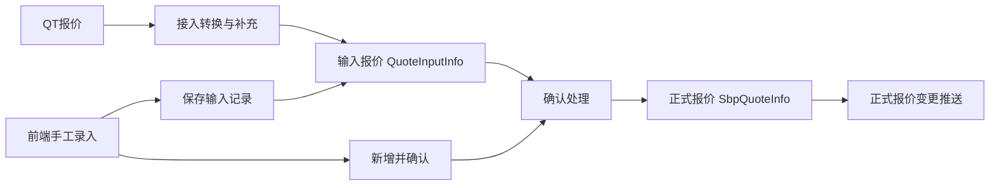
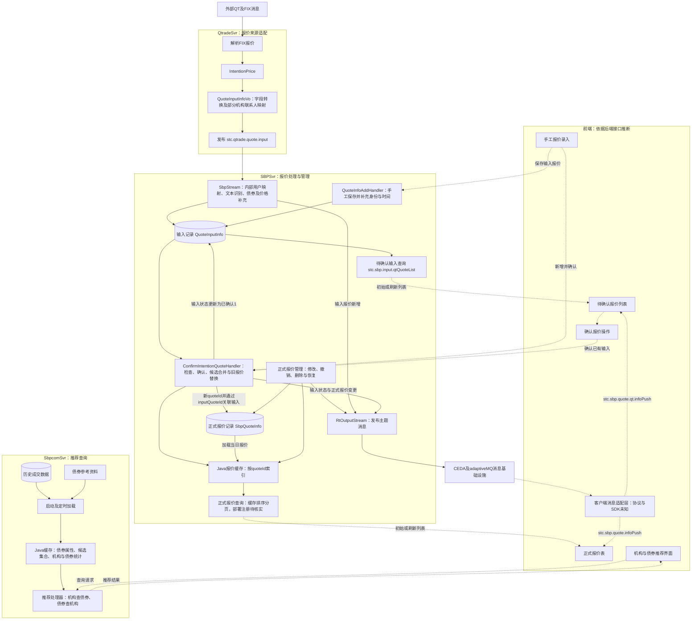

# FICC销售交易旧系统实现与迁移参考

前端来源专题：[QTrade消息与销售交易前端模型映射](qtrade-frontend-model-mapping.zh-CN.md)，区分SBPSvr正式报价、QT询价以及MDSvr深度行情。

专题补充：[QTrade对外通信消息清单](qtrade-message-inventory.zh-CN.md)，包含FIX上下行、HTTP接口、回执关联及未启用或不完整的代码路径。

整理日期：2026年9月8日  
阅读对象：产品负责人、领域建模人员、后端开发与架构人员  
用途：记录本次会话对旧代码的分析，帮助理解报价处理并评估可复用内容。

本文的核心结论是：三个旧服务已经实现了QT来源适配、手工报价录入、报价输入与确认、正式报价管理，以及基于历史成交的机构推荐。报价来源不限于QT，后端也提供前端手工保存和新增并确认的入口。它们使用数据库、Java内存缓存和内部消息框架，但不能据此认定已经具备可靠的主写多读复制、故障切换或严格一致性。当前FICC产品与旧项目的需求不同，本文记录的是实现参考，不是新产品需求规格。

证据口径：**已确认**表示在所读应用源码中可直接定位；**推断**表示根据调用关系解释业务目的；**待核实**表示依赖外部框架、数据契约、运行配置或尚未追踪的分支；**设计建议**不代表旧系统已有能力。分析为静态阅读，没有启动旧服务、连接其数据库或完成端到端消息回放。

## 1 阅读范围与项目边界

| 对象 | 本地位置 | 本次确认的作用 |
| --- | --- | --- |
| 当前FICC页面 | `D:\workspace\greatewall\ficc\ficc` | 浏览器保存的HTML、JavaScript、CSS，含需求说明与界面逻辑；没有随文件复制原服务器数据库和后端 |
| SBPSvr | `D:\workspace\greatewall\Archive\sc-app-stc-sbpsvr` | 输入报价、确认、正式报价、撤销、删除、债券资料、成交相关流程 |
| SbpcomSvr | `D:\workspace\greatewall\Archive\sc-app-stc-sbpcomsvr` | 历史成交统计、债券推荐机构、机构推荐债券 |
| QtradeSvr | `D:\workspace\greatewall\sc-app-stc-qtradesvr\sc-app-stc-qtradesvr` | QT FIX接入、意向记录处理、报价消息转换与发布 |

两个Archive服务的构建文件指定Java 8，使用Spring、MyBatis或MyBatis-Plus，并依赖内部STC/ATS/CEDA组件。源码和部分编译产物存在，不等于运行所需的外部服务、配置、主数据和数据库已经齐备。用户管理界面存在真实前端逻辑，会调用 `/api/accounts` 的读取、创建和修改接口；当前保存页面本身不提供这些后端能力。

本次为保存页面增加了本地预览入口、修复本地资源后缀和页内链接，并提供 `start-demo.cmd`。预览不创建数据库，不代表已恢复登录、保存、实时行情或OCR。HTML资源与JavaScript语法等检查通过，但当时浏览器自动化不可用，不能称为完整交互验收。

## 2 三个服务如何协作

```text
QT FIX Quote
  │
  ▼
QtradeSvr
  提取 IntentionPrice
  转换 QuoteInputInfoVo 并补充部分身份信息
  │  JSON消息  stc.qtrade.quote.input
  ▼
SBPSvr
  QT用户映射 → 文本再识别 → 债券资料检查 → 价格计算与估值补充
  │
  ▼
QuoteInputInfo 输入记录  未确认0
  │ 用户确认 参数及风险检查 批内合并
  ├── 输入记录标记为已确认1
  ▼
SbpQuoteInfo 正式报价  有效2
  │ 数据库 内存缓存 前端推送 操作记录
  └── 修改 撤销 删除 恢复为新报价

历史成交数据库 ──► SbpcomSvr ──► 机构或债券推荐
债券资料服务   ──► 属性分组与候选债券选择
```

SbpcomSvr不是上述确认链路的下一道必经处理步骤。它从历史成交与债券资料构建推荐视图，不能把它画成每条正式报价都要同步写入的第三级存储。

`stc.qtrade.quote.input` 是消息目的地，`QuoteInputInfoVo` 是消息载荷模型。VO使SBP消费相对统一的报价信息，而不用在业务处理处重复理解FIX分组、买卖两套价格字段和QT编码。可以直接从FIX转换成VO再发布；中间 `IntentionPrice` 是否必要取决于是否还需要原有意向业务。发布原始FIX并不会消除转换，只会把工作转移给消费者。[Q1][Q2][S1]

需要注意，生产端类为 `sc.app.stc.qtradesvr.vo.QuoteInputInfoVo`，消费端导入 `sc.app.stc.api.QuoteInputInfoVo`，不是同一个Java类。生产端报量为Long，而消费者按BigDecimal使用。实际部署需验证共享API版本、JSON反序列化与字段类型兼容性。

## 3 报价生命周期

### 3.1 生命周期跨越两类记录

```text
录入或识别 → 待确认输入0 → 用户确认 → 已确认输入1
                                      │
                                      └─ 创建正式报价 有效2
                                              │
                           修改后仍有效 ◄──────┤
                                              ├─ 人工撤销3
                                              └─ 系统撤销4
                                                    │
                                      ┌─────────────┴────────────┐
                                      ▼                          ▼
                              逻辑删除 isDelete=1          恢复并创建新报价
```

确认是业务生命周期中的明确阶段。旧系统没有使用一个统一对象和统一状态枚举表达全程，而是把输入阶段放在 `QuoteInputInfo`，把正式报价阶段放在 `SbpQuoteInfo`。正式报价的 `inputQuoteId` 关联来源输入的 `quoteId`，正式报价自身有另一个新生成的ID。[S2][S3][S4]

### 3.2 状态值与注释冲突

| 模型或标识 | 值 | 含义与证据边界 |
| --- | --- | --- |
| QuoteInputInfo.quoteStatus | 0 | 未确认；输入查询筛选此值 |
| QuoteInputInfo.quoteStatus | 1 | 已确认；确认处理更新此值 |
| QuoteInputInfo.quoteStatus | 4 | QT日终清理也会写此值，模型只写0和1的注释不完整 |
| SbpQuoteInfo.quoteStatus | 2 | 有效，正式报价创建时设置 |
| SbpQuoteInfo.quoteStatus | 3 | 人工撤销，也被旧确认流程用于撤销重复报价 |
| SbpQuoteInfo.quoteStatus | 4 | 系统撤销 |
| SbpQuoteInfo.quoteStatus | 5和6 | 模型注释列出成交和部分成交，但枚举仅定义2、3、4；本次定向搜索未确认5、6的实际赋值路径 |
| 两模型的isDelete | 0和1 | 正常与逻辑删除，独立于quoteStatus |
| QuoteInputInfo.isConfirm | 1 | 非持久化请求参数，表示已经确认风险或估值偏离提示，不等于输入生命周期状态 |

不能因为枚举只出现2、3、4，就断言整个旧项目绝无成交相关报价状态；也不能仅依据注释认定5、6已完整实现。订单处理在 `OrderFacade` 等类中另有流程，需要另行验证与报价状态的联动。[S5][S6][S7]

### 3.3 修改 撤销 删除与恢复

撤销入口检查缓存中的报价是否有效。删除路径要求报价已经人工或系统撤销，移出内存缓存并设置数据库 `isDelete=1`。恢复方法 `UnreferQuote` 会复制旧报价并调用新增路径，生成新的正式报价；当旧记录属于当天时，还会尝试逻辑删除旧记录，并把非空交易日期重置为当天。

配置的定时任务在22点撤销有效报价，23点30分清空报价缓存；输入QT记录的清理任务在23点35分执行。时间解释依赖调度器实际时区配置。清空缓存不是删除数据库历史，输入清理也不是统一报价状态机的正常用户确认动作。[S6][S8]

## 4 QT输入转换与字段契约

### 4.1 实际启用的来源分支

FIX Quote监听中，私聊分支筛选处理N或H等交易类型，排除配置的销售群，并在相应聊天类型条件下发布；配置销售群有单独的发布分支。分支条件需要按原代码理解，不能泛化为所有FIX消息都会创建输入记录。

市场数据聚合分支也构造了VO，解析PriceType 55、56、54、57以及多接收人列表，但其向 `stc.qtrade.quote.input` 发布的调用在该代码版本中被注释。因此该分支不能作为已启用的输入来源，更不能据此认定活跃路径已经正确填充useridList。[Q1]

### 4.2 价格与数量转换

| QT侧价格类型 | 含义 | VO.quoteType | VO.yieldType | 赋值字段 |
| --- | --- | --- | --- | --- |
| BidPxType或OfferPxType为1 | 到期收益率 | 1 | 1 | yield |
| BidPxType或OfferPxType为2 | 行权收益率 | 1 | 2 | yield |
| BidPxType或OfferPxType为3 | 净价 | 2 | 1 | price |
| BidPxType或OfferPxType为4 | 全价 | 3 | 1 | fullPrice |

构造函数以side为1选择Bid价格和数量，否则进入Offer分支。报量使用 `size.longValue() / 10000` 转成Long，这包含整数截断；不能仅看到字段名就认定端到端单位与精度正确。接收端又在useridList非空时除以10000，说明不同来源存在不同隐含单位约定。[Q2][S1]

SBP在成功解析内部用户后，可能对remark再次调用文本识别。对匹配的债券，价格大于30按净价处理，否则按收益率；名称含h或文本含“全价”时按全价。解析出的数量也可能覆盖上游数量。这些是旧业务启发式规则，不宜直接作为新产品通用规则。旧字段可能保留多个价格值，计算器覆盖规则和错误处理需要测试。[S1][S9]

### 4.3 从消息到待确认输入

| 目标字段 | 接收端规则 |
| --- | --- |
| quoteId securityId | 复制消息ID与债券ID；参考资料不存在时不走正常入库路径 |
| symbol | 复制后转大写 |
| side | 消息值0映射为1，其他所有值映射为2 |
| netPrice | 从消息price赋值，计算结果可能覆盖 |
| yield fullPrice | 从消息复制，计算结果可能覆盖 |
| quoteType yieldType | 使用可能被文本再识别调整的值；quoteType为空时最终默认1 |
| orderQty | 复制或被文本解析替换；useridList非空时再除10000 |
| settlType | 非空则复制，否则默认2；价格计算请求却固定使用1 |
| bondType tradeDate | 分类来自债券缓存，交易日期设当天 |
| quoteMethod quoteStatus isDelete | 分别强制设2、0、0 |
| tag priority | 分别重置为空字符串、null |
| createUser createUserName updateUser | 复制经过身份映射后的值 |
| createTime updateTime | 复制生产端时间 |
| counterPartyId counterPartySubId | 复制对手机构和联系人ID |
| remark quoteGroupId instutionShortName transationTime | 直接复制 |
| useridList useridListTemp userdesireId | 直接复制；活跃生产分支未见完整填充 |
| bondValuation exerciseYield bAnalYieldCnbd | 使用中债参考缓存补充 |
| basePrice basePriceType | 该接收方法没有赋值 |

随后插入输入表、记录QT报价操作日志并推送输入变化。它不是直接写成有效报价。[S1]

### 4.4 从确认输入到正式报价

确认处理先校验登录与输入；既有输入更新 `quoteStatus=1`、`updateUser=当前用户`、`userdesireId=当前用户`。ADD分支则同时创建新的已确认输入，并设置创建用户。确认请求可携带用户修改后的报价信息，不能认为正式报价永远原样复制最初接收的消息。

| 正式报价字段组 | 转换规则 |
| --- | --- |
| quoteId inputQuoteId quoteStatus | 新ID加SBP前缀；来源输入ID；有效2 |
| createTime updateTime | 正式记录转换时的当前时间 |
| securityId symbol side quoteType yieldType settlType | 从确认输入复制 |
| netPrice fullPrice yield orderQty | 从确认输入复制 |
| basePrice basePriceType priority tag remark | 从确认输入复制 |
| counterPartyId counterPartySubId | 从确认输入复制 |
| createUser createUserName updateUser | 从输入的所有者及审计字段复制，确认者未必等于创建者 |
| quoteMethod isDelete bondType tradeDate sortTime | 从确认输入复制 |
| bondValuation | 先复制，再在缓存有中债净价时覆盖 |
| bAnalYieldCnbd exerciseYield及四个中证估值字段 | 在估值缓存存在时补充；部分值不是直接复制输入 |
| coupon bIssueAmountact bInfoMaturitydate repaymentmethod subjectrating bondrating | 发布阶段补充，不映射正式报价表 |

输入专属的用户列表、认领用户、分组、来源机构简称和transationTime没有对应正式报价列，需要通过inputQuoteId追溯。FIX原始QuoteID、NegotiationID、原始有效期等没有被这条映射完整保留；追踪能力需结合上游意向记录另行核实。[S4]

### 4.5 去重与报价替换

确认处理按“方向＋债券＋清算类型＋创建人＋对手交易员＋对手机构”分组。机构为空时不按相同机构合并；交易员为空时用占位值处理。非空机构的组内Bid取较低收益率，Ofr取较高收益率，相同收益率取较大数量。代码对空收益率使用零，不能把此规则直接推广为所有价格口径下的正确最优排序。

然后查找相同业务键的已有有效报价，撤销它们，再生成新的正式报价。旧注释中的“覆盖”不能简单理解为保留原quoteId的数据库UPDATE。输入记录标记已确认早于上述合并，因此已确认输入数可能大于新正式报价数；被合并掉的输入未必都有独立正式报价关联。[S4]

## 5 机构 用户与权限身份

### 5.1 必须区分的身份

| 概念 | 典型字段 | 业务含义 |
| --- | --- | --- |
| 我方内部用户 | createUser updateUser userdesireId | 登录账号背后的内部用户，以及创建、更新、确认角色 |
| 对手机构 | counterPartyId | 报价对手的机构ID |
| 对手联系人 | counterPartySubId | 对手机构交易员或联系人ID，不是内部登录用户ID |
| 债券发行人 | 债券参考资料中的issuer | 发债主体，不必等于报价对手机构 |
| 推荐结果机构 | partyId | 来自历史成交inst_id，需核对与counterPartyId是否同一ID体系 |

### 5.2 QtradeSvr中的机构和联系人映射

```text
QT OppInstiInterBankID
  → BaseSvrClient.getPartyInfo21
  → 中文机构全称
  → institutionMap按全称匹配
  → 内部instId → counterPartyId

QT InterloNickname
  → nameContactMap按姓名匹配
  → 检查contact.instId等于已解析机构instId
  → contactId → counterPartySubId
```

这是使用名称连接不同主数据体系。机构全称变化会造成漏配，联系人缓存按姓名唯一键存储，同名者会覆盖。机构一致性检查能拒绝错误机构的联系人，但无法找回已被同名覆盖的正确联系人。私聊分支执行这些补充，销售群分支没有重复执行同一套补充，故可能缺少对手机构和联系人。[Q1][Q3]

### 5.3 SBPSvr中的内部用户映射

私聊消息把OwnQtNO放入createUser；销售群消息把InterloNickId放入createUser，并有历史记录回退。SBP在createUser非空且useridList为空时，先查昵称ID到QT账号的QtNickUser映射，再按QT账号查 `stc_tbook_users` 中enable=1的用户；若没有可用昵称映射，则尝试把输入直接作为QT账号查询。

成功后createUser和updateUser变为内部userid，createUserName为内部name；username用于文本解析调用。故同一字段在管道不同阶段包含不同命名空间。查询取首条匹配记录，唯一性约束未在本次阅读中验证。映射失败未见统一的强制拒绝逻辑，存在原始身份值继续进入待确认记录的可能。[S1][S10]

确认时根据消息会话通过LoginSvrClient取得登录用户，无登录用户则拒绝。既有输入的创建者一般保留，更新用户和userdesireId写确认者；新增输入时创建者也写当前用户。不能把“我创建的报价”和“我确认的报价”视为同一筛选条件。

useridList以字符串参与查询，接收端支持该字段不等于整个活跃生产链已经可靠建立多用户权限。它也不能替代所有读写入口上的权限校验。

### 5.4 SbpcomSvr的机构身份

推荐服务从 `t_fat_gdsy_trd_bond_hy_tradedetail_1d_di` 读取inst_id和inst_name，按机构归集统计，输出为partyId和partyName。反向推荐用请求partyId查询历史inst_id。所读代码没有建立历史机构ID到QT映射后counterPartyId的显式转换；是否同源需要检查数据生产契约。

历史模型有traderName，但并未形成上面基于contactId的联系人映射。所读两个推荐handler没有显式登录解析，不足以断言系统没有访问控制，外围CEDA及部署框架仍需核查。[C1][C2][C3]

## 6 缓存 查询 推荐与一致性

SBPSvr将quoteId到正式报价对象存入ConcurrentHashMap，另有债券资料和有效债券缓存。加载函数从数据库读取当天未删除的正式报价，其中可能包括已撤销状态，不能称为只存有效报价。按securityId查询使用values().stream().filter，而报价分页先收集全部缓存、按创建时间排序，再截取一页；这是全量扫描和排序，不是范围索引检索。[S6][S11][S12]

OrderFacade使用成交单、机构订单、批次关系和ReentrantLock缓存实现部分本地订单流程。这些锁只说明进程内控制，不能证明跨节点唯一写入或自动故障接管。[S7]

SbpcomSvr使用HashMap保存债券属性、属性组合到债券集合，以及按全部、销售、代付分类的历史统计。组合键包含地方债标记、专项债标记、地区分类和剩余期限区间。由债券找候选机构时，可查同类债券再合并历史统计；由机构找债券时，按历史交易和属性扩展候选。地区分类与期限分段属于旧业务规则，不应无条件复用。[C1][C2]

推荐缓存启动时加载，另有01点清空、07点加载的计划任务。没有在所读路径中看到原子换代或完整的实时更新机制。若期间仍接收查询，存在空或部分重建视图的风险；运行时间窗口与调度配置需验证。[C4]

写入顺序在不同分支并不一致。撤销helper先修改内存对象，再写数据库；确认路径先把输入置为已确认、处理旧报价撤销，再把新正式报价放进缓存后插入数据库。消息发布失败主要记录日志。所读应用路径没有事务性outbox、持久重放位置或一致性补偿的完整实现，不能宣称数据库、缓存、日志和推送是原子操作。[S4][S6][S13]

Java并发容器保证单次容器操作的部分线程安全，不保证多个缓存、对象字段和数据库事务的一致快照。查询阶段还会给共享报价对象补充参考属性，需要进一步验证与写线程并发时的行为。

## 7 对新系统架构的讨论记录

本节是设计探索，不是已选定架构或旧代码能力说明。

### 7.1 权威数据源与读模型

权威数据源是系统对业务状态的最终认定依据。例如主系统已接受撤销，即使读副本暂时仍展示旧报价，也不能据旧副本决定成交。若PostgreSQL是权威存储，后端完成校验并提交事务后确认成功；若Java写主节点承担权威角色，它必须有明确的持久化、复制与成功应答语义。

报价检索和撮合建议可使用可重建读模型，并明确允许的滞后；真正接受订单和产生执行结果，需要更严格的顺序、版本校验和失败恢复。持久复制完成与搜索索引已应用，是两个不同进度。

### 7.2 全量复制与查询负载均衡

用户提出所有查询节点保存完整数据集，支持发行人类型等跨全市场筛选。只要每个节点能容纳完整数据和索引并处理全部更新，这是一条值得首先压测的方案。扩容增加查询能力和可用性，不提高单节点可容纳数据量或全量更新处理上限。

```text
报价命令 → 一个权威写入路径 → 已提交且有序的变更
                              ├─ Java读节点A 全量数据与索引
                              ├─ Java读节点B 全量数据与索引
                              └─ Java读节点C 全量数据与索引
查询请求 → 负载均衡 → 满足新鲜度条件的读节点
```

应使用可重放事件同步，而不是各节点彼此无序修改。每个读节点记录已应用版本或日志位置，启动从快照恢复后追赶；落后过多的节点不接查询。用户修改后查询可以要求至少应用到该修改版本。自动提醒要指定发布者或去重，避免全量副本重复发出同一提醒。

一主多读是另一种具体部署形态。异步复制应答延迟较低，但主节点故障可能使接管节点缺少已应答更新；同步法定多数复制增加网络和持久化等待，提供更强的数据保留条件。Java主节点若负责权威决策，就同时承担选主、fencing、日志、快照和副作用幂等责任，不能仅靠多个JVM共享数据库声称已实现HA。

### 7.3 分片何时使用

按instrument分片可把同一债券的买卖两侧和更新放在一个逻辑拥有者中，简化局部匹配并分散更新压力。但发行人类型、评级、期限等全局搜索需要跨片聚合或独立全量搜索视图。分片是容量和写负载手段，复制是可用性与读扩展手段。应先测量全量副本方案，达到内存或更新上限后再决定分片，不按债券数量机械平均分配。

### 7.4 候选技术的会话结论

| 候选 | 讨论中的适用位置 | 限制与下一步 |
| --- | --- | --- |
| PostgreSQL加Java读模型 | 数据持久化与全量搜索分离 | 需实现可靠变更投影与新鲜度控制；尚未实现 |
| Redis | 共享活跃数据与搜索索引 | 有复制和运维工具，但常见异步复制不是无损故障切换保证 |
| FastDB | C++内嵌活跃报价检索候选 | 为内存驻留设计；单写多读及特殊并发模式限制需实测，不因旧网页外观认定停更 |
| GigaBASE | 使用页池的持久化嵌入式候选 | 偏磁盘存储，数据库级修改锁和尾延迟需要评估，未列为本次低延迟首选 |
| Java数据结构 | 自定义报价簿、条件索引、增量匹配 | 类型控制灵活，但需要承担一致读、分配与GC控制以及复制恢复集成 |
| Aeron Cluster | 权威Java执行状态机的评估候选 | 提供复制状态机框架，但应用仍需确定性、幂等与分片设计 |

上述产品比较来自会话中的官方文档阅读，并未做同机同数据基准测试。参考链接：Redis复制 `https://redis.io/docs/latest/operate/oss_and_stack/management/replication/`；FastDB手册 `http://www.garret.ru/fastdb/FastDB.htm`；GigaBASE手册 `http://www.garret.ru/gigabase/GigaBASE.htm`；Aeron Cluster `https://aeron.io/docs/cluster-quickstart/cluster-quickstart-overview/`。文档内容和版本应在选型时重新核实。

## 8 需优先验证的问题

| 编号 | 发现 | 影响 | 验证或整改方向 |
| --- | --- | --- | --- |
| R01 | 私聊将side 1和2转换为0和1，销售群未做相同转换；SBP把非0全部变成Ofr | 销售群Bid可能变成Ofr | 用真实共享API版本回放两个来源的Bid和Ofr |
| R02 | FIX转换未见settlType赋值；输入默认2，计算请求固定1 | 展示清算日与估值计算口径可能不同 | 显式定义清算契约，测试四种清算类型 |
| R03 | 生产端整数除10000，消费端依条件再除 | 截断或量级错误 | 用带小数及非整万数量验证来源单位 |
| R04 | 名称匹配机构与联系人，createUser混用三类ID | 漏配、同名覆盖、所有者不明确 | 明确外部ID命名空间与内部ID映射结果 |
| R05 | 输入确认、旧报价撤销、新记录持久化和推送不原子 | 确认成功但无正式报价，或缓存与库不一致 | 故障注入并定义事务边界、outbox或恢复策略 |
| R06 | 合并键和最优选择使用旧业务规则，空收益率视为0 | 净价口径或未知收益率可能选择错误 | 按报价口径、结算和单位建立测试样例 |
| R07 | 原始来源ID、有效期、事件版本未完整进入输入链 | 重复消息与迟到消息难以识别 | 增加source、sourceQuoteId、eventId、version和时间语义 |
| R08 | 状态注释、枚举、bondType注释相互不一致 | 迁移错误与状态误判 | 用可执行状态机和字段字典替代散落字符串 |
| R09 | 只读路径全量排序、共享对象更新、推荐缓存清空后重建 | 高并发抖动或不一致视图 | 索引、不可变发布或受控写入、原子换代与压测 |
| R10 | 历史inst_id与counterPartyId无显式桥接 | 推荐机构无法正确回填报价 | 核实机构主数据生产和映射契约 |
| R11 | 内部消息框架能力没有完整检查 | 无法确认顺序、重放、断线恢复和HA | 单独分析部署依赖及运行参数，不能等同于应用已实现 |

建议按“来源Bid/Ofr与价格口径 → 用户映射 → 待确认 → 确认合并 → 撤销恢复 → 重复及迟到消息 → 数据库和推送故障”的顺序建立回放样例。新系统性能指标应区分查询p99、更新到可见延迟、更新到提醒延迟、恢复时间和允许的数据丢失范围，不能用一个平均响应时间代表全部。

## 9 会话结论修订与使用方式

最初只检查正式报价枚举时，生命周期图遗漏了输入模型的确认状态；现已明确待确认是持久化输入阶段。正式报价注释中的5和6尚未证实实现，不能作为完整成交状态机。transationTime在所读QT构造路径中是本地当前时间；quoteGroupId在私聊发布路径中是内容相关分组ID，不是直接复制聊天群ID。机构、交易员、用户字段的精确含义随来源分支变化，不能从命名推断端到端一致性。

复用优先级：先复用并验证领域字段、转换思路和候选检索方式；再根据当前需求重写状态、单位、身份、幂等与一致性契约；最后依据压测选择索引、复制与分片。不要把旧地区分组、日终时间、收益率优选或删除规则直接变成当前FICC产品需求。

## 10 前后端实时报价协作与手工录入

本节仅依据旧后端源码反推客户端协作方式，没有旧项目前端源码作为证据，也不以当前保存的FICC演示页面证明旧客户端行为。查询处理、业务状态修改及消息发布为已确认；客户端连接协议、订阅时序和表格更新算法为推断或待核实。

### 10.1 报价来源与确认阶段是两个维度

QT不是唯一报价来源。归档配置注册了 `stc.sbp.quote.add`，由 `QuoteInfoAddHandler` 接收 `QuoteInputInfo` 列表。处理器验证登录会话，生成输入报价ID，以当前登录用户填写创建人、更新人和时间，设置未删除标记，写入数据库，并记录手工录入操作日志。

这个保存处理器没有显式设置 `quoteStatus`，也没有直接发布报价变更消息。因此不能仅凭入口名称认定所有手工保存必然形成状态0，或立即广播到其他客户端；状态还需核查请求值与数据库默认值，保存后的刷新方式需核查客户端。

`ConfirmIntentionQuoteHandler` 还支持新增并确认。其 `ConfirmType.ADD` 常量为 `confirmAdd`，结合注册通配主题，对应 `stc.sbp.inputquote.confirmAdd`。通过前置检查后，该分支生成输入记录ID并将状态设置为1，再进入后续正式报价生成流程。用户可以在一次请求中完成新增并确认，不必先把记录留在待确认页面。



图中的手工保存不预设输入状态。来源说明数据从哪里进入，确认阶段说明业务是否认可该输入，不能将二者合并成同一个概念。

另有 `QuoteInfoHandler` 接收 `SbpQuoteInfoDTO`，通过操作类型调用正式报价新增、修改及删除服务，但未在已检查的归档处理器注册列表中找到该类。只能确认源码存在这项能力，不能据此确定线上客户端使用了该入口。

### 10.2 首次查询与后续变更

后端同时提供查询处理器和主题推送，符合“首次查询列表，随后订阅记录变化”的协作方式。旧客户端也可能收到通知后重新查询，实际策略未知。

| 数据 | 已确认的后端行为 | 客户端行为推断或限制 |
| --- | --- | --- |
| 待确认QT输入列表 | `QueryInputQtQuoteInfoPageHandler` 处理 `stc.sbp.input.qtQuoteList`，结合登录用户查询数据库并返回分页数据 | 页面打开时加载待确认区域；该查询不应直接视为全部来源的统一输入列表 |
| 当天正式报价列表 | `QueryQuoteInfoPageHandler` 遍历报价缓存，按创建时间排序后分页，并补充债券属性 | 可作为初始列表；归档配置未发现该类注册，实际入口待核实 |
| 输入记录变化 | `stc.sbp.quote.qt.infoPush` 推送输入报价；QT接入与确认路径均有发布调用 | 用于新增、更新或移出待确认视图；主题名称含QT，不代表所有消息都只能由QT触发 |
| 正式报价变化 | `stc.sbp.quote.infoPush` 逐条发送正式报价对象 | 按报价ID更新行，再根据状态、删除标记和筛选条件决定显示 |
| 债券资料刷新 | `stc.sbp.quote.wind.infoPush` 的部分发布路径只发送 `{"data":"1"}` | 更像重新查询的通知，不能一概视为完整债券或报价数据 |

`quoteInfoPush` 先补充票息、发行规模、到期日和评级等属性，再逐条序列化正式报价。这里的增量是“发生变化的记录”，并非仅包含被修改字段的差异，也不是每次发送全表。业务层先转换为JSON字符串，输出层再调用框架序列化；客户端实际解码层数应以框架或抓包结果为准。

### 10.3 一次确认如何影响页面

输入记录确认后状态为1，同时创建具有新 `quoteId` 的正式报价，通过 `inputQuoteId` 关联原输入。前端不能假设输入表和正式报价表共享同一个主键。

确认处理先发布输入状态变化，随后可能撤销被替换的旧正式报价，再发布新正式报价。一次操作可能形成多条消息，源码未提供把这些消息作为一次原子页面更新提交的协议。客户端可能短暂出现待确认记录已经消失、正式报价尚未显示的中间状态。

合理的客户端实现可以按 `quoteId` 保存记录，收到消息后新增或替换，再重新判断筛选条件。撤销记录可保留在包含撤销的视图中，软删除应按删除标记处理。如果采用服务端分页，新增、撤销或排序字段变化可能影响页边界与总数，单独修改当前页的一行不能保证整个分页结果正确。这些是实现推断与设计提示，不是对旧前端算法的确认。

### 10.4 消息链路的证据边界

已确认链路为：业务处理 → `RtOutputStream` → 带主题目的地的消息 → `CedaMessageUtils.publishMessage` → CEDA及adaptiveMQ基础设施。未从这些业务类确认浏览器使用WebSocket、网关转接还是桌面容器SDK，因此不能直接称其为某种浏览器推送实现。

另外，`SbpStream.startMD` 使用 `subscribeWithImage` 订阅上游 `stc.md.ct.**`，并转发行情消息。这是外部行情通道，与输入确认后生成的销售正式报价通道不同。存在上游行情快照订阅API，不代表正式报价前端已经具有无缝快照衔接。

| 待核实事项 | 当前证据边界 |
| --- | --- |
| 查询与订阅之间漏消息 | 未确认正式报价初始快照与订阅的原子衔接机制 |
| 重复、乱序及迟到消息 | 已检查发布路径未见明确的应用层单调版本号协议 |
| 断线补发 | 未确认客户端游标、服务端重放或强制重载机制 |
| 数据落库成功但发布失败 | 输出层记录发布异常，未在该路径发现持久化补发机制 |
| 用户可见范围 | 查询有登录用户处理；公共推送主题的订阅授权及逐用户过滤需检查消息框架，不能依赖前端过滤作为权限控制 |
| 实际部署入口 | 部分处理器类与归档注册列表不一致，需结合部署配置验证 |

新系统若沿用该协作方式，应明确报价版本、初始加载与订阅衔接、断线恢复、分页刷新及服务端可见性规则；这些是新系统设计建议，不代表旧系统已经实现。

### 10.5 本节源码定位

以下路径以 `D:\workspace\greatewall\Archive\sc-app-stc-sbpsvr` 为根目录，行号仅用于本次阅读定位。

| 源码 | 关键位置与用途 |
| --- | --- |
| `control/SBPSvr/resourceCfg.ini` | 第15行处理器列表，第26行手工保存主题，第47行待确认查询主题，第54行确认通配主题 |
| `src/main/java/sc/app/stc/sbp/handler/QuoteInfoAddHandler.java` | 第35行起，登录验证、手工输入保存与操作日志 |
| `src/main/java/sc/app/stc/sbp/handler/ConfirmIntentionQuoteHandler.java` | 第266行附近新增并确认，第322行附近输入推送，第539行附近正式报价推送 |
| `src/main/java/sc/app/stc/sbp/utils/Consts.java` | 推送主题及 `ConfirmType` 常量 |
| `src/main/java/sc/app/stc/sbp/handler/QueryInputQtQuoteInfoPageHandler.java` | 第35行起，待确认查询 |
| `src/main/java/sc/app/stc/sbp/handler/QueryQuoteInfoPageHandler.java` | 第40行起，缓存排序与分页 |
| `src/main/java/sc/app/stc/sbp/handler/QuoteInfoHandler.java` | 正式报价操作入口类，注册情况待核实 |
| `src/main/java/sc/app/stc/sbp/service/impl/QuoteInfoServiceImpl.java` | 第1403行属性补充，第1422行逐条推送 |
| `src/main/java/sc/app/stc/sbp/stream/RtOutputStream.java` | 第45行起，主题消息发布 |
| `src/main/java/sc/app/stc/sbp/stream/SbpStream.java` | 第200行行情订阅，第537行附近QT输入保存与推送 |
| `src/main/java/sc/app/stc/sbp/job/WindDescriptionExtendJob.java` | 第118行附近，资料刷新通知 |

### 10.6 前端与三个服务的关键数据流总图

下图实线表示已确认的后端处理或数据路径，虚线表示依据后端接口推断的前端协作。前端到处理器的连线表示逻辑调用，不代表已经确认浏览器直接连接服务、使用HTTP或使用某种特定消息协议。图中省略外部行情转发和成交回报通道。



| 组件 | 核心职责 |
| --- | --- |
| 前端 | 收集手工输入、提交确认命令、展示查询结果与报价变化；具体实现仍属推断 |
| QtradeSvr | 将外部QT报价转换成内部输入消息契约 |
| SBPSvr | 管理输入与正式报价、执行确认、维护数据库与报价缓存、发布变更 |
| SbpcomSvr | 从历史成交与债券资料构建推荐视图并响应查询 |

读图时需保留以下边界：手工报价直接进入SBPSvr，不经过QtradeSvr；新增并确认会创建已确认的输入记录，再生成正式报价。SbpcomSvr是独立推荐分支，不是每条报价的必经处理节点。数据库、缓存与消息发布的连线不表示原子事务，也不表示图上排列即严格执行顺序。手工保存处理器本身没有直接推送调用，其保存后的页面刷新方式仍待核实。

## 11 报价生命周期中的外部数据依赖

QT消息和用户手工输入提供报价原始内容，但不足以解释最终报价的全部字段。旧后端还引入身份主数据、债券参考资料、文本识别、价格计算、估值和风险参数。外部数据可以通过本地缓存或数据库表读取，并不代表每处理一条报价都同步调用远程服务。以下为所读路径的静态分析，不保证所有来源执行相同流程，也不表示报价只有在全部字段填满后才能保存。

### 11.1 机构、对手联系人与我方用户是不同依赖

QT私聊路径中的机构映射为：

```text
QT机构或银行间编码
  → BaseSvr查询机构信息
  → 取得机构全称
  → 按全称查询内部机构缓存
  → 内部instId
  → counterPartyId

QT对手昵称
  → 按名称查询内部联系人缓存
  → 校验联系人所属instId等于已解析的机构ID
  → 内部contactId
  → counterPartySubId
```

因此，该路径最终写入的不是简单复制的BaseSvr机构编码和交易员编码，而是内部机构 `instId` 与联系人 `contactId`。BaseSvr在其中承担外部机构编码到机构名称的桥接作用。相关缓存对象为 `SXZQInstitution` 和 `SXZQContactInfo`；其上游主数据的维护责任及更新契约仍需结合接口实现核实。

机构或联系人匹配失败并不在所有分支统一拒绝报价，销售群输入也没有执行完全相同的对手机构与联系人补充分支。不能把私聊映射推广为所有来源的统一规则。

手工录入相关的机构与交易员查询处理器分别读取 `party_info_grp` 和 `party_dealer_info_grp`。前者查询机构编码与简称，后者查询机构编码、交易员ID和姓名。缺少前端源码，不能确认查询结果如何转换为提交字段，也不能假定这些编码与QT路径的内部机构、联系人ID天然等价。

我方用户是另一套身份：QT账号或昵称通过内部用户资料映射为内部用户；手工保存与确认从登录会话取得当前用户。`createUser`、`updateUser` 和确认用户不应与对手联系人 `counterPartySubId` 混用。

### 11.2 外部数据与补充字段清单

| 数据或服务依赖 | 引入的字段或作用 | 使用阶段与必要性边界 |
| --- | --- | --- |
| BaseSvr机构资料及内部机构、联系人缓存 | `counterPartyId`、`counterPartySubId`，以及消息中的机构和联系人名称 | QT私聊来源映射；缺失匹配不一定拒绝输入，来源分支行为不同 |
| 内部用户目录、QT昵称映射、登录会话 | `createUser`、`createUserName`、`updateUser`、确认用户 | QT路径进行用户映射；手工保存与确认要求有效登录，QT映射失败处理不统一 |
| 债券基础资料缓存 | `bondType` 等债券识别与分类信息 | QT接入的正常保存分支要求 `windSimpleDataMap` 中存在债券；不能直接套用于手工保存路径 |
| 债券扩展资料 | 票息、发行规模、到期日、还本方式、主体评级、债项评级 | 正式报价查询和推送时按债券代码补充；资料缺失时不能保证展示属性齐全 |
| 文本识别服务 | 从备注识别价格、价格口径及数量 | QT处理中具备内部解析用户名时可再次识别；识别结果可能覆盖原QT提取值 |
| 内部债券计算服务与Wind计算器 | `yield`、`netPrice`、`fullPrice` 之间的换算结果 | 由债券代码、价格口径、收益率类型及清算等参数驱动；按配置选择路径并包含回退逻辑，非空返回值用于覆盖或补充 |
| 中债与中证估值参考数据 | `bondValuation`、`bAnalYieldCnbd`、`exerciseYield`、`bAnalYieldCsi`、`bAnalNetCsi`、`bAnalDirtyCsi`、`bAnalYtmIfexe` 等 | 输入阶段补充部分值，正式报价生成时再次读取估值缓存；不是所有字段都同时存在于两类模型中 |
| 风险参数服务 | 信用债与利率债的价格或收益率偏离阈值 | 用于确认检查，而非单纯补齐报价字段；所读检查方法在参数或估值缺失时直接返回，不能假设缺失必然阻止确认 |

上述债券与估值数据通过Wind相关数据访问和缓存逻辑进入SBPSvr；这是参考数据来源，不等同于每条报价都向Wind发起在线查询。计算器则是另一条计算服务依赖，不能与估值缓存混为一谈。计算器内部如何取得现金流、日历等基础数据未在本次所读调用层完整验证。

### 11.3 补充发生在多个阶段

```text
QT原始消息或手工输入
  ├─ 身份资料：解析机构、联系人、我方用户
  ├─ 债券资料：识别债券与分类
  ├─ 文本识别：解释价格和数量
  ├─ 计算服务：补充相关价格与收益率
  └─ 参考估值：补充估值价格和收益率
       ↓
输入报价
  ├─ 确认检查：风险参数与估值比较
  ├─ 正式报价生成：再次读取估值参考数据
  └─ 查询或推送：补充债券展示属性
       ↓
客户端展示的报价
```

此图表示依赖类别及可能发生的阶段，不是所有来源必经的严格顺序。`QuoteInfoAddHandler` 主要保存提交字段并补充身份和时间，没有执行完整的QT识别与计算流程。手工输入的前端可能先调用机构、交易员、债券或计算接口，再提交结果，但实际调用次序与字段来源仍需前端或消息记录验证。

报价ID、关联输入ID、时间戳、生命周期状态及默认标记主要由本地业务代码生成，不属于外部数据补充。SbpcomSvr使用历史成交生成推荐，不是已确认的报价字段补全必经依赖。外部实时行情转发同样不能直接视为正式报价构建的必需步骤。

### 11.4 对新系统字段契约的启示

建议将原始输入、解析后的身份、计算结果、参考估值和展示属性分别记录来源与更新时间。尤其需要明确：价格由用户输入还是计算得到，机构ID属于哪套主数据，估值使用哪个日期或版本，以及参考资料更新是否触发已有报价重新计算或仅更新展示。这些属于新系统设计建议，旧源码尚未证明具备统一的数据来源与版本追踪机制。

对于依赖缺失，应逐项定义“拒绝报价、保存但标记不完整、允许确认但提示、暂缓计算”等策略。旧代码的实际处理并不统一，不能将“允许保存”解释成“字段已完整且风险检查已完成”。

### 11.5 本节源码定位

| 服务及源码 | 关键位置与用途 |
| --- | --- |
| QtradeSvr：`src/main/java/sc/app/stc/qtradesvr/lisener/MessageListener.java` | 第715行附近，BaseSvr机构查询、内部机构及联系人映射 |
| QtradeSvr：`src/main/java/sc/app/stc/qtradesvr/stream/QtradeStream.java` | 第1620行附近联系人缓存，第1644行附近机构缓存 |
| SBPSvr：`src/main/java/sc/app/stc/sbp/handler/PartyInfoHandler.java` | 手工录入相关机构查询 |
| SBPSvr：`src/main/java/sc/app/stc/sbp/handler/PartyDealerInfoHandler.java` | 手工录入相关交易员查询 |
| SBPSvr：`src/main/java/sc/app/stc/sbp/stream/SbpStream.java` | 第351行起QT输入处理，第396行文本识别，第437行债券缓存判断，第505行计算，第524行估值补充 |
| SBPSvr：`src/main/java/sc/app/stc/sbp/utils/SbpCalUtils.java` | 第31行起，计算请求、计算器选择与回退逻辑 |
| SBPSvr：`src/main/java/sc/app/stc/sbp/handler/ConfirmIntentionQuoteHandler.java` | 第773行附近正式报价构造，第810行估值补充，第835行附近风险检查方法 |
| SBPSvr：`src/main/java/sc/app/stc/sbp/service/impl/QuoteInfoServiceImpl.java` | 第1403行附近，查询或推送前补充债券扩展属性 |
| SBPSvr：`src/main/java/sc/app/stc/sbp/service/impl/WindDataServiceImpl.java` | 估值、债券基础资料与扩展资料缓存加载逻辑 |

## 附录A 完整字段字典

下表按实际Java声明自动核对字段集合，解释依据注释及调用路径。映射列不等于已核验生产数据库DDL，非持久化表示@TableField(exist=false)。两个模型均无父类业务字段。

### QuoteInputInfo

表名：`stc_tbook_sbp_quote_input`。共48个实例字段，其中37个映射入库，11个不入库。

映射入库字段如下。

| Java字段 | 类型 | 数据库列 | 业务含义及注意事项 |
| --- | --- | --- | --- |
| `quoteId` | String | `quote_id` | 当前记录主键。输入ID与正式报价ID不同，均由应用生成。 |
| `securityId` | String | `security_id` | 债券代码，关联债券参考资料与行情。 |
| `symbol` | String | `symbol` | 债券简称；QT接收路径会转大写。 |
| `side` | String | `side` | 1=Bid，2=Ofr；注意生产消息部分分支采用0/1，接收时需转换。 |
| `netPrice` | BigDecimal | `net_price` | 净价，不包含应计利息；接收消息中的字段名为price。 |
| `fullPrice` | BigDecimal | `full_price` | 全价，包含应计利息。 |
| `yield` | BigDecimal | `yield` | 报价收益率；结合yieldType理解口径，数值单位需验证接口约定。 |
| `quoteType` | String | `quote_type` | 价格口径：1=收益率，2=净价，3=全价。 |
| `settlType` | String | `settl_type` | 正式模型注释：1=T+0，2=T+1，3=明天+0，4=明天+1。接收默认2但计算请求固定1。 |
| `yieldType` | String | `yield_type` | 正式模型注释：1=到期收益率，2=行权收益率。 |
| `orderQty` | BigDecimal | `order_qty` | 报量，Java使用BigDecimal；来源转换含整数除10000，完整单位契约待验证。 |
| `tag` | String | `tag` | 报价标签。正式模型：1紧急、2推荐、3整量、4可见、5 OCO、6打包；OCO与打包互斥，组合编码待核实。 |
| `basePrice` | BigDecimal | `base_price` | 底价，参与报价与底价比较；数值口径由basePriceType表达。 |
| `basePriceType` | String | `base_price_type` | 底价类型，枚举未在模型中说明，不应直接假定等于quoteType。 |
| `priority` | String | `priority` | 优先级，取值和排序含义待核实。 |
| `bondValuation` | BigDecimal | `bond_valuation` | 中债估值；所读转换路径用中债净价填充或覆盖。 |
| `counterPartyId` | String | `counter_party_id` | 内部对手机构ID，不是债券发行人ID。 |
| `counterPartySubId` | String | `counter_party_sub_id` | 对手交易员或联系人ID，不是我方登录用户ID。 |
| `createTime` | String | `create_time` | 当前记录创建时间。正式记录在确认转换时重新生成；不等于原始市场事件时间。 |
| `updateTime` | String | `update_time` | 最近更新时间；生产端和确认阶段有不同赋值时点。 |
| `createUser` | String | `create_user` | 创建或归属用户；进入SBP前可能是QT账号或昵称ID，映射成功后为内部userid。 |
| `createUserName` | String | `create_user_name` | 创建用户姓名或显示名称；不同生产分支存在username与name混用。 |
| `updateUser` | String | `update_user` | 最近更新用户；确认既有输入时写入当前登录用户userid。 |
| `quoteMethod` | String | `quote_method` | 1=人工，2=QT下行。 |
| `quoteStatus` | String | `quote_status` | 0未确认、1已确认；QT清理任务另写4，超出模型注释。 |
| `isDelete` | String | `is_delete` | 逻辑删除：0正常，1删除；独立于quoteStatus。 |
| `remark` | String | `remark` | 备注，QT路径保存原始content，用于后续文本再识别。 |
| `bondType` | String | `bond_type` | 代码分类及转换支持1=利率债、2=信用债；正式模型注释写反，迁移需统一。 |
| `tradeDate` | String | `trade_date` | 交易日期，QT输入默认当天；与记录创建时间和清算类型分别处理。 |
| `exerciseYield` | BigDecimal | `exercise_yield` | 中债行权收益率，来自估值参考数据。 |
| `bAnalYieldCnbd` | BigDecimal | `B_ANAL_YIELD_CNBD` | 中债到期收益率YTM，注释单位为百分比。 |
| `useridList` | String | `userid_list` | 关联内部用户列表字符串。查询使用此字段；市场聚合构造分支按逗号拼接，但该分支的输入发布被注释。 |
| `userdesireId` | String | `userdesire_id` | 确认时写当前登录userid；可解释为认领或确认用户，完整旧业务定义待核实。 |
| `useridListTemp` | String | `userid_list_temp` | 多用户处理辅助字段，虽然名称含Temp仍映射入库；相关处理有TODO。 |
| `quoteGroupId` | String | `quote_group_id` | 私聊发布按用户列表、对手联系人、remark组合复用分组ID，不直接等于ChatGroupID。 |
| `instutionShortName` | String | `instution_short_name` | 来源对手机构简称，QT构造路径复制OppInstiShortName；保留旧拼写。 |
| `transationTime` | String | `transation_time` | QT构造路径设置本地当前时间，并非复制FIX TransactTime；保留旧拼写。 |


不入库字段如下。

| Java字段 | 类型 | 数据库列 | 业务含义及注意事项 |
| --- | --- | --- | --- |
| `isConfirm` | String | `不入库` | 非持久化风险提示确认参数，1表示已确认相关偏离提示，不是输入生命周期状态。 |
| `quoteOperate` | String | `不入库` | 输入操作：1或空字符串为录入，2为撤销。 |
| `bondValuationFlag` | String | `不入库` | 估值来源：1中债，2中证。 |
| `bAnalNetCsi` | BigDecimal | `不入库` | 中证净价。输入模型不入库，正式模型映射入库。 |
| `bAnalYtmIfexe` | BigDecimal | `不入库` | 中证行权收益率。正式模型注释误写为到期收益率，与输入模型和使用口径不一致。 |
| `bAnalYieldCsi` | BigDecimal | `不入库` | 中证到期收益率YTM，注释单位为百分比。 |
| `sortTime` | String | `不入库` | 对价板排序时间，格式yyyy-MM-dd HH:mm:ss.SSS；输入不入库，正式报价入库。 |
| `sortTmp` | Integer | `不入库` | 排序临时辅助值。 |
| `remainingTime` | String | `不入库` | 剩余期限，模型未说明格式和单位。 |
| `bInfoMaturitydate` | String | `不入库` | 债券到期日，参考资料补充字段。 |
| `bInfoCallbkorputbkdate` | String | `不入库` | 推断为赎回或回售行权日期，日期选取规则需核实。 |


### SbpQuoteInfo

表名：`stc_tbook_sbp_quote_info`。共43个实例字段，其中37个映射入库，6个不入库。

映射入库字段如下。

| Java字段 | 类型 | 数据库列 | 业务含义及注意事项 |
| --- | --- | --- | --- |
| `quoteId` | String | `quote_id` | 当前记录主键。输入ID与正式报价ID不同，均由应用生成。 |
| `securityId` | String | `security_id` | 债券代码，关联债券参考资料与行情。 |
| `symbol` | String | `symbol` | 债券简称；QT接收路径会转大写。 |
| `side` | String | `side` | 1=Bid，2=Ofr；注意生产消息部分分支采用0/1，接收时需转换。 |
| `quoteType` | String | `quote_type` | 价格口径：1=收益率，2=净价，3=全价。 |
| `netPrice` | BigDecimal | `net_price` | 净价，不包含应计利息；接收消息中的字段名为price。 |
| `fullPrice` | BigDecimal | `full_price` | 全价，包含应计利息。 |
| `yield` | BigDecimal | `yield` | 报价收益率；结合yieldType理解口径，数值单位需验证接口约定。 |
| `settlType` | String | `settl_type` | 正式模型注释：1=T+0，2=T+1，3=明天+0，4=明天+1。接收默认2但计算请求固定1。 |
| `yieldType` | String | `yield_type` | 正式模型注释：1=到期收益率，2=行权收益率。 |
| `orderQty` | BigDecimal | `order_qty` | 报量，Java使用BigDecimal；来源转换含整数除10000，完整单位契约待验证。 |
| `tag` | String | `tag` | 报价标签。正式模型：1紧急、2推荐、3整量、4可见、5 OCO、6打包；OCO与打包互斥，组合编码待核实。 |
| `basePrice` | BigDecimal | `base_price` | 底价，参与报价与底价比较；数值口径由basePriceType表达。 |
| `basePriceType` | String | `base_price_type` | 底价类型，枚举未在模型中说明，不应直接假定等于quoteType。 |
| `priority` | String | `priority` | 优先级，取值和排序含义待核实。 |
| `counterPartyId` | String | `counter_party_id` | 内部对手机构ID，不是债券发行人ID。 |
| `counterPartySubId` | String | `counter_party_sub_id` | 对手交易员或联系人ID，不是我方登录用户ID。 |
| `createTime` | String | `create_time` | 当前记录创建时间。正式记录在确认转换时重新生成；不等于原始市场事件时间。 |
| `updateTime` | String | `update_time` | 最近更新时间；生产端和确认阶段有不同赋值时点。 |
| `createUser` | String | `create_user` | 创建或归属用户；进入SBP前可能是QT账号或昵称ID，映射成功后为内部userid。 |
| `createUserName` | String | `create_user_name` | 创建用户姓名或显示名称；不同生产分支存在username与name混用。 |
| `updateUser` | String | `update_user` | 最近更新用户；确认既有输入时写入当前登录用户userid。 |
| `quoteMethod` | String | `quote_method` | 1=人工，2=QT下行。 |
| `quoteStatus` | String | `quote_status` | 枚举定义2有效、3人工撤销、4系统撤销；模型注释另列5成交、6部分成交，但实际状态转换尚未验证。 |
| `isDelete` | String | `is_delete` | 逻辑删除：0正常，1删除；独立于quoteStatus。 |
| `inputQuoteId` | String | `input_quote_id` | 来源输入记录ID，关联QuoteInputInfo.quoteId；原注释误写为逻辑删除。 |
| `remark` | String | `remark` | 备注，QT路径保存原始content，用于后续文本再识别。 |
| `bondValuation` | BigDecimal | `bond_valuation` | 中债估值；所读转换路径用中债净价填充或覆盖。 |
| `bAnalYieldCnbd` | BigDecimal | `B_ANAL_YIELD_CNBD` | 中债到期收益率YTM，注释单位为百分比。 |
| `bAnalNetCsi` | BigDecimal | `B_ANAL_NET_CSI` | 中证净价。输入模型不入库，正式模型映射入库。 |
| `bAnalDirtyCsi` | BigDecimal | `B_ANAL_DIRTY_CSI` | 中证全价。 |
| `bAnalYieldCsi` | BigDecimal | `B_ANAL_YIELD_CSI` | 中证到期收益率YTM，注释单位为百分比。 |
| `bondType` | String | `bond_type` | 代码分类及转换支持1=利率债、2=信用债；正式模型注释写反，迁移需统一。 |
| `tradeDate` | String | `trade_date` | 交易日期，QT输入默认当天；与记录创建时间和清算类型分别处理。 |
| `exerciseYield` | BigDecimal | `exercise_yield` | 中债行权收益率，来自估值参考数据。 |
| `bAnalYtmIfexe` | BigDecimal | `B_ANAL_YTM_IFEXE` | 中证行权收益率。正式模型注释误写为到期收益率，与输入模型和使用口径不一致。 |
| `sortTime` | String | `sort_time` | 对价板排序时间，格式yyyy-MM-dd HH:mm:ss.SSS；输入不入库，正式报价入库。 |


不入库字段如下。

| Java字段 | 类型 | 数据库列 | 业务含义及注意事项 |
| --- | --- | --- | --- |
| `coupon` | BigDecimal | `不入库` | 票面利率，查询或推送时补充。 |
| `bIssueAmountact` | BigDecimal | `不入库` | 发行量，模型未明确单位。 |
| `bInfoMaturitydate` | String | `不入库` | 债券到期日，参考资料补充字段。 |
| `repaymentmethod` | String | `不入库` | 偿还方式，编码待核实。 |
| `subjectrating` | String | `不入库` | 发行主体评级。 |
| `bondrating` | String | `不入库` | 债券评级。 |


两类都声明static final long serialVersionUID常量，值为-3103563388175193265L，不属于业务实例字段，不入库。SbpQuoteInfo实现Serializable；QuoteInputInfo未显式实现该接口。

输入XML的batchInsert把orderQty绑定为JDBC INTEGER，并把部分BigDecimal估值字段绑定为VARCHAR，Java类型和SQL绑定存在不一致。输入batchUpdate只更新所列字段子集，不能认为确认请求中的每个字段都同步持久化。迁移前应核实真实DDL的精度、长度、空值和索引。[S14]

## 附录B 源码索引与版本定位
索引为本机文件链接，换机器时需按第1节仓库根路径重新定位。行号取自生成本文时的工作区文件。HEAD只能标识仓库基线，文件SHA256可进一步定位实际阅读的文件内容。
| 仓库 | 生成时HEAD |
| --- | --- |
| sc-app-stc-qtradesvr | `397d2ee207db662f1e70881044b7d3bfec39ba73` |
| sc-app-stc-sbpsvr | `72144138541e6abc08138bc51da5c0c11ab1ecc8` |
| sc-app-stc-sbpcomsvr | `2f5a5779c3e09ebbfff507836a143f547c3be083` |
| 编号 | 文件及定位 | 说明 |
| --- | --- | --- |
| Q1 | MessageListener.java:684（本地来源：`D:/workspace/greatewall/sc-app-stc-qtradesvr/sc-app-stc-qtradesvr/src/main/java/sc/app/stc/qtradesvr/lisener/MessageListener.java:684`） | FIX来源分支、身份补充、方向转换及发布 |
| Q2 | QuoteInputInfoVo.java:168（本地来源：`D:/workspace/greatewall/sc-app-stc-qtradesvr/sc-app-stc-qtradesvr/src/main/java/sc/app/stc/qtradesvr/vo/QuoteInputInfoVo.java:168`） | 价格、报量、时间和来源字段转换 |
| Q3 | QtradeStream.java:1620（本地来源：`D:/workspace/greatewall/sc-app-stc-qtradesvr/sc-app-stc-qtradesvr/src/main/java/sc/app/stc/qtradesvr/stream/QtradeStream.java:1620`） | 联系人和机构主数据缓存 |
| Q4 | QtCategoryJob.java:23（本地来源：`D:/workspace/greatewall/sc-app-stc-qtradesvr/sc-app-stc-qtradesvr/src/main/java/sc/app/stc/qtradesvr/job/QtCategoryJob.java:23`） | 按输入表最新创建时间清理内容分组缓存 |
| S1 | SbpStream.java:351（本地来源：`D:/workspace/greatewall/Archive/sc-app-stc-sbpsvr/src/main/java/sc/app/stc/sbp/stream/SbpStream.java:351`） | 消息接收、用户转换、再识别、入库和推送 |
| S2 | QuoteInputInfo.java:16（本地来源：`D:/workspace/greatewall/Archive/sc-app-stc-sbpsvr/src/main/java/sc/app/stc/sbp/model/QuoteInputInfo.java:16`） | 输入模型及确认字段 |
| S3 | SbpQuoteInfo.java:24（本地来源：`D:/workspace/greatewall/Archive/sc-app-stc-sbpsvr/src/main/java/sc/app/stc/sbp/model/po/SbpQuoteInfo.java:24`） | 正式报价模型及关联字段 |
| S4 | ConfirmIntentionQuoteHandler.java:66（本地来源：`D:/workspace/greatewall/Archive/sc-app-stc-sbpsvr/src/main/java/sc/app/stc/sbp/handler/ConfirmIntentionQuoteHandler.java:66`） | 确认、合并、撤销旧报价与转换新报价 |
| S5 | QuoteStatusEnum.java:4（本地来源：`D:/workspace/greatewall/Archive/sc-app-stc-sbpsvr/src/main/java/sc/app/stc/sbp/model/emu/QuoteStatusEnum.java:4`） | 正式报价状态枚举 |
| S6 | QuoteInfoServiceImpl.java:62（本地来源：`D:/workspace/greatewall/Archive/sc-app-stc-sbpsvr/src/main/java/sc/app/stc/sbp/service/impl/QuoteInfoServiceImpl.java:62`） | 报价加载、修改、撤销、恢复和发布 |
| S7 | OrderFacade.java:41（本地来源：`D:/workspace/greatewall/Archive/sc-app-stc-sbpsvr/src/main/java/sc/app/stc/sbp/service/impl/OrderFacade.java:41`） | 订单缓存和成交动作处理入口 |
| S8 | SBPBondsExtendJob.java:36（本地来源：`D:/workspace/greatewall/Archive/sc-app-stc-sbpsvr/src/main/java/sc/app/stc/sbp/job/SBPBondsExtendJob.java:36`） | 日终撤销与清理计划 |
| S9 | IntentionHelper.java:306（本地来源：`D:/workspace/greatewall/Archive/sc-app-stc-sbpsvr/src/main/java/sc/app/stc/sbp/utils/IntentionHelper.java:306`） | 文本数量和价格解释辅助方法 |
| S10 | UserInfoDao.java:16（本地来源：`D:/workspace/greatewall/Archive/sc-app-stc-sbpsvr/src/main/java/sc/app/stc/sbp/dao/UserInfoDao.java:16`） | 启用内部用户的QT账号查询 |
| S11 | SBPCacheManage.java:26（本地来源：`D:/workspace/greatewall/Archive/sc-app-stc-sbpsvr/src/main/java/sc/app/stc/sbp/cache/SBPCacheManage.java:26`） | 全量报价缓存和按券扫描 |
| S12 | QueryQuoteInfoPageHandler.java:31（本地来源：`D:/workspace/greatewall/Archive/sc-app-stc-sbpsvr/src/main/java/sc/app/stc/sbp/handler/QueryQuoteInfoPageHandler.java:31`） | 全量排序后分页 |
| S13 | RtOutputStream.java:21（本地来源：`D:/workspace/greatewall/Archive/sc-app-stc-sbpsvr/src/main/java/sc/app/stc/sbp/stream/RtOutputStream.java:21`） | 消息发布与异常处理 |
| S14 | QuoteInputMapper.xml:5（本地来源：`D:/workspace/greatewall/Archive/sc-app-stc-sbpsvr/src/main/resources/mapper/mysql/QuoteInputMapper.xml:5`） | 输入表SQL绑定和更新字段 |
| S15 | QuoteInputInfoServiceImpl.java:34（本地来源：`D:/workspace/greatewall/Archive/sc-app-stc-sbpsvr/src/main/java/sc/app/stc/sbp/service/impl/QuoteInputInfoServiceImpl.java:34`） | 输入列表查询与QT状态清理 |
| C1 | SbpcomCacheManager.java:29（本地来源：`D:/workspace/greatewall/Archive/sc-app-stc-sbpcomsvr/src/main/java/sc/app/stc/sbpcom/common/SbpcomCacheManager.java:29`） | 推荐缓存及双向候选查询 |
| C2 | SymbolTradeDataServiceImpl.java:30（本地来源：`D:/workspace/greatewall/Archive/sc-app-stc-sbpcomsvr/src/main/java/sc/app/stc/sbpcom/service/impl/SymbolTradeDataServiceImpl.java:30`） | 按机构统计与属性分组 |
| C3 | SymbolStatistics.java:10（本地来源：`D:/workspace/greatewall/Archive/sc-app-stc-sbpcomsvr/src/main/java/sc/app/stc/sbpcom/model/po/SymbolStatistics.java:10`） | 历史instId到partyId转换 |
| C4 | SbpcomJob.java:43（本地来源：`D:/workspace/greatewall/Archive/sc-app-stc-sbpcomsvr/src/main/java/sc/app/stc/sbpcom/job/SbpcomJob.java:43`） | 推荐清空与加载计划 |

关键源码文件SHA256如下，便于后续核对是否为同一工作区版本。
```text
Q1 1d5b990af11345cdb9dc15367130378a1a4046ff7736bd99ae16d0d4e28e6e9b
Q2 6f03a78c93a4d8cbda5649a8b4fdda4ffcc92657a55e7b8e49c5d2b8d7dbbd32
Q3 c66d761b80ddec529685410e40fe031fc5c7ca85dfeb9c76ef8596d85acd29c4
Q4 4ba2ffcb68f33460e2fb08e0f477a3f540b06c2f201efd5c6e33bd8031ef7235
S1 45a07f9404ec0a48fed195f38ffb0291789f72b9f30d80bc7d4b74d1690244dd
S2 13ceefece7bf887aa886e8442654a6b3dcbfbd7c8b8f5c86b2f6f508205c0305
S3 3ed97606ff0626779f9ebf470251ebf6106bba7127bc4c9a7233a1f5362e2876
S4 a72927dc2e2f271bc88bde4a3304ffe0093e681b516b0a2acfaff371bcad61fd
S5 8e6e71bb15cb5db18c8ab5e26a9d32044238e79a9b9118c54fbbc45add01af98
S6 c299d6f6f7434bc5c7baefb65e160b54ccb56ff14b7472e091e1992c6c88ed5c
S7 be55e6776731408de0b4fefe723f268969424aeaf900d359acb3349ef277d60c
S8 83228e6b2b19832e8a6952b8ce929666e2bc1a528a8563d7efe7b9678471369b
S9 9fb279f6690d8ad93f59379df2398907b834d26a618ad286b626c8fb1e3e6462
S10 c73d42f0ad7eb38d925865f31b63a9e4340356ec13e41922ecc2cb739c4592cb
S11 a83e2f2da81a3890c6d88ad06159e587af498c75f03b7979654485c5ce8b2692
S12 29bb0023d7c3adddff471c8f117580e60dbab2a15af312a510c95205fdd6e367
S13 353f1e0c166ae5cb299269aa2f2c4e72f330ab3b8bb463de0e070dda842e6f59
S14 cf380c8b9ad2a3498423530caac45e23150f496735188555281e22034cf2566c
S15 a41eccf6f478960a2aa1899378e1680fdfd9944fd5eeb4c524a0efc7d04f5086
C1 10741b121b6e3159a9f1c12119d9142972da59e10a5186889b673bb5b5f8ea99
C2 1eb5e12fe836b7accbce7f88c4111bb112de4d301886edd34b8b67124e24f741
C3 ccffb62f7e3dee45401de13407d0af4621d723ddec31aa286c18bbfbbfdcffec
C4 65972fbdfde4fbb443cecaa18e599fa2da849f9365a99c614642fc213a00939b
```
