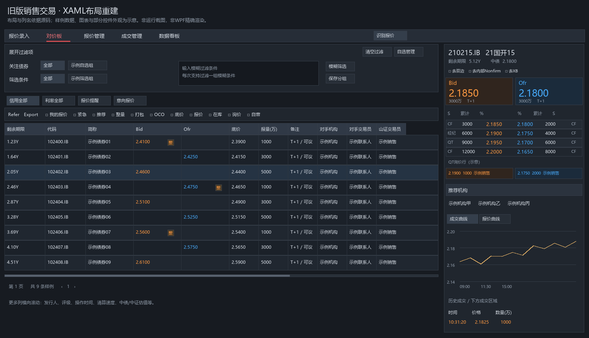
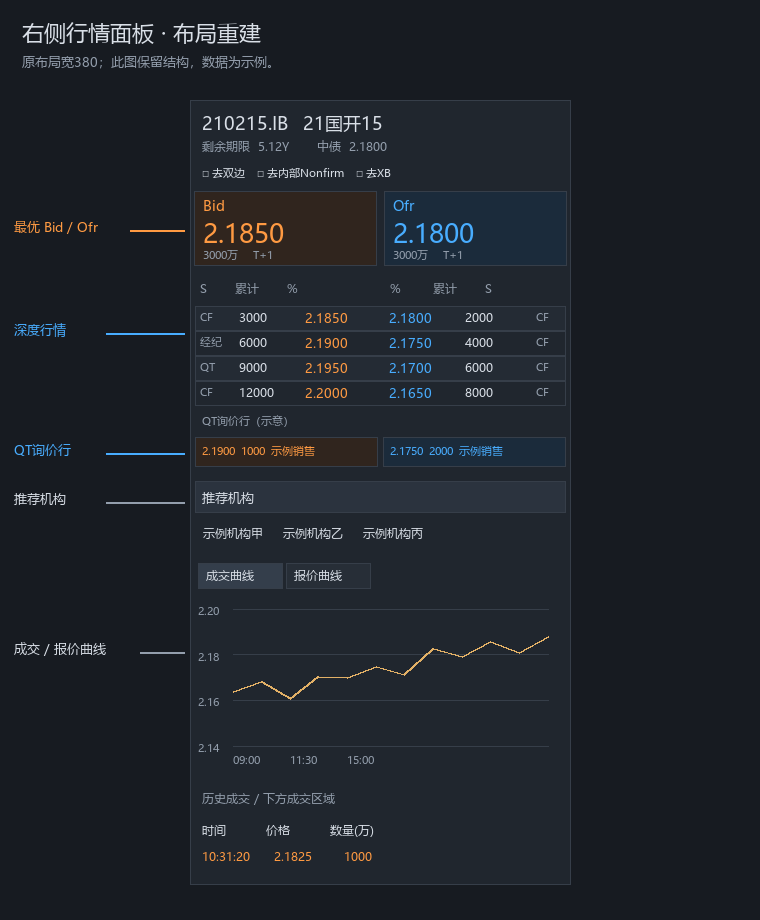

# 旧客户端销售交易布局重建

以下图片根据`stc-client-sz/stc-client-lite`的XAML结构与字段制作，是静态布局示意，不是旧程序运行截图，也不是WPF原控件的精确渲染。报价、客户、图表数据均为虚构样例；动态筛选项、图标、局部间距及复杂控件外观有所简化。

## 对价板与右侧行情

主标签来自`SalesTradingPlatformView.xaml`，过滤区与信用/利率页签来自`QuotationBoardView.xaml`，报价列名及初始宽度直接读取`CreditQuotationView.xaml`。更多列保留在来源清单中，图片只展示左侧可容纳的列。未将已注释的信用最优、利率最优标签画为启用页签。

## 右侧行情区域

主界面将右侧区域设为380宽；`MarketPriceView.xaml`包含`PriceAndOrderViewST`、推荐机构以及成交/报价曲线区域。图片将行情深度、QT询价和底部成交内容以少量示例表达；具体显示高度、权限、展开状态和运行时绑定可能改变实际外观。

## 可追溯来源

- `STC.SalesTrading.Plugin/View/SalesTradingPlatformView.xaml`
- `STC.SalesTrading.Plugin/View/QuotationBoard/QuotationBoardView.xaml`
- `STC.SalesTrading.Plugin/View/QuotationBoard/CreditQuotationView.xaml`
- `STC.SalesTrading.Plugin/View/Component/MarketPrice/MarketPriceView.xaml`
- `STC.Common/View/Card/PriceAndOrderViewST.xaml`

[来源与完整列清单](images/legacy-layout/source-manifest.json)记录绝对路径；重建脚本（仓库外参考：`../tools/reconstruct-legacy-layout.py`）未随本仓库发布；此处仅记录历史来源。原脚本仅解析XML并绘制静态图片，不运行WPF、不连接后端、不进行压力测试。

模型与消息来源见[前端模型映射](qtrade-frontend-model-mapping.zh-CN.md)。
