# 核心数据模型ER图（讨论草稿）

> 基于本ER的完整服务接口见[FICC服务API规范（v2：报价与行情分离）](../ficc-api-spec.zh-CN.md)。API新增的技术字段仍以该稿评审清单为准，不代表已更改本ER中的业务决定。

本文先画已确定的核心关系。实体表示逻辑业务模型，不要求共用数据库或建立跨服务物理外键；仅列关键字段，Quote完整字段沿用[报价模型与字典](quote-model.zh-CN.md)。新增实体的非关联字段为设计建议，尚不是完整接口定义。

本轮所说的“contract”已确认为`Contact`（对手联系人），不增加交易合同或合约实体。

2026-09-12更新：FICC销售交易作为STC子系统，复用STC用户体系。下图的STC_USER来自既有`stc_tbook_users`，不是FICC新建用户表。表名及字段依据LoginSvr的DAO和Java模型；未发现该仓库的建表DDL，PK/FK标记表示本图的逻辑标识和关联，不断言现有数据库约束。

已确定FICC使用独立逻辑数据库，不将FICC业务表加入STC现有schema。STC_USER和STC_SESSION是STC侧外部实体；它们与FICC报价、审计的连线只表示逻辑引用，不建立跨库物理外键。独立数据库实例的部署决定仍保留。

基础资料经BaseSvrClient以统一模型访问：初期使用既有STC BaseSvr提供的Sumscope数据，后续通过DM适配器切换。下图的Security、Issuer和DailyValuation表示FICC逻辑模型，不直接沿用供应商表结构。

QuoteSvr统一负责报价事实、行情条目及价格簿。报价和审计持久化，行情条目及价格簿可重建；本图不为原FICC行情服务另建业务主库。STC行情兼容关系见[行情模型与STC映射](market-data-model.zh-CN.md)。

## 1．核心实体与关系

```mermaid
erDiagram
    STC_USER ||--o{ QUOTE : "拥有 ownerUserId 对应 userid"
    STC_USER ||--o{ STC_SESSION : "会话归属 现有表按username关联"
    STC_USER |o--o{ QUOTE_HISTORY : "人工操作主体 operatorUserId"
    STC_USER ||--o{ NOTIFICATION : "单个用户拥有通知及已读状态"
    STC_USER ||--o| NOTIFICATION_PREFERENCE : "个人提醒设置"
    STC_USER ||--o{ WATCHLIST : "个人关注债券分组"
    WATCHLIST ||--o{ WATCHLIST_SECURITY : "手工维护成员"
    SECURITY ||--o{ WATCHLIST_SECURITY : "可加入多个关注分组"
    STC_USER ||--o{ FILTER_GROUP : "个人筛选分组"
    FILTER_GROUP ||--o{ FILTER_SUBGROUP : "组织条件子分组"
    FILTER_SUBGROUP ||--|{ FILTER_CONDITION : "包含具体条件"
    SECURITY ||--o{ NOTIFICATION : "提醒对应债券"
    NOTIFICATION ||--|{ NOTIFICATION_QUOTE : "关联触发及参与报价"
    QUOTE ||--o{ NOTIFICATION_QUOTE : "可参与多个用户的提醒"
    SECURITY |o--o{ QUOTE : "报价标的 securityId"
    INSTITUTION |o--o{ QUOTE : "对手机构 institutionId"
    CONTACT |o--o{ QUOTE : "对手联系人 contactId"
    INSTITUTION ||--o{ CONTACT : "联系人归属"
    QUOTE ||--|{ QUOTE_HISTORY : "连续变更记录"
    ISSUER |o--o{ SECURITY : "发行人 issuerId 资料缺失时可空"
    SECURITY ||--o{ DAILY_VALUATION : "每日估值"
    SECURITY ||..o| PRICE_BOOK : "每券一个统一报价集合"
    QUOTE ||..o| MARKET_DATA_ENTRY : "生效报价生成当前行情条目"
    PRICE_BOOK ||..o{ MARKET_DATA_ENTRY : "包含同券买卖侧条目"
    PRICE_BOOK ||..o{ PRICE_BOOK_VIEW : "按客户端条件生成视图"
    PRICE_BOOK_VIEW ||..o{ PRICE_LEVEL : "先过滤 再按收益率分档及排序"
    PRICE_LEVEL }o..|{ MARKET_DATA_ENTRY : "档内全部条目 按报价updateTime从新到旧"

    STC_USER {
        string userid PK "STC外部用户标识 FICC引用此值"
        string username "登录账号 不作为报价所有者ID"
        string name "用户显示姓名"
        string enable "STC启用标志 1允许继续登录校验"
        string roleid "STC角色标识"
        string rolename "角色名称"
        string biztypeid "业务类型编号"
        string venueusersid "渠道账户编号 非userid"
    }
    STC_SESSION {
        string sid PK "STC外部会话标识 非用户标识"
        string username FK "现有会话表记录登录账号"
        string clienttype "登录客户端类型"
        string createtime "会话创建时间"
    }
    INSTITUTION {
        string institutionId PK "对手机构主数据标识"
        string institutionName "机构名称"
    }
    CONTACT {
        string contactId PK "对手联系人标识"
        string institutionId FK "所属对手机构"
        string contactName "联系人名称"
    }
    ISSUER {
        string issuerId PK "统一发行人标识 非供应商代码"
        string issuerName "发行人名称"
        string issuerType "发行人类型 统一字典待定义"
        string issuerRating "当前主体评级 取值口径待映射"
        string province "省级地域"
        string city "城市"
    }
    SECURITY {
        string securityId PK "债券代码及市场后缀"
        string securityName "债券简称"
        string issuerId FK "发行人 资料缺失时可空"
        string bondRating "当前债项评级"
    }
    PRICE_BOOK {
        string securityId PK "按债券唯一 不按清算类型分簿"
        string yieldType "比较口径 无行权选项为1到期 含权债为2行权"
    }
    PRICE_BOOK_VIEW {
        object filter "清算等筛选条件 可无清算限制"
    }
    MARKET_DATA_ENTRY {
        string entryId PK "稳定行情标识 对应STC MDEntryID"
        string quoteId FK "来源报价 单条报价至多一个当前条目"
        string securityId FK "所属债券及价格簿"
        string quoteRevision "对应报价版本 非整簿版本"
        string side "FICC买卖方向 转STC行情时映射为0或1"
        string price "本条目用于价格簿比较的收益率"
        string yieldType "比较收益率口径 与所属簿一致"
        string yield "可用到期收益率 百分数"
        string exerciseYield "可用行权收益率 百分数"
        string cleanPrice "可用净价"
        string fullPrice "可用全价"
        string quantity "报价报量 保留单位 不引入成交扣减"
        string quantityUnit "沿用来源Quote单位"
        string settlType "原清算条件"
        string ownerUserId FK "报价归属STC用户"
        string updateTime "来源报价更新时间 不因计算刷新改写"
    }
    PRICE_LEVEL {
        string side "STC方向代码 1买入 2卖出"
        string price "本档收益率 百分数 最多4位小数"
        int rank "所在买卖侧的档位 从1开始 非永久标识"
    }
    QUOTE {
        string quoteId PK "报价永久标识"
        string clientQuoteId "客户端新建关联 所属用户内唯一 可省略"
        string sourceMessageId "来源消息引用 可省略 实体待补全"
        object source "来源信息 可省略 子字段待统一"
        string ownerUserId FK "引用STC用户userid"
        string securityId FK "待确认时可空"
        string institutionId FK "对手机构 可空"
        string institutionName "待确认可先录入名称，确认时人工选择CRM机构"
        string contactId FK "对手联系人 可空"
        string contactName "待确认可先录入姓名，确认时人工选择CRM联系人"
        string revision "报价版本"
        string status "生命周期状态"
        string side "STC方向代码"
        string quoteType "STC报价类型"
        string yieldType "STC收益率类型"
        string price "用户输入价格 收益率输入最多4位小数"
        string quantity "报量 与单位共同解释"
        string quantityUnit "报量单位 当前WAN 有报量时必填"
        string currency "面值币种 当前CNY 有报量时必填"
        string tradeDate "交易日期"
        string settlType "清算类型"
        boolean urgent "急 默认false"
        boolean recommended "荐 默认false"
        boolean whole "整 默认false"
        boolean oco "OCO 默认false 与packing互斥"
        boolean packing "打包 默认false 与oco互斥"
        string remark "用户备注 可空"
        string createdBy "首次执行主体 人工时引用STC userid"
        string updatedBy "最近执行主体 人工时引用STC userid"
        string confirmedBy "首次人工确认人 未确认时为空"
        string createTime "创建时间"
        string updateTime "最近变更时间"
        string quoteTime "最近发布刷新时间 首次确认前为空"
        string confirmTime "首次人工确认时间 未确认时为空"
    }
    QUOTE_HISTORY {
        string eventId PK "对应业务事件"
        string quoteId FK "被操作报价"
        string revision "操作完成后的版本"
        string action "创建 修改 确认 撤销 恢复 删除"
        string operatorUserId "实际操作主体 含系统主体"
        string operationTime "操作时间"
        object before "变更前报价 CREATE时为空"
        object after "变更后报价"
        string reason "操作原因 可空"
    }
    NOTIFICATION_PREFERENCE {
        string userId PK,FK "所属用户 每用户一份设置"
        boolean watchlistEnabled "关注债券提醒开关"
        boolean filterGroupEnabled "筛选分组提醒开关"
        boolean counterQuoteEnabled "对价提醒开关"
        boolean myBestEnabled "我的最优提醒开关"
        string updateTime "设置最近修改时间"
    }
    WATCHLIST {
        string watchlistId PK "关注分组标识"
        string userId FK "所属STC用户 私有分组"
        string name "关注分组名称"
        string market "债券范围 CREDIT信用 RATE利率"
        string scope "使用范围 MARKET行情 HISTORY历史等"
        int displayOrder "分组显示顺序 非报价排序规则"
        string createTime "创建时间"
        string updateTime "最近修改时间"
    }
    WATCHLIST_SECURITY {
        string watchlistId PK,FK "所属关注分组"
        string securityId PK,FK "关注的债券 同组内不重复"
        int displayOrder "成员显示顺序"
        string createTime "加入分组时间"
    }
    FILTER_GROUP {
        string filterGroupId PK "筛选分组标识"
        string userId FK "所属STC用户 私有分组"
        string name "筛选分组名称"
        string market "债券范围 CREDIT信用 RATE利率"
        string scope "使用范围 MARKET行情 HISTORY历史等"
        int displayOrder "分组显示顺序"
        string createTime "创建时间"
        string updateTime "最近修改时间"
    }
    FILTER_SUBGROUP {
        string subgroupId PK "条件子分组标识"
        string filterGroupId FK "所属筛选分组"
        int displayOrder "编辑器中的子分组顺序"
    }
    FILTER_CONDITION {
        string conditionId PK "条件标识"
        string subgroupId FK "所属条件子分组"
        string field "统一筛选字段 如bondRating或issuerType"
        string operator "比较操作 如EQ IN BETWEEN"
        object value "按字段类型保存单值 多值或区间"
        int displayOrder "子分组内显示顺序"
    }
    NOTIFICATION {
        string notificationId PK "通知标识"
        string userId FK "唯一接收用户 引用STC userid"
        string securityId FK "提醒对应债券"
        object reasons "提醒原因列表 可包含同券多种提醒类型"
        string content "提醒展示内容"
        string readTime "为空表示未读 非空表示已读时间"
        string createTime "通知生成时间"
        string updateTime "通知最近修改时间"
    }
    NOTIFICATION_QUOTE {
        string notificationId PK,FK "所属通知"
        string quoteId PK,FK "参与该提醒的报价"
    }
    DAILY_VALUATION {
        string valuationId PK "建议的估值记录标识"
        string securityId FK "对应债券"
        string valuationDate "估值日期"
        string valuationSource "估值提供方 中债或中证 编码待定"
        string dataVendor "数据供应商 Sumscope或DM 编码待定"
        string valuationBasis "到期或行权等估值口径 字典待定"
    }
```

- `STC_USER`是STC统一管理的我方用户，`CONTACT`是对手联系人，两者不因都是人员而合并。Quote同时填写contactId和institutionId时，必须匹配联系人所属机构；人员转机构后的历史归属规则后续细化。
- 待确认Quote允许只有institutionName／contactName，相关外键为空。用户从CRM列表手动选择已有机构、联系人，由UI补齐ID再确认；有名称就必须有对应ID，后端不自动按名称匹配。全部对手信息未填写时保留原可空规则，原始名称留在报价历史中。
- 每条Quote最多关联一个标的、一个对手机构和一个联系人，待确认记录允许缺失。确认时securityId必须确定。
- Refer、Unrefer不更换quoteId，变更历史连续；逻辑删除保留Quote与历史。图中的STC_USER与QUOTE_HISTORY关系仅用于人工操作；系统操作主体编码另行统一，不强制对应人工用户行。
- SECURITY表示债券身份及当前参考属性，不把当前债项评级写入不可变的报价审计快照。
- ISSUER表示债券发行人，INSTITUTION表示报价对手机构；即使现实中为同一家机构，也需明确标识映射，不能直接共用供应商institution_code。发行条款归债券参考资料，本图暂不展开完整字段。
- bondRating与issuerRating是不同含义；中债/中证隐含评级也需分开。评级机构、日期及完整评级记录后续在参考模型中补齐，本图的评级字段仅表示当前显示值，具体取值口径须在适配时明确。
- DAILY_VALUATION按日保存。同一债券可能有不同来源及估值口径，暂不将securityId与valuationDate直接定义为唯一键；具体估值字段和唯一性后续确定。
- valuationSource表示中债或中证，dataVendor表示Sumscope或DM，两者不混用；供应商切换不改变债券身份或估值提供方。valuationBasis用于区分到期/行权等口径，估值日期及价格、收益率须以结构化字段保留，具体数值字段另行定义。
- 历史报价搜索关联当前债项评级及最新可用日估值，并显示估值日期；保留原报价业务值，没有订阅。历史搜索记录是否按每日终态或任意时点保存尚未确定，因此不将QUOTE_HISTORY直接当作历史搜索表。
- NOTIFICATION归属单个STC用户，对应一只债券，已读状态随该用户的通知保存，不增加共享通知的多接收人实体。NOTIFICATION_PREFERENCE按产品的四类账户级开关拆为明确字段，替代原settings对象；不额外引入任意规则配置模型。
- WATCHLIST表示关注债券的命名分组，WATCHLIST_SECURITY保存用户选入的债券；同一债券可属于多个分组，同一分组内不重复。FILTER_GROUP保存筛选条件，不保存固定的命中债券成员；命中结果随当前基础资料及业务数据变化重新计算。
- 两类分组均归属单个STC用户，按信用/利率债区分。scope为落实产品“行情与历史分组条件隔离”建议的使用范围字段；相同模型可供不同业务页面使用，不代表自动共享同一条分组记录。具体页面编码在接口设计时统一。当前不增加跨用户共享分组。
- FILTER_SUBGROUP仅组织编辑器中的条件，不代表查询逻辑的括号。按产品现行要求，保存时丢弃空子分组，查询时合并各子分组条件，同字段OR、跨字段AND；不将其解释为多个AND条件组之间的OR。FILTER_CONDITION的field、operator、value使用SearchSvr和SearchSvrClient共用的字段字典及过滤语义；value是有类型的条件值，不复制整份前端控件状态，物理存储是否使用JSON另定。
- 提醒通过共同userId使用该用户的行情关注分组和筛选分组。根据示例实现matchedFavoriteGroups/matchedMarketFilterGroups，提醒匹配该市场下的全部个人分组，不限于行情面板当前点选的分组；因此不增加NotificationPreference到“选中提醒分组”的关联表。Notification.reasons可记录命中分组标识及显示名称，便于解释提醒来源；无需复制分组条件。
- 根据产品的同券合并要求，NOTIFICATION.reasons保存提醒原因列表，每项描述提醒类型及命中依据；非对价提醒可在同券通知内包含多种原因，对价提醒独立。因此不将一条通知限定为一种提醒类型，也不为每一种提醒单独复制通知实体。
- NOTIFICATION_QUOTE表达通知与报价的多对多关系：一条通知可关联多条报价，一条报价可参与多个用户的通知。对价提醒关联同券、反方向的一条本人报价与一条他人报价；关注债券等提醒也通过该关系引用相关报价，不复制Quote业务记录。
- “我的最优报价”由NotificationSvr消费QuoteSvr的最优价格档及成员变化后判断，依据同券、同买卖方向最优档中的quoteId与Quote.ownerUserId确定用户归属，并保留并列最优。其他人的报价变化也会影响本人的最优资格，不能只监听本人报价。该通知通过NOTIFICATION_QUOTE关联相关报价；PriceLevel是可重建且会变化的分档，不为通知增加永久priceLevelId外键。服务依赖已补入[架构图](../ficc-sales-trading-architecture.zh-CN.md)。
- 对价提醒也消费QuoteSvr的价格簿成员变化，按同券、反方向、本人及他人的报价形成关联；按现行产品要求不检查价格交叉、计价方式或清算速度是否相同。匹配范围不限最优价格档，因此需获取完整相关成员及其增量。NOTIFICATION_QUOTE记录参与的报价，无需为这种提醒新增Price业务主表或价格档外键。
- 上述通知字段为基于产品要求补充的逻辑草稿。个人设置控制通知生成，通知保存自己的原因及内容，不依赖读取当前设置来解释已生成的内容；readTime为空表示未读。通知保留期限、重复触发和计算细节留给后续行为设计，不作为完成实体关系的前置问题。
- MARKET_DATA_ENTRY对应STC的GNoMDEntries，由QuoteSvr从生效Quote生成，保留quoteId、报价版本、数值和身份关联。每条单方向Quote至多一个当前条目；撤销或删除使条目退出当前簿，恢复沿用报价身份。Quote原始输入不被计算结果覆盖。条目的完整字段及STC字典转换见行情模型文档。
- PRICE_BOOK、PRICE_BOOK_VIEW和PRICE_LEVEL是QuoteSvr内部的衍生模型，虚线表示可重建的关联，不要求新增业务主表。每券最多一个统一PriceBook，以securityId标识，不按清算类型拆簿；集合成员为MarketDataEntry，每个成员关联来源Quote。PriceBookView与PriceLevel描述过滤结果和分档，不是另一个服务或独立价格业务事实。
- 客户端选择清算过滤或不过滤，由QuoteSvr及其SearchSvrClient在服务端执行；先落实用户权限和筛选条件，再按买卖侧、收益率分档及排序，最后取最优/N档/完整视图。每个非空档引用一到多条Quote，同价报价保留各自身份；一个Quote可被多个视图引用，在同一时刻、同一视图内仅属于一个买卖侧的一个价格档。
- 没有清算过滤时，T+0、T+1及远期报价可一起按收益率排序，同收益率进入同档；每条Quote保留原始tradeDate和settlType，不强制换算成统一交收日期，也不要求最优Bid/Ofr具有相同清算条件。远期参与展示已确认，具体日期及接口字典仍需单独细化，不直接照搬旧系统的组合清算代码。
- depth=N选取当前视图各买卖侧从优到次的N个不同价格档，包含选中档的全部Quote。最优、限定深度、完整快照是视图的不同读取范围，不分别新增实体或复制报价事实；完整指满足当前权限及筛选条件的全部价格档。首版按收益率分档和排序，无行权选项的债券使用到期收益率，含权债使用行权收益率，净价排序后续支持。rank表示当前视图中的档位，随过滤或行情变化，不是永久ID；收益率使用百分数、最多4位小数，按十进制数值相等分档，计算结果超出精度时的舍入规则另行确认。

## 2．STC用户身份的接入约定

| FICC使用位置 | STC来源 | 约定 |
| --- | --- | --- |
| 用户模型userId、Quote.ownerUserId | `stc_tbook_users.userid` | 直接复用STC标识，不生成第二套FICC用户编号；本图STC实体保留数据库字段拼写 |
| 用户模型displayName | `stc_tbook_users.name` | 展示姓名，不作为身份键 |
| 登录账号 | `stc_tbook_users.username` | LoginSvr通过此字段查找用户；与userid区分 |
| 人工操作的createdBy、updatedBy、confirmedBy、operatorUserId | 认证会话中的Users.userid | 服务端从STC会话解析，不信任客户端自行填写；confirmedBy在未确认时可空 |
| 会话身份 | `stc_tbook_users_session.sid`及LoginSvr会话缓存 | sid用于登录态和推送路由，不写成报价所有者ID，也不替代操作审计的用户ID |

LoginSvr现有会话表保存username，查询时按username关联`stc_tbook_users`；运行时缓存以sid关联Users对象。FICC沿用STC会话鉴权机制取得userid，不要求每次操作直接查询用户表。图中允许一个用户关联不同客户端类型的会话，具体登录并发控制继续由STC负责。

FICC服务通过既有`sc.app.stc.utils.LoginSvrClient`及轻量会话访问封装完成身份解析：从可信消息上下文取得sid，调用`get(sid)`，使用返回的`UserInfo.userid`写入人工操作审计或引用STC用户。该库先读本地缓存，未命中时查询LoginSvr，并消费`SYS.ATS.LOGIN`的登录、登出及用户更新消息。它是服务进程内的访问组件，不是新的ER实体，不改变用户和会话归属。

UserInfo中的角色等信息作为FICC权限判断输入，不代表自动拥有所有操作权限。身份不可确认时不执行需认证操作；登出、权限变化和缓存恢复也必须与本地订阅处理衔接。具体集成注意项见[架构文档的消息与身份约定](../ficc-sales-trading-architecture.zh-CN.md)。会话缓存不是完整用户目录，离线用户的历史姓名展示应通过用户资料或必要的显示缓存解决。

FICC维护自己的报价、筛选设置等业务数据，用户引用统一指向STC身份；不另建独立账号、密码或登录会话体系。需要缓存用户显示信息时只是STC数据副本。用户停用或名称变化不应改写历史操作中的用户ID，也不级联删除报价及审计记录。

### 数据存储归属

| 实体或数据 | 存储归属 |
| --- | --- |
| STC_USER、STC_SESSION及STC角色、凭据 | STC既有数据库；不在FICC重建用户主表或会话主表 |
| Quote、QuoteHistory、Notification、NotificationPreference、NotificationQuote及筛选设置 | FICC独立数据库；通知及提醒设置由NotificationSvr管理，SearchSvr保存所需搜索副本 |
| Watchlist、WatchlistSecurity、FilterGroup、FilterSubgroup、FilterCondition | FICC独立数据库中的用户设置；由对应业务服务管理，跨服务使用通过接口或设置变更消息同步，不放入STC用户schema。行情分组供NotificationSvr读取；不是SearchSvr维护的运行时订阅 |
| MarketDataEntry、PriceBook、PriceBookView、PriceLevel | QuoteSvr维护的可重建行情模型，从持久化Quote状态及可恢复事件恢复；可选检查点只用于加速，不另建独立价格业务主库。SearchSvr保存所需搜索副本，不维护每个视图或订阅的结果状态 |
| Security、Issuer、Institution、Contact、DailyValuation等参考数据 | 由相应基础数据服务提供；FICC按需保存搜索/展示副本，本图不重新指定其主数据归属；本轮Sumscope/DM接入范围为债券、发行人及估值，不推断涵盖联系人 |
| 用户显示缓存、SearchSvr搜索副本 | FICC侧可重建缓存或搜索存储，不能代替源系统身份与权限 |

Quote.ownerUserId直接保存STC userid，不通过跨库JOIN或物理外键绑定STC用户表。人工审计字段同样处理；身份解析走STC服务/会话。报价、审计和待发布事件使用FICC本地事务，无需跨STC数据库事务。

FICC与STC可先共用数据库实例，但使用分开的逻辑数据库、访问账号、迁移及备份管理；是否分开实例仍待确定。整体边界见[架构文档](../ficc-sales-trading-architecture.zh-CN.md)。

BaseSvrClient是共享访问组件，不是新的ER实体。供应商适配器集中转换字段、字典、单位及标识；FICC服务不依赖BondInfoView或供应商表名。供应商债券/发行人代码与统一ID的对照在基础资料层维护，物理存储另定。SearchSvr保存统一资料的搜索副本，SearchSvrClient继续使用其搜索属性接口，避免在过滤路径引入第二套供应商映射。接入来源与切换约定见架构文档“基础资料接入与供应商切换”。

roleid、biztypeid等字段沿用STC含义，FICC功能权限与可见范围的具体映射仍需单独确定。DAO中的moduleid=3001用于管理端查询，不能直接作为FICC子系统模块编号；当前有效查询将groupids/groupnames设为null，不根据已注释的分组SQL补画用户组关系。

`Users`类还包含CRM登录分支使用的instId、instName等字段，但普通`stc_tbook_users`查询未建立该机构关联；本图不据此添加STC_USER到对手机构INSTITUTION的关系。用户所属组织与报价对手机构也不能混用。

源码依据：

- LoginDao.java（本地来源：`D:/workspace/GitHub/sc-app-stc-loginsvr/src/main/java/sc/app/stc/login/dao/LoginDao.java:30`）：用户查询、会话按username关联，以及独立CRM分支。
- Users.java（本地来源：`D:/workspace/GitHub/sc-app-stc-loginsvr/src/main/java/sc/app/stc/login/po/Users.java:17`）：userid、username、name、角色及渠道账户等字段。
- UsersSessionControl.java（本地来源：`D:/workspace/GitHub/sc-app-stc-loginsvr/src/main/java/sc/app/stc/login/po/UsersSessionControl.java:19`）：既有会话记录字段。
- AbstractLogin.java（本地来源：`D:/workspace/GitHub/sc-app-stc-loginsvr/src/main/java/sc/app/stc/login/type/AbstractLogin.java:334`）：创建会话、保存记录并建立sid到Users的缓存。
- LoginSvrClient.java（本地来源：`D:/workspace/GitHub/sc-app-stc/src/main/java/sc/app/stc/utils/LoginSvrClient.java:121`）：服务侧会话缓存、查询及登录状态消息处理；用于FICC身份接入。

## 3．待确认后补全的实体

| 实体 | 已知职责 | 需要确认的关系 |
| --- | --- | --- |
| Price / PriceBook | 已确认：每券一个统一集合，先过滤再按最多4位小数的收益率分档排序；无清算过滤可混合T+0/T+1/远期；含权债用行权收益率，净价排序后续支持；深度N保留N档中的全部报价 | 继续确认计算结果舍入规则、权限范围、行权依据和计算缺失处理；清算日期及远期字典另行细化 |
| Notification及NotificationPreference | 已补入第1节：四类个人开关、通知所属用户及债券、提醒原因、已读状态，以及通过NotificationQuote关联多条报价；通过userId使用个人行情分组 | 重复触发及保留期限在行为设计中细化，不阻塞当前ER |

Price是衍生视图，不能限制成只含一个Bid和一个Ofr的独立业务事实。Quote仍保存原始报价及生命周期；最优、完整和限定深度是同一报价簿的不同输出方式，不要求分别建业务主表。PriceBook为解释该概念使用的名称，正式消息及存储结构待上述口径确定。

**深度口径已确认：depth=N按不同价格档计数，不按报价条数计数，每档保留全部来源报价。** 在同一买卖侧及可比口径下，收益率为2.50%、2.50%、2.60%的三条报价组成两个PriceLevel；depth=2返回两档中的全部三条报价。PriceLevel表示价格档及其来源报价集合，各条报价仍保留quoteId、机构、联系人和各自报量，不因同价而合并成一条Quote。最优档也保留该档全部报价。参考MDSvr逐条保留报量的结构，当前草稿不增加价格档totalQuantity；没有新增汇总需求时，不将汇总报量作为必须确认的事项。

**排序已确认：先收益率，后更新时间；Bid收益率升序，Ofr收益率降序，同档Quote按updateTime降序（最新在前）。** 更新时间相同以quoteId升序作为确定性兜底，不表示额外业务优先级。updateTime来自Quote，不使用资料刷新时间或价格簿重算时间；仅更新时间变化可调整档内位置，不会生成新价格档。

此规则不能表述为完全照搬MDSvr：其比较器（本地来源：`D:/workspace/GitHub/sc-app-stc-mdsvr/src/main/java/sc/app/stc/md/resource/PriceResource.java:627`）在价格相同后还比较FirmFlag、InternalFlag、Info2，再按MDEntryTime升序及MDEntryID排序。本产品采用本轮确认的“同档最新在前”，与销售客户端MatchQuoteInfoViewModel的UpdateTime降序方向一致，不引入上述额外排序优先级。

**首版仅支持收益率排序，后续增加净价排序。** 这是价格簿内部形成价格档和判断最优的规则，不增加前端自由排序功能，也不改变报价列表按updateTime展示的约定。PriceLevel.price保存该档用于比较的收益率，使用百分数十进制字符串，例如"2.50"表示2.50%；它不覆盖Quote.price中用户输入的原值。清算是可选筛选条件，无清算过滤时允许混合比较。

**收益率最多保留4位小数，用户输入超过4位时前端直接判定格式错误，不自动四舍五入后接受。** 例如2.5、2.50、2.5000表示同一数值，属于同档；2.50005不是合法用户输入。服务端操作接口采用同一格式约束，防止绕过前端校验。CalSvr返回的计算结果与用户输入分别处理：需要对齐4位小数的入簿精度，但超出精度时具体采用何种舍入规则尚待确认，不能以输入校验规则推断。净价、全价的输入精度未在本轮一并定稿。

计算精度源码复核：CalReq.Scale默认4（本地来源：`D:/workspace/GitHub/sc-app-stc/src/main/java/sc/app/stc/api/CalReq.java:25`），MDSvr的CalStream未覆盖该值；返回后将到期/行权收益率乘100，再调用TextUtil.removeZero（本地来源：`D:/workspace/GitHub/sc-app-stc/src/main/java/sc/app/stc/utils/TextUtil.java:154`）移除末尾零。该方法只使用stripTrailingZeros，不执行四舍五入；CalSvrClient也不调整返回数值。因此已确认MDSvr这条计算调用路径不额外舍入，精度控制的请求交给CalSvr。CalSvr是否对两种收益率都按百分数4位小数返回、以及是否使用HALF_UP，仍需服务端实现或接口契约验证；不能仅凭调用方没有舍入就视为已确认。

补充核查用户提供的AnalyticServiceLib-2.5.15.1反编译源码：

- FeCalculator.calcBond（本地来源：`C:/Users/loong/Downloads/AnalyticServiceLib-2.5.15.1.jar.src/com/sumscope/FeCalculator.java:215`）调用bondService后返回BondMessage；本轮沿此对象接口追踪。
- service/e.java的possiblyFromCleanPrice（本地来源：`C:/Users/loong/Downloads/AnalyticServiceLib-2.5.15.1.jar.src/com/sumscope/service/e.java:575`）在roundCleanPrice=true时将净价保留4位小数，然后按该净价重新计算。其utils/f.java（本地来源：`C:/Users/loong/Downloads/AnalyticServiceLib-2.5.15.1.jar.src/com/sumscope/utils/f.java:43`）调用BigDecimal.setScale(4, 4)，第二个4为ROUND_HALF_UP，即四舍五入；这明确针对净价，不是收益率输出精度。
- 同文件populateCommonResult直接将计算结果的double yield赋给BondMessage.yield；optionCallCalc和optionPutCalc同样直接赋值，yieldToExecution在缺失时取yieldToCall或yieldToPut。已检查的返回路径没有统一将收益率按百分数4位小数舍入。常规债券计算路径（本地来源：`C:/Users/loong/Downloads/AnalyticServiceLib-2.5.15.1.jar.src/com/sumscope/bond/analytic/b.java:206`）求解yield后直接生成结果，求解容差不等于输出小数位数。
- BondMessage及其父类CalcMessage没有STC CalReq中的Scale字段。该库提供净价四舍五入能力，但不能据此认定CalSvr最终返回的收益率已做相同处理。CalSvr包装层源码用户将后续提供，计算收益率最终舍入规则保留待核查；本次不运行库、不连接数据源。

**含权债使用行权收益率分档和排序，由CalSvr提供所需行权收益率。** PriceBook.yieldType表示整本簿的比较口径：无行权选项时为"1"（到期），含权债为"2"（行权）。该字段与Quote.yieldType共用字典，但用途不同：后者描述用户原始收益率输入；即使用户输入到期收益率、净价或全价，含权债入簿时仍使用对应的行权收益率，不修改原始报价类型和数值。CalInfo.yield对应到期收益率，yieldToExecution对应行权收益率，适配时显式选择。含权识别和行权依据使用基础资料及计算服务；多个或已过期行权选项的处理、计算结果缺失时的处理仍待细化，不能将这些情况视为已确认的到期收益率回退规则。

用户输入的收益率、净价或全价可通过CalSvr换算成其他表示。既有CalSvrClient（本地来源：`D:/workspace/GitHub/sc-app-stc/src/main/java/sc/app/stc/utils/CalSvrClient.java:47`）使用stc.broker.calbond请求/应答并缓存成功结果；CalStream（本地来源：`D:/workspace/GitHub/sc-app-stc-mdsvr/src/main/java/sc/app/stc/md/stream/CalStream.java:100`）经CalResource调用，结合债券、输入类型/数值及清算类型补齐行情数据。CalInfo（本地来源：`D:/workspace/GitHub/sc-app-stc/src/main/java/sc/app/stc/api/CalInfo.java:7`）包含到期/行权收益率、净价、全价及交收日期。换算值属于报价的计算结果，不是每日估值；调用适配需显式转换收益率百分数与小数及价格类型代码。QuoteSvr内部行情模块通过CalSvr补齐所需计算值，MarketDataEntry承接结果；计算精度及失败处理后续细化，不改写Quote原始输入。

参考STC PriceResource.java（本地来源：`D:/workspace/GitHub/sc-app-stc-mdsvr/src/main/java/sc/app/stc/md/resource/PriceResource.java:149`）：book按行情标识汇集报价并按买卖侧排序，book_atf_depth限制遍历的报价条数，MDPriceLevel对条目顺序编号；主book路径的最优输出可保留同价报价，独立H0方法则每侧取首条。新设计按不同价格档计深度，不能直接复用旧实现按条数截断的规则。这里只复用价格簿与多种视图的建模思路，不照搬来源快照替换、状态码或排序字典。

### MDSvr价格结构与报量依据

2026-09-13补充：[InnerSvr行情模型与持久化核查](stc-innersvr-price-model-review.zh-CN.md)已找到stc_tbook_inner_orders的实际写入、启动恢复和转换为STC行情消息的路径。其OrderBook由订单记录重建，对外复用MarketDataSnapshotFullRefresh/GNoMDEntries。当前ER的价格部分仍为讨论稿；本图已补入行情条目模型，归属合并后的QuoteSvr；字典、档位和排序差异集中适配，具体比较与建议见该文。

#### stc_tbook_md_price持久化表核查（2026-09-13）

建表定义（仓库外参考：`../../IDBPro.create_tables.sql:1089`）以mdentryid（报价编号）为唯一主键，每行包含securityid、渠道、side、price、qty、settltype，以及cleanprice、dirtyprice、yield和创建/更新时间。其粒度是单条行情报价，不是一只债券的整个PriceBook，也不是聚合后的PriceLevel。表内没有独立快照批次或历史版本键，因此结构上适合保存每个报价编号的一份状态；仅凭DDL不能确认其实际更新、清理或历史保存策略。

本次在可用STC仓库及greatewall旧代码的Java/XML/C#源码中未找到该表的读写引用，不能认定当前MDSvr正在使用它持久化行情或重启恢复。已确认的路径是PriceResource.cache（本地来源：`D:/workspace/GitHub/sc-app-stc-mdsvr/src/main/java/sc/app/stc/md/resource/PriceResource.java:127`）按ric将快照保存到内存htAllPrice，getPrice（本地来源：`D:/workspace/GitHub/sc-app-stc-mdsvr/src/main/java/sc/app/stc/md/resource/PriceResource.java:1028`）从该缓存读取。数据库表存在与运行时已启用持久化是两项不同证据。

进一步沿调用链复核MDSvr与共享sc-app-stc组件，而非只搜索表名：

- MDSvr、MD1Svr、MD2Svr的现有部署流配置均将RtOutputStream绑定到共享NetRtOutputStream（本地来源：`D:/workspace/GitHub/sc-app-stc-mdsvr/control/MDSvr/streams.xml:95`）。其publishMessage（本地来源：`D:/workspace/GitHub/sc-app-stc/src/main/java/sc/app/stc/net/NetRtOutputStream.java:87`）序列化消息后调用NetServerResource.publishMessage（本地来源：`D:/workspace/GitHub/sc-app-stc/src/main/java/sc/app/stc/net/NetServerResource.java:84`），由CEDA/GW发布；该路径未写入行情价格表。MDSvr仓库内同名RtOutputStream.java的旧实现已整体注释，不能据此判断实际配置。
- MDSvr的CommonDataManager（本地来源：`D:/workspace/GitHub/sc-app-stc-mdsvr/src/main/java/sc/app/stc/md/stream/CommonDataManager.java:330`）确有异步SQL执行器，但当前调用用于stc_tbook_md_securityids订阅设置及stc_tbook_system_oplog操作日志；未发现逐条行情入库或从stc_tbook_md_price恢复的调用。
- sc-app-stc的SqlBatchExecutor和BatchDBUtil提供通用SQL执行及动态SQL生成能力，但在上述MDSvr源码中没有相应行情调用。共享库还包含RocksDB消息存储和SQLite消息记录/回放组件，当前检查的MDSvr流配置未接入这些组件；它们也不是该MySQL表的写入实现。

核查结论限于当前提供的源码和部署配置：没有找到stc_tbook_md_price的实际持久化实现。旧版本、其他服务或部署时另外接入的记录程序仍有可能使用此表，不能将未找到调用等同于该表在所有STC版本中均未使用。

对本ER的启发：可以逐条保存构成价格簿的行情状态，再据此重建价格视图；不必将每个筛选条件、深度或价格档保存成独立业务事实。该表暂作为存储设计参考，不据此新增已确认的PriceSnapshot实体或断言旧系统具备一致时点快照恢复能力。

PriceResource（本地来源：`D:/workspace/GitHub/sc-app-stc-mdsvr/src/main/java/sc/app/stc/md/resource/PriceResource.java:323`）内部按行情标识、买卖侧保存GNoMDEntries列表；对外MarketDataSnapshotFullRefresh.NoMDEntries仍是报价条目列表。主book路径排序后逐条加入输出，每条保留自己的MDEntryID、MDEntryPx、MDEntrySize、来源及SettlType；没有按同价报价求和生成价格档总量。最优输出可保留并列报价，仍是各自报量。QDMESP专用分档逻辑（本地来源：`D:/workspace/GitHub/sc-app-stc-mdsvr/src/main/java/sc/app/stc/md/resource/PriceResource.java:576`）根据同侧不同价格设置Info3/Info4，也不求和报量。该结论限于PriceResource组簿路径，不推断上游原始报量必然未经其他处理。

本图PriceLevel表达本产品已确认的“不同价格档及其全部报价”关系；不要求物理建表、合并Quote或采用嵌套报文。后续消息可采用带档位的平铺报价列表，具体协议另定。既有客户端的特定来源展示汇总与PriceResource结构分开看待。

### 清算过滤的旧客户端依据

- 销售对价板：QuotationBoardViewModel（本地来源：`D:/workspace/greatewall/stc-client-sz/stc-client-lite/STC.SalesTrading.Plugin/ViewModel/QuotationBoard/QuotationBoardViewModel.cs:703`）按SecurityId对可见报价分组，没有将settlType或tradeDate加入键。MatchQuoteInfoViewModel（本地来源：`D:/workspace/greatewall/stc-client-sz/stc-client-lite/STC.SalesTrading.Plugin/ViewModel/Data/MatchQuoteInfoViewModel.cs:337`）再按买卖侧组织报价，Bid按收益率升序、Ofr降序；显示视图按YieldBestSort及UpdateTime排序。因此可见的T+0、T+1报价可参与同券同侧比较，最优Bid与Ofr不要求同一清算类型。
- 共享行情小面板：MarketPriceLittleViewModel（本地来源：`D:/workspace/greatewall/stc-client-sz/stc-client-lite/STC.Common/ViewModel/Card/MarketPriceLittleViewModel.cs:1690`）先调用GetGNoMDEntriesList，再生成全部/最优等视图。其清算筛选与合并逻辑（本地来源：`D:/workspace/greatewall/stc-client-sz/stc-client-lite/STC.Common/ViewModel/Card/MarketPriceLittleViewModel.cs:2041`）先按所选清算类型过滤；部分CDH/CFETS来源再按方向、渠道和价格合并同价条目，分组键不含清算类型，并拼接不同SettlType。该行为仅为旧展示实现，本产品仍保留档内全部Quote，不照搬合并成一条报价的方式。
- 计算与展示分开：QuoteInfoViewModel.CalPrice（本地来源：`D:/workspace/greatewall/stc-client-sz/stc-client-lite/STC.SalesTrading.Plugin/ViewModel/Data/QuoteInfoViewModel.cs:2319`）发送该报价的交易日期和清算类型，T+0/T+1原值保留在请求中；上述分组/排序路径没有先统一交收日期再比较的步骤。合并展示不表示不同清算条件已经换算成同一交易条件。

本产品已确认采用“同券统一报价集合、每条报价保留清算条件、按条件过滤后生成价格视图”。没有清算条件时，T+0/T+1及远期报价共同参与收益率分档；筛选发生在深度截取前，不能先取未过滤的N档再筛清算类型，否则可能遗漏后续符合条件的档位。本次仅阅读源码，未运行客户端或性能测试。

## 4．逐项确认与补全清单

本轮目标是完成核心业务模型的实体、关联、关键字段及约束。下表用于逐项收敛，未确认的建议不视为最终决定；物理DDL、供应商完整字段映射和运行时缓存结构不在本轮强行定稿。第1节已按现行Quote字典补齐报量单位、业务标记、来源引用、执行主体与时间字段；reference和validationIssues属于只读补充结果，不作为报价事实或审计快照字段。

当前进度：Price的核心关系和Notification的逻辑草稿已写入上方ER。通知模型依据产品报价提醒要求（仓库外参考：`../../FICC销售智能交易平台_files/requirement-spec-page.js:108`），覆盖四类提醒、用户隔离、同券多类型合并及对价关联；不因此新增历史通知查询功能。按用户要求，CalSvr计算细节、舍入、异常场景及通知的运行细节后续处理，本轮集中补全实体与关系。

| 顺序 | 范围 | 已有依据与本轮需明确的内容 |
| --- | --- | --- |
| 1 | Price及来源报价 | 已确认同券统一集合、先过滤再分档、无清算过滤可混合T+0/T+1/远期；各档保留全部报价；首版收益率排序、含权债用行权收益率、收益率最多4位小数且超精度用户输入被拒绝，净价排序后续支持。同档按updateTime降序已确认；待确认计算结果舍入规则、行权依据、计算结果模型及缺失处理、权限范围和失效处理 |
| 2 | Notification及个人设置 | 已补齐NotificationPreference、Notification和NotificationQuote：四类个人开关、通知与债券及报价关联、同券多类型原因；以userId关联个人行情分组，不新增选中提醒分组表 |
| 3 | Quote及SourceMessage | quoteId生命周期和连续审计已定；补全来源消息到多条报价的关系。仍需明确来源子字段、自动动作主体、确认时价格/报量必填规则、清算日期及历史搜索记录粒度 |
| 4 | Security、Issuer、评级、条款、日估值及标识映射 | 发行人关系与供应商隔离已定；补全评级来源/日期、条款字段、估值数值和唯一性，区分直接字段与需要独立记录的多值信息 |
| 5 | STCUser、Institution、Contact | STC用户引用已定；明确对手机构/联系人主数据来源、联系人转机构后的历史口径及可见范围，不混淆发行人与对手机构 |
| 6 | 关注债券及筛选分组 | 已补入Watchlist及债券成员、FilterGroup及条件子组和条件记录；个人归属、信用/利率范围、行情/历史隔离、同字段OR与跨字段AND按产品要求建模。字段编码及物理DDL后续细化；持久化设置与运行时订阅分开 |

产品复核依据：整合需求（仓库外参考：`../../FICC销售智能交易平台_files/srs-integrated-data.js`）中的BR-3.1（全部/最优报价）、BR-3.5（筛选子分组）、BR-3.8（四类提醒），以及示例数据模型（仓库外参考：`../../FICC销售智能交易平台_files/data-model-spec-data.js`）中的board_credit_best、board_rate_best、alert_read。示例模型保存用户维度已读记录，但不足以替代新系统对通知归属和共享方式的确认；不直接复制示例表结构。

关注分组与筛选分组补充依据：筛选子分组需求（仓库外参考：`../../FICC销售智能交易平台_files/requirement-spec-page.js:105`）、行情与历史条件隔离（仓库外参考：`../../FICC销售智能交易平台_files/requirement-spec-page.js:150`）、示例数据模型中的market_groups与market_group_items，以及提醒匹配分组实现（仓库外参考：`../../FICC销售智能交易平台_files/app.js:944`）。示例表用kind区分收藏/筛选，本逻辑ER分开表达两类业务模型及其成员，不要求物理表名照搬示例实现。

每项确认后同步更新上方ER及对应字段说明；涉及服务职责或现有Quote字典的变更，再同步架构或报价模型文档。未确认项继续明确标注，不将本图称为已完成的数据库设计。
