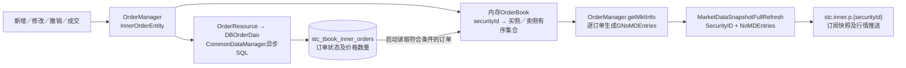
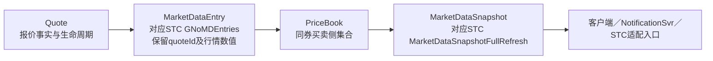

# STC InnerSvr行情模型与持久化核查

更新日期：2026-09-13。依据当前`sc-app-stc-innersvr`源码，重点核查DAY挂单形成行情的路径；不运行服务、不连接数据库。以下区分旧实现事实与FICC对齐建议。

## 1．核心结论

InnerSvr的已核实路径是：**持久化订单状态 → 按债券组织内存OrderBook → 转为STC标准行情条目 → 发布整券行情消息**。实际写入的是`stc_tbook_inner_orders`，本次仍未发现`stc_tbook_md_price`的读写实现。

它没有把最优、价格档、每个查询视图分别存成业务表。持久化行保留订单身份、价格、报量、成交量和状态；恢复后可以重新生成行情。这为FICC提供了明确的存储与消息对齐依据。

数据库写入与行情发送使用异步路径；此图不表示行情发布必须等待数据库提交。

## 2．三层模型

| 层次 | 旧实现 | 含义 |
| --- | --- | --- |
| 持久化 | `stc_tbook_inner_orders` / `TTbookInnerOrders` | 每条订单的状态，包含价格、收益率、净价、报量、累计成交量及双方资料 |
| 内存 | `InnerOrderEntity` / `OrderBook<InnerOrderEntity>` | 挂单对象及按债券、买卖侧组织的有序集合 |
| 对外消息 | `MarketDataSnapshotFullRefresh` / `GNoMDEntries` | 债券及渠道信息放在消息头，各订单的行情信息放在条目列表 |

表定义见IDBPro.create_tables.sql（仓库外参考：`../../IDBPro.create_tables.sql:983`）中的stc_tbook_inner_orders；主键为`(orderid, clordid)`。内存订单索引使用orderID，消息MDEntryID也使用orderID；并非直接把数据库复合键序列化成行情ID。

`OrderManager.htOrders`按securityID保存OrderBook，另有`ht`按orderID定位挂单。OrderBook（本地来源：`D:/workspace/GitHub/sc-app-stc-innersvr/src/main/java/sc/app/stc/inner/model/OrderBook.java:21`）使用ConcurrentSkipListSet：买侧price升序、卖侧price降序，同价按orderID升序。不同清算类型未作为分簿键；同价订单仍是独立成员，没有汇总成一条价格记录。

## 3．数据库写入及恢复

新增订单通过OrderResource.insertInnerOrder（本地来源：`D:/workspace/GitHub/sc-app-stc-innersvr/src/main/java/sc/app/stc/inner/service/impl/OrderResource.java:78`）调用DBOrderDao，再进入CommonDataManager.insertInnerOrder（本地来源：`D:/workspace/GitHub/sc-app-stc-innersvr/src/main/java/sc/app/stc/inner/common/CommonDataManager.java:294`）。它组装SQL参数，以orderID将任务放入异步执行队列；工作线程调用DBUtils.update。

修改使用同表UPDATE，条件为orderid及clordid，更新状态、累计成交量、价格、收益率、净价和部分关联信息。SQL定义（本地来源：`D:/workspace/GitHub/sc-app-stc-innersvr/src/main/java/sc/app/stc/inner/common/Consts.java:63`）明确了写入表名。撤销从内存簿移除订单，同时更新数据库状态；不是删除一份独立PriceBook快照。

启动恢复（本地来源：`D:/workspace/GitHub/sc-app-stc-innersvr/src/main/java/sc/app/stc/inner/service/impl/OrderManager.java:556`）读取数据库，将TTbookInnerOrders转换为InnerOrderEntity，重建两个内存索引并生成行情。虽然读取方法名为getAllIOCInnerOrder，实际查询参数（本地来源：`D:/workspace/GitHub/sc-app-stc-innersvr/src/main/java/sc/app/stc/inner/common/CommonDataManager.java:531`）是：当天创建、TimeInForce=DAY、状态0/1、渠道MANUAL/QUANT/IDB。不能按方法名误认为恢复的是IOC订单，也不能将这条路径描述成恢复所有历史订单。

因此，该表承担的是**可用于恢复订单簿的订单状态存储**。它不是按时点保存的完整行情快照序列。源码虽有stc_tbook_inner_execorders写入方法，但上述新增/更新路径的调用已注释，不能据此宣称每次变更都有独立历史记录。

## 4．行情条目与源订单映射

实际使用OrderManager.getMktInfo（本地来源：`D:/workspace/GitHub/sc-app-stc-innersvr/src/main/java/sc/app/stc/inner/service/impl/OrderManager.java:321`）逐条转换；MarketHandler也调用此方法，其文件内另一个private getMktInfo不是这里的实际调用点。

| 行情字段 | 订单来源或生成方式 |
| --- | --- |
| MDEntryID | orderID，保持订单身份 |
| MDReqID | MDReqID |
| MDEntryType | Side=1买入转为0，Side=2卖出转为1 |
| MDEntryPx | price；旧实现将特定占位值转为`--` |
| MDEntrySize | 通常为orderQty−cumQty，无成交时为orderQty；零报量有`--`展示约定 |
| Yield、NetPrice | yield、netprice，分别保留，不只提供一个抽象price |
| PriceType、ExerciseFlag | 原订单计价类型、收益率口径标志 |
| SettlType | 原订单清算条件 |
| MDEntryDate、MDEntryTime | 从订单createtime拆出；不能直接认定等于FICC updateTime |
| MDPriceLevel | 当前买卖侧遍历条目的顺序号，每条递增；不是不同价格的档号 |
| InstitutionID、TraderID | institutionId、traderId等客盘资料，需与FICC我方ownerUserId区分 |
| Venues、VenueTypeGW及业务标记 | 渠道信息与FirmFlag、WholeFlag、OCOFlag等 |

对于IDB来源，转换还可能先从inf3反序列化GNoMDEntries，再覆盖当前订单字段。这说明旧实现保留STC行情结构以承接来源扩展，但FICC不宜将必要业务字段都塞入inf3。

sendAllMD（本地来源：`D:/workspace/GitHub/sc-app-stc-innersvr/src/main/java/sc/app/stc/inner/service/impl/OrderResource.java:221`）合并买卖条目，以MarketDataSnapshotFullRefresh发布到`stc.inner.p.{securityId}`；MarketHandler.snapshot（本地来源：`D:/workspace/GitHub/sc-app-stc-innersvr/src/main/java/sc/app/stc/inner/handler/MarketHandler.java:34`）从内存簿生成订阅初始快照。这里的snapshot是消息快照，不是读一张已序列化的快照表。

需注意getMktInfo按marketNum限制每侧**条数**；仓库普通配置为50，部署模板值另行提供。因此方法名sendAllMD不保证输出整本订单簿，也不保证同价订单全部输出。

## 5．FICC对齐方案（已同步架构与主ER）

FICC已决定将报价与行情职责合并为QuoteSvr，内部模块化。主ER已补入对应STC GNoMDEntries的MarketDataEntry，价格簿和视图仍为衍生模型；当前关系如下：

- **模型与协议复用：** 优先以共享sc-app-stc的MarketDataSnapshotFullRefresh/GNoMDEntries作为兼容边界；FICC保留报价事实Quote，通过集中转换生成行情条目。PriceLevel和筛选视图继续表达算法结果，不必成为独立持久化主表。
- **身份：** FICC条目稳定关联quoteId；映射到MDEntryID时显式处理来源命名空间。STC owner用户、渠道交易员与对手联系人分别映射，不因字段名相近就共用ID。
- **存储：** 合并后的QuoteSvr保存Quote事实与审计，以已保存报价及可恢复事件重建行情条目和价格簿。可选检查点用于加速恢复，不再设置独立行情服务或第二份价格业务主库。
- **代码：** 可复用共享行情消息类、DPS通信和基础资料/计算访问组件；OrderBook的按券分侧结构可借鉴。现有OrderBook泛型绑定InnerOrderEntity，需要抽取接口或适配器才能用于FICC，不是直接换泛型参数即可复用。
- **保留FICC已定语义：** depth按不同价格档、并列全部保留、同价updateTime降序、含权债行权收益率。这些与InnerSvr按条数截断、orderID同价排序不同，应作为策略差异集中处理，不能为复用源码静默改变产品行为。
- **字典适配：** InnerSvr PriceType注释为1净价/2全价/3收益率，FICC Quote.quoteType为1收益率/2净价/3全价；ExerciseFlag为0行权/1或空到期，FICC yieldType为1到期/2行权。订单Side=1/2与行情MDEntryType=0/1也不同。集中映射后才能共用消息。

本次确认了可参考的持久化与恢复实现，也明确了对齐方向；不会把InnerSvr的撮合、成交量、IOC/FAK状态全部引入FICC报价模型。异步SQL与事件发布的可靠性仍沿用FICC既定设计，不能将旧实现视为已经提供“提交后发布”的保证。

当前设计见[架构](../ficc-sales-trading-architecture.zh-CN.md)、[核心ER](core-data-model-er.zh-CN.md)及[行情模型与STC映射](market-data-model.zh-CN.md)。第1至4节仍为旧源码事实，不表示FICC照搬其异步持久化、状态或档位规则。
