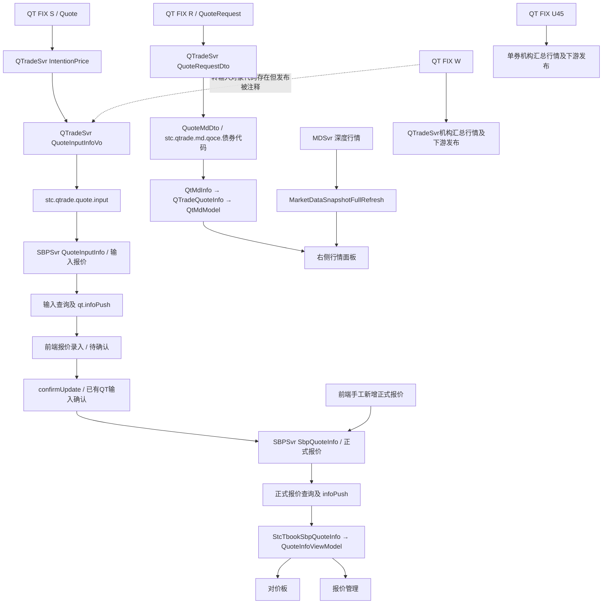

# QTrade消息与销售交易前端模型映射

页面位置参考：[旧客户端布局重建图片](legacy-layout-reconstruction.zh-CN.md)（根据源码制作的静态示意，非运行截图）。

## 1 范围与核心结论

本文将[QTrade消息清单](qtrade-message-inventory.zh-CN.md)与以下源码关联：

- 前端：`D:\workspace\greatewall\stc-client-sz\stc-client-lite`。
- 中间服务：`D:\workspace\greatewall\Archive\sc-app-stc-sbpsvr`。
- QT适配服务：`D:\workspace\greatewall\sc-app-stc-qtradesvr\sc-app-stc-qtradesvr`。

用户所说的“行情中心”在本次分析中包括两个区域：销售交易的对价板报价表，以及右侧行情面板。源码中的主标签实际为“对价板”；右侧组件为`MarketPriceView`。下文另外比较“报价管理”。

**三个区域并不都使用同一个模型，也不都经过SBPSvr。** 对价板与报价管理主要显示SBPSvr正式报价；右侧面板同时承载MDSvr深度行情和直接来自QTradeSvr的“Q一下”询价。

分析为静态源码追踪，没有启动客户端、连接服务或执行压力测试。三个仓库不一定来自同一部署版本；类型名称、JSON字段和主题的对应关系不能替代端到端联调。

## 2 页面与模型总表

| 页面区域 | 前端业务模型 | 前端显示模型 | 直接提供数据的服务 | 可确认的QT源头 |
| --- | --- | --- | --- | --- |
| 对价板：信用全部、利率全部 | `StcTbookSbpQuoteInfo` | `QuoteInfoViewModel`，由`CreditQuotationViewModel`分页展示 | SBPSvr | 对QT识别来源，可追溯到FIX `S / Quote`；另有手工和内部报价来源 |
| 报价管理：当日报价、历史报价 | `StcTbookSbpQuoteInfo` | `QuoteInfoViewModel`，由当日/历史管理ViewModel展示 | SBPSvr | 同一正式报价来源体系；不是直接显示FIX Quote |
| 报价录入：待确认报价，作为中间阶段对照 | 同样复用`StcTbookSbpQuoteInfo` | `QuotationConfirmViewModel`及其表格模型 | SBPSvr输入报价接口 | QT `S`经适配后形成输入报价，尚未必然成为正式报价 |
| 右侧行情：QT买卖方向列表 | `QtMdInfo.list : List<QTradeQuoteInfo>` | `QtMdModel`，放入`QuotationListViewModel.BidDatas/OfrDatas` | QTradeSvr，直接连接 | FIX `R / QuoteRequest`；`AE`等后续业务消息可影响列表状态 |
| 右侧行情：一般深度报价 | `STC.Common.Model.Fix.Message.MarketDataSnapshotFullRefresh`及`GNoMDEntries` | `QuotationListViewModel`中的行情表及相关显示属性 | MDSvr | 当前追踪到MDSvr即止，不能仅因类型同名认定为QT `W`或`U45` |

## 3 总体数据流

图中QT到SBPSvr的入口以发送主题及SBPSvr调用`ServerApi.subscribeForInnerGroupQtrade`、接收`sc.app.stc.api.QuoteInputInfoVo`为依据。本次未重新展开依赖包中该订阅封装的全部实现；生产路由仍需以部署配置和依赖版本验证。

## 4 对价板与报价管理：正式报价链

### 4.1 QT适配阶段

`MessageListener.onMessage(quickfix.fix44.Quote)`先调用`reseveQueto`生成`IntentionPrice`，再在符合分支条件时构造`sc.app.stc.qtradesvr.vo.QuoteInputInfoVo`并发布`stc.qtrade.quote.input`。

普通分支有`TransType=N/H`、群配置等条件；内部群和销售交易群又有独立分支。因此并非每一条收到的`S`都会进入销售交易输入表，更不能将QT所有撤销状态直接等同于SBPSvr正式报价撤销。

### 4.2 SBPSvr输入与确认阶段

SBPSvr的`SbpStream.onMessage`接收API包中的`QuoteInputInfoVo`，形成数据库模型`QuoteInputInfo`，写入`stc_tbook_sbp_quote_input`，并发布`stc.sbp.quote.qt.infoPush`。其中包含用户映射、债券检查、报价要素计算与估值补充，不是单纯的字段复制。

已有QT输入的确认通过`stc.sbp.inputquote.confirmUpdate`进入处理，更新已有输入记录；识别结果页使用`stc.sbp.inputquote.confirmAdd`，先新增已确认的输入记录。前端由`IsIdentity`选择这两个入口。两者随后都可由`ConfirmIntentionQuoteHandler.reserveQuoteInfoByInput`创建`SbpQuoteInfo`：生成新的`quoteId`，以`inputQuoteId`关联输入报价，设置正式有效状态`2`。正式记录写入`stc_tbook_sbp_quote_info`、更新缓存，并推送正式报价。

输入阶段还存在确认更新入口；前端手工新增正式报价也可通过`stc.sbp.quote.info`进入。因此不能将上图理解为所有正式报价都必须经过QT或都使用同一确认分支。

### 4.3 前端接收与页面差异

| 操作 | 服务/主题 | 前端实现 |
| --- | --- | --- |
| 正式当日报价加载 | SBPSvr，`stc.sbp.quote.queryTodayInfoPage` | `SalesTradingHandler.QueryTodayQuoteInfoAll`循环分页加载，并可能合并内部报价查询结果 |
| 正式报价增量 | SBPSvr，`stc.sbp.quote.infoPush` | `SubscribeQuoteInfo`；对价板使用300毫秒消息消费器，另监听内部报价主题 |
| 历史报价加载 | SBPSvr，`stc.sbp.history.quoteList` | `QueryHistoryQuoteInfoAll` |
| QT输入报价加载 | SBPSvr，`stc.sbp.input.qtQuoteList` | `QueryTodayQuoteDraftAll` |
| QT输入报价增量 | SBPSvr，`stc.sbp.quote.qt.infoPush` | 待确认页消息消费器；还监听另一条意向报价推送 |

正式查询接口在本版后端由`QueryQuoteInfoPageHandler`读取正式报价缓存并补充Wind数据。前端将返回JSON反序列化为`StcTbookSbpQuoteInfo`，再包装成`QuoteInfoViewModel`。它们分别是传输/业务数据与界面投影；界面上的价格展示、债券资料、筛选字段和提示并不全是FIX原始字段。

对价板与报价管理的差异主要在集合来源补充、筛选条件和操作权限。对价板组织信用/利率等视图；当日报价管理初始化按当前用户的`createUser`选择记录，其增量接收也检查当前用户，并排除`quoteMethod=4`的内部看板记录。相同模型不意味着两页展示完全相同的记录。

尤其需要注意：前端待确认页也复用`StcTbookSbpQuoteInfo`。这不代表后端输入表与正式表是同一实体，不能只根据前端类名判断生命周期阶段。

## 5 右侧行情：两个不同的数据通道

### 5.1 QT“Q一下”列表来自FIX R

`MarketPriceView`嵌入`PriceAndOrderViewST`，绑定`QuotationListViewModel`。切换债券时，该ViewModel调用`QtRiskHandler.SearchQtMd`加载数据，并调用`SubscribeQTMdSummary`订阅：

`QTradeSvr / stc.qtrade.md.qoce.<SecurityID>`。

尽管方法名含“Summary”，其消息负载不是`W`市场快照，而是：

| 层次 | 模型与字段 |
| --- | --- |
| FIX输入 | `QuoteRequest (R)`，包括债券询价组及参与方组 |
| QTradeSvr单条业务对象 | `QuoteRequestDto` |
| QTradeSvr集合对象 | `QuoteMdDto { securitId, list: List<QuoteRequestDto> }` |
| 前端集合对象 | `QtMdInfo { securitId, list: List<QTradeQuoteInfo> }` |
| 前端显示行 | `QtMdModel(QTradeQuoteInfo)` |

这里`securitId`是源码中的实际拼写，两端均使用，不能在接口层随意改为`securityId`。

`MessageListener.onMessage(QuoteRequest)`维护按债券及协商ID组织的询价集合，结合机构资料与白名单处理后发布该主题。初始查询由`QuoteRequestHandler`读取`stc_tbook_qtrade_quote_request`中`trans_type=N`的记录，生成同样的集合对象。

前端`OnQTSummaryInfo`先清空QT列表，再只展示`transType=N`且`iswhite=1`的记录，按`side=1/2`分到Bid/Ofr。`AE`中的特定“Q一下”单据处理会移除相应询价并再次发布列表。因此列表变化不全是新的`R`报文，也可能来自后续交易状态。

这条显示链直接经过QTradeSvr，不经过SBPSvr正式报价表；服务内部可能调用其他服务计算或风控，不改变其直接数据提供者。

### 5.2 普通深度行情来自MDSvr

同一个`QuotationListViewModel`还调用`PriceHandler.RegisterCTPrice`，经`MDHandler.SubscribeCT`与`ClientApi.subscribeForMD`向MDSvr订阅`stc.md.ct`系列主题。

收到的前端模型是`MarketDataSnapshotFullRefresh`，内部包含`GNoMDEntries`。它进入本地行情队列和行情表，同时通过`OnMarketPrice`交给外层`MarketPriceViewModel`处理。

**当前没有证据可以把这条MDSvr数据链直接标记为“QT W → 右侧行情”。** QT适配服务确实接收`W`和`U45`，但需继续检查MDSvr的实际接入、聚合与发布代码，才能判断其是否消费了QT来源以及如何混合其他场所数据。同名类或相似字段不能证明是同一消息流。

## 6 关键字段对应与注意事项

| 业务含义 | 正式报价链：FIX S → SBPSvr → 前端 | QT右侧询价链：FIX R → 前端 |
| --- | --- | --- |
| 债券 | `SecurityID/ExDestination`经适配补交易所后缀，进入`securityId`与显示模型 | 询价组债券信息进入`QuoteRequestDto.securityID`，对应`QTradeQuoteInfo.securityID`、`QtMdModel.SecurityId` |
| 关联标识 | 输入报价ID由适配层生成；正式报价新建ID，`inputQuoteId`保留输入关联，不等于FIX QuoteID | `NegotiationID`进入`negoId`，显示模型以`NegoId`暴露，用于询价与后续状态关联 |
| 价格 | 按方向取`BidPx/OfferPx`，按价格类型拆成收益率、净价、全价，再由SBPSvr补算；前端以`QuoteInfoViewModel`派生显示 | 询价组Bid/Offer字段进入`bidPx/ofrPx`及价格类型；`QtMdModel.Price/PxType`按方向选择，服务可能补充或换算价格 |
| 数量 | `QuoteInputInfoVo(IntentionPrice)`将Bid/OfferSize除以10000并转整数；SBPSvr还有按`useridList`决定的换算分支，不能统一假定原样传递 | 询价解析中BidSize等换算为以万计的量；显示模型选择`bidQty/ofrQty` |
| 机构与人员 | QT账号、昵称、机构资料经过本地用户/客户映射，形成创建人及对手机构、联系人ID | FIX参与方组进入`partyID/partySubID/partySubName`等，并补充白名单及`qtUserId`；显示名称还受当前用户与权限影响 |
| 生命周期 | 输入状态、正式报价状态与FIX `TransType/QuoteStatus`是不同语义 | `transType`用于询价列表筛选；后续单据可使询价从列表移除 |
| 估值、评级、期限等 | 来自债券资料、Wind估值、计算服务及前端派生属性，不是QT Quote完整提供 | 也存在本地机构映射和风控补充，不能当作未经处理的FIX行 |

FIX S价格类型在`QuoteInputInfoVo`构造器中的转换是：`BidPxType/OfferPxType=1`映射收益率、到期；`2`映射收益率、行权；`3`映射净价；`4`映射全价。此处FIX价格类型与SBPSvr的`quoteType`不是同一个枚举：后者`1/2/3`分别表示收益率/净价/全价。

**跨版本方向契约需要核实。** QTrade侧S适配保留`IntentionPrice.side`，并按`1`选择Bid字段；所读Archive版SBPSvr却将输入`side=0`映射为买、其余映射为卖。两端直接拼接可能产生方向错误。当前不能宣称这几个版本已经兼容；应先核对实际部署依赖与报文样本，再修正映射。数量的整数截断及重复单位转换风险也应一并检查。

## 7 W和U45为何不能直接等同于这些页面的源模型

`W`处理器确实构造了`QuoteInputInfoVo`，并将`PriceType=55/56/54/57`转换为收益率/净价/全价等字段，但约2493行的`publishMessage(QTRADE_QUOTE_INPUT, ...)`位于块注释中。因此，这份源码中不能把它计入已确认启用的SBPSvr报价输入来源。

`W`仍有向`stc.qt.mdt.all`等下游主题发布的代码；`U45`有单券快照与缓存/RabbitMQ发布路径。没有在上述页面发现直接订阅这些主题的证据。可能存在其他中间转发服务，但不应补画未经验证的实线连接。

## 8 源码索引

以下路径相对于本工作区的目录布局；行号随代码修改可能变化。

| 证据 | 源码位置 |
| --- | --- |
| 对价板两个债券视图 | QuotationBoardView.xaml（仓库外参考：`../../../stc-client-sz/stc-client-lite/STC.SalesTrading.Plugin/View/QuotationBoard/QuotationBoardView.xaml#L260`） |
| 对价板正式报价订阅 | QuotationBoardViewModel.cs（仓库外参考：`../../../stc-client-sz/stc-client-lite/STC.SalesTrading.Plugin/ViewModel/QuotationBoard/QuotationBoardViewModel.cs#L459`） |
| 当日报价管理用户过滤 | TodayQuoManageViewModel.cs（仓库外参考：`../../../stc-client-sz/stc-client-lite/STC.SalesTrading.Plugin/ViewModel/QuotationManagement/TodayQuoManageViewModel.cs#L790`） |
| 正式、输入、历史接口与确认 | SalesTradingHandler.cs（仓库外参考：`../../../stc-client-sz/stc-client-lite/STC.Common/Handler/SalesTrading/SalesTradingHandler.cs#L321`） |
| 正式报价前端传输模型 | StcTbookSbpQuoteInfo.cs（仓库外参考：`../../../stc-client-sz/stc-client-lite/STC.Common/Model/SalesTrading/StcTbookSbpQuoteInfo.cs`） |
| 正式报价界面包装 | QuoteInfoViewModel.cs（仓库外参考：`../../../stc-client-sz/stc-client-lite/STC.SalesTrading.Plugin/ViewModel/Data/QuoteInfoViewModel.cs#L108`） |
| QT直接订阅和查询 | QtRiskHandler.cs（仓库外参考：`../../../stc-client-sz/stc-client-lite/STC.Common/Handler/Risk/RiskSetting/QtRiskHandler.cs#L244`） |
| QT集合及单条接口模型 | QtMdInfo.cs（仓库外参考：`../../../stc-client-sz/stc-client-lite/STC.Common/Model/Qtrade/QtMdInfo.cs`） |
| QT显示行 | QtMdModel.cs（仓库外参考：`../../../stc-client-sz/stc-client-lite/STC.Common/Model/Qtrade/QtMdModel.cs`） |
| QT显示筛选 | QuotationListViewModel.cs（仓库外参考：`../../../stc-client-sz/stc-client-lite/STC.Common/ViewModel/QuotationListViewModel.cs#L4256`） |
| 行情面板的嵌入关系 | MarketPriceView.xaml（仓库外参考：`../../../stc-client-sz/stc-client-lite/STC.SalesTrading.Plugin/View/Component/MarketPrice/MarketPriceView.xaml#L37`） |
| MDSvr订阅终点 | ClientApi.cs（仓库外参考：`../../../stc-client-sz/stc-client-lite/STC.Common/Api/ClientApi.cs#L803`） |
| FIX R/S/W及相关下游发布 | MessageListener.java（仓库外参考：`../../../sc-app-stc-qtradesvr/sc-app-stc-qtradesvr/src/main/java/sc/app/stc/qtradesvr/lisener/MessageListener.java`）；R入口211，S入口684，W入口2160，禁用的输入发布约2493 |
| S转输入报价字段 | QuoteInputInfoVo.java（仓库外参考：`../../../sc-app-stc-qtradesvr/sc-app-stc-qtradesvr/src/main/java/sc/app/stc/qtradesvr/vo/QuoteInputInfoVo.java`） |
| R侧集合模型 | QuoteMdDto.java（仓库外参考：`../../../sc-app-stc-qtradesvr/sc-app-stc-qtradesvr/src/main/java/sc/app/stc/qtradesvr/vo/QuoteMdDto.java`） |
| QT询价初始查询 | QuoteRequestHandler.java（仓库外参考：`../../../sc-app-stc-qtradesvr/sc-app-stc-qtradesvr/src/main/java/sc/app/stc/qtradesvr/handler/QuoteRequestHandler.java#L38`） |
| SBPSvr输入、用户映射、方向换算 | SbpStream.java（仓库外参考：`../../../Archive/sc-app-stc-sbpsvr/src/main/java/sc/app/stc/sbp/stream/SbpStream.java#L351`） |
| SBPSvr输入转正式 | ConfirmIntentionQuoteHandler.java（仓库外参考：`../../../Archive/sc-app-stc-sbpsvr/src/main/java/sc/app/stc/sbp/handler/ConfirmIntentionQuoteHandler.java#L773`） |
| SBPSvr正式分页查询 | QueryQuoteInfoPageHandler.java（仓库外参考：`../../../Archive/sc-app-stc-sbpsvr/src/main/java/sc/app/stc/sbp/handler/QueryQuoteInfoPageHandler.java#L39`） |

## 9 对建模的直接启示

迁移设计至少应保留“输入报价”“正式销售报价”“QT询价”“市场深度快照”四类语义。对价板与报价管理可以共享正式报价投影；右侧面板可以组合多个来源，但不应因为同屏展示就合并它们的ID、状态、权限和更新规则。
