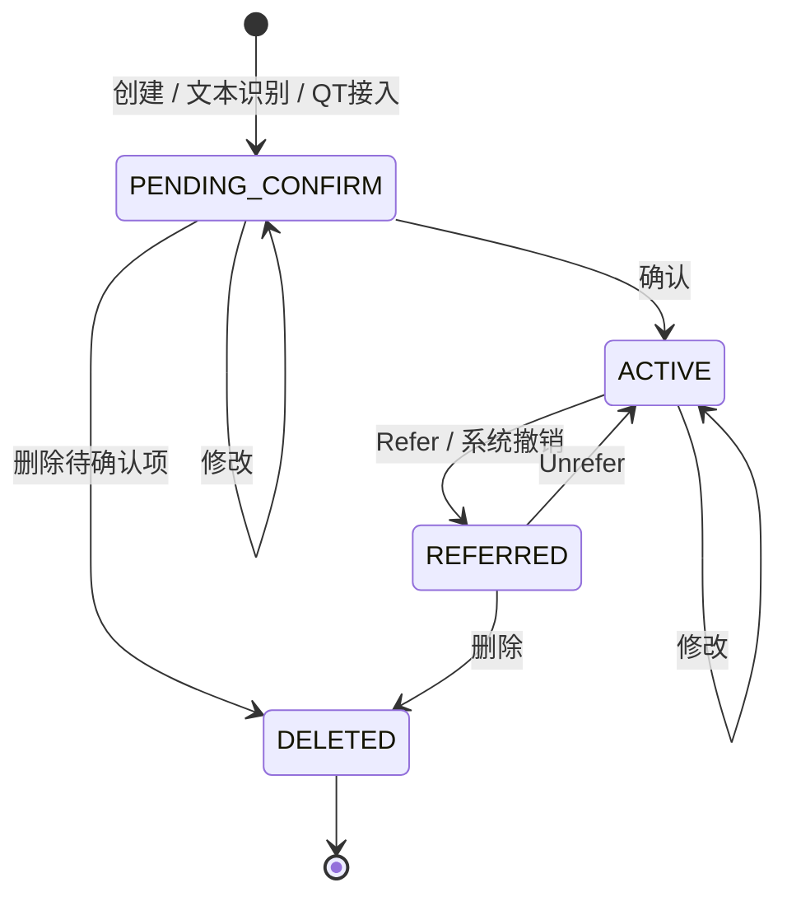

# 报价录入与生命周期API设计（DPS讨论稿）

本稿面向FICC销售智能交易平台的**精确报价、报价确认**，参考旧C#客户端和SBPSvr，但不照搬旧表结构。以下topic和字段为新设计建议。**本版不包含行情中心、报价管理的搜索API**；Refer、Unrefer等作为统一报价动作定义，供相关页面复用。

## 1．一条报价，一个ID，一套生命周期



| 动作 | 允许的原状态 | 结果及约定 |
| --- | --- | --- |
| `create` | 无记录 | 创建`PENDING_CONFIRM`，服务端分配`quoteId`，`revision=1` |
| `update` | `PENDING_CONFIRM`、`ACTIVE` | 修改字段，ID与状态不变；有效报价修改须重新校验 |
| `confirm` | `PENDING_CONFIRM` | 变为`ACTIVE`；可同时提交人工修订，整条成功才生效 |
| `refer` | `ACTIVE` | 变为`REFERRED`，记录原因、操作者和时间 |
| `unrefer` | `REFERRED` | 校验后恢复`ACTIVE`，**原ID不变**，刷新报价发布时间 |
| `delete` | `PENDING_CONFIRM`、`REFERRED` | 逻辑删除为`DELETED`，保留审计；有效报价先Refer再删除 |

每次成功变更递增`revision`。首次确认记录`confirmTime/confirmedBy`；Unrefer不是再次确认，不覆盖首次确认信息。`quoteTime`在确认、有效报价修改、Unrefer时更新，用于报价新鲜度；`updateTime`记录所有变更时间。

这里的“确认”是**人工审核并使报价在本平台生效**，不代表成交确认、对手方确认，也不隐含向QT发送FIX消息。删除后不提供Unrefer；要重新报价，创建新记录。跨业务日Unrefer需要重新检查日期与清算信息，不静默改成当天。

## 2．页面入口与DPS接口

采用现有`RequestMessageAsync<T>(svrId, topic, JSON)`请求/应答，服务器逻辑名使用`QuoteSvr`（报价服务）；登录Sid由消息封装携带。报价生命周期写请求统一使用`quotes`数组，单条也是长度为1的数组；文本识别请求仍提交`text`。逐条处理应答保留`results`，用于表达每条报价的成功或失败。

| 请求topic | 用途 | 主要入参 / 返回内容 |
| --- | --- | --- |
| `ficc.quote.recognize` | 精确报价文本识别，保存待确认结果 | `requestId, text` → `sourceMessageId, quotes, unresolvedLines` |
| `ficc.quote.create` | 结构化手工录入，可批量 | `requestId, quotes[].clientQuoteId`及平铺的业务字段 → 每行新建结果 |
| `ficc.quote.update` | 保存待确认修改，或修改有效报价 | `quoteId, expectedRevision`及直接填写的待修改业务字段 → 每行修改结果 |
| `ficc.quote.confirm` | 精确报价和QT待确认报价共用 | `quoteId, expectedRevision`，可直接附带待修改业务字段 → 每行确认结果 |
| `ficc.quote.refer` | 批量撤销 | `quoteId, expectedRevision, reason?` → 每行结果 |
| `ficc.quote.unrefer` | 批量恢复 | `quoteId, expectedRevision`，可直接附带待修改业务字段 → 校验修订后的日期等，再恢复 |
| `ficc.quote.delete` | 删除待确认项或已撤销报价 | `quoteId, expectedRevision, reason?` → 每行结果 |
| `ficc.quote.sourceMessage.query` | 报价确认页的来源消息列表 | `businessDate, sourceType?, page, pageSize` → 原始消息摘要、待处理数、总数 |
| `ficc.quote.query` | 某条来源消息或录入结果的待确认行 | `sourceMessageId?, businessDate, page, pageSize` → `totalCount, quotes`，固定查询`PENDING_CONFIRM` |
| `ficc.quote.get` | 编辑前读取单条最新报价，或写冲突后回读 | `quoteId` → 一条完整报价；不是行情搜索 |
| `ficc.quote.watch / unwatch` | 打开/关闭录入页的实时订阅 | 当前视图会话内订阅报价结果及页面变化；见第6节 |

新设计统一使用服务名`QuoteSvr`和topic前缀`ficc.quote.*`。旧系统的SBPSvr及`stc.sbp.*`仅作为实现参考，报文不兼容；新服务单独注册DPS路由，不替换旧客户端正在使用的处理器。

### 服务端推送topic（DPS订阅/发布）

| 推送topic | 发布方 → 订阅方 | 推送内容 |
| --- | --- | --- |
| **`ficc.quote.report.<sessionId>`** | QuoteSvr → 对应客户端会话 | QuoteReport报价结果，以及相关页面变化；网络按第6节的会话级BATCH合并承载 |

实际topic示例：**`ficc.quote.report.session-1`**。所有报价动作CREATE、UPDATE、CONFIRM、REFER、UNREFER、DELETE共用此topic，同一客户端各面板共用一次DPS订阅。

```text
客户端调用 ficc.quote.watch
服务端应答 Data.pushTopic = "ficc.quote.report.session-1"
客户端通过DPS订阅该pushTopic（使用服务端返回值，不自行拼接登录Sid）

客户端调用 ficc.quote.confirm
  ← 请求应答：逐条确认结果
  ← 已订阅的 ficc.quote.report.session-1：报价数据及页面变化
```

`quote.watch`是登记订阅范围的请求topic；`quote.report.<sessionId>`才是接收更新的推送topic。应答与推送的到达先后不作假设，订阅就绪及快照衔接要求见第6节。

```text
精确报价：文本 → recognize → 持久化待确认行 → 人工校正 → confirm
手工新建：表单 → create    → 持久化待确认行 → 人工校正 → confirm
报价确认：QT接入适配器    → 持久化待确认行 → 人工校正 → confirm
```

识别完成不自动发布。双向报价拆成两条单方向报价。识别不完整的报价行可保存，携带缺失项；完全无法识别的文本放入`unresolvedLines`。识别出的撤销指令不能按新增报价确认，先列为待人工处理内容，本版不自动执行文本中的动作。

同一待确认行在两个入口出现时使用相同ID。前端不再根据“是否来自识别”选择`confirmAdd/confirmUpdate`。为保持简单，不另设业务批次ID：确认页需要按原文分组时，使用`sourceMessageId`，一条来源消息可以对应多条报价。选中项必须提交明确的报价ID，不能用“当前筛选全部”代替操作清单。

`requestId`标识一次调用，`sourceMessageId`标识一条持久化的来源消息，两者不互换。同一来源消息的报价可以分多次确认，一次确认也可以选择不同来源消息的报价。创建、修改、确认、Refer、Unrefer、删除请求不依赖来源分组ID。

## 3．统一报价对象：先明确业务字段

业务字段直接放在报价对象中，例如`priceType`、`price`，创建和修改都采用平铺结构，不增加额外的业务字段包装层。修改时，待修改字段与`quoteId`、`expectedRevision`放在同一个报价对象内；服务端仍负责限制各动作允许编辑的字段，不能直接提交status改变生命周期。

| 字段 | 业务含义及填写责任 |
| --- | --- |
| `quoteId, revision, status` | 服务端生成的报价身份、数据版本、生命周期状态；客户端不能直接改状态 |
| `clientQuoteId` | 客户端新建本地报价行时生成的唯一标识，用于将该行与服务端应答及QuoteReport关联；不是订单ID |
| `sourceMessageId, source` | 可选的来源消息关联及来源信息，仅用于原文分组和追溯；由接入端或服务端记录，不参与生命周期动作寻址 |
| `securityId` | 内部标准债券ID；代码或简称未匹配时可先保存待确认，确认前必须确定债券 |
| `side` | `BID / OFR`，需统一定义为报价方买入 / 卖出方向 |
| `priceType, price` | `YIELD_MATURITY / YIELD_EXERCISE / NET_PRICE / FULL_PRICE`与对应值；收益率单位为百分数，例如`"2.6500"`表示2.65%，净价/全价按每百元面值计 |
| `quantity, quantityUnit, currency` | 报量及单位，例如`"1000", "WAN", "CNY"`表示1000万元面值；禁止把空值当0 |
| `institutionId, contactId` | 报价对手机构、联系人，采用内部主数据ID；联系人须属于该机构 |
| `tradeDate, settlement` | 业务交易日期及清算约定，如`"2026-09-09", "T+1"`；明+0等枚举后续统一 |
| `urgent` | 布尔值，急：是否标记为紧急报价 |
| `recommended` | 布尔值，荐：用户设置的推荐标记，不表示智能推荐算法评分 |
| `whole` | 布尔值，整：整量标记；具体成交约束需另行定义 |
| `oco` | 布尔值，OCO标记；与packing互斥 |
| `packing` | 布尔值，打包标记；与oco互斥 |
| `remark` | 用户填写的报价备注，可显式清空 |
| `ownerUserId, createdBy, updatedBy, confirmedBy` | 分别表示报价所属用户、创建人、最近修改人、首次确认人；操作者由服务端根据Sid确定。报价所属用户不一定是本次操作者，不能与对手联系人混用 |
| `createTime, updateTime, quoteTime, confirmTime` | 创建、修改、报价发布、首次确认时间，均由服务端生成 |
| `reference` | 债券简称、期限、评级、中债/中证估值、换算价格等只读参考字段；缺失应返回空及可读原因 |
| `validationIssues` | 当前缺失或错误字段列表，供页面定位；服务端执行动作时仍须重新校验 |

时间字段统一使用小驼峰命名并以`Time`结尾；业务日期`tradeDate`仍只表示日期。

| 时间字段 | 明确含义 |
| --- | --- |
| `createTime` | 报价首次创建时间，后续动作不覆盖 |
| `updateTime` | 报价最近一次成功变更时间，包含字段及状态修改 |
| `quoteTime` | 最近一次报价发布或刷新时间，在确认、有效报价修改、Unrefer时更新 |
| `confirmTime` | 首次人工确认时间，未确认时为空，Unrefer不覆盖 |
| `operationTime` | 某一次动作的执行时间，用于审计及QuoteReport；每条操作记录分别保留 |
| `receiveTime` | 来源消息到达平台的时间，用于消息列表，不等于报价创建或确认时间 |

上述时间由服务端记录，使用带明确时区的ISO 8601字符串，例如`"2026-09-09T10:32:00+08:00"`。前端只负责按显示需要格式化，不用本机当前时间替换服务端时间。

数值以十进制字符串传输。用户选择一种价格口径输入；其他换算值放入`reference`，不能同时把多个来源的价格都当作用户输入。单位换算在旧接口适配层完成。

对已有报价执行修改，或确认/恢复时附带修订，只提交用户明确修改的业务字段：**未传=保留；null=主动清空（字段须允许为空）；false=关闭对应布尔标记**。例如直接传`"price":"2.6600", "remark":null`，表示修改价格、清空备注，其他字段不变。客户端序列化和服务端解析必须区分“字段未传”和“字段值为null”，不能把未编辑字段自动补成null，也不能丢掉用户明确提交的false。清空后的可选字段不能被估值或识别结果重新补回。这里是写请求的编辑内容，与看板推送“每次发送所需的全部显示字段”不冲突。

### 急、荐、整、OCO、打包

这五项使用上述独立布尔字段，不再用通用标签数组表示。创建时未传默认false；修改时未传保持原值，传false取消标记，不接受null。创建、修改、确认附带修订及QuoteReport中的报价数据采用同一套字段名。

**OCO与打包互斥，不能同时为true。** 前端切换时明确提交一开一关，例如`"oco":true, "packing":false`；服务端将本次字段与原数据合并后校验，冲突则返回对应报价的字段错误，不静默替用户改值。其他三个标记可独立设置。

```json
{
  "requestId": "flags-001",
  "quotes": [{
    "quoteId": "Q1", "expectedRevision": "3",
    "urgent": true, "recommended": false, "whole": true,
    "oco": true, "packing": false
  }]
}
```

上例发送到`ficc.quote.update`。这些字段目前表达报价属性，不据此承诺自动撤销其他报价、整量成交限制或多报价联动成交；相关业务规则以后再讨论。修改标记同样递增revision、记录审计并发布QuoteReport，不新增专门的标记操作API。

产品代码参考：[app.js](../FICC销售智能交易平台_files/app.js)中的`TAG_NAME_MAP`、`toggleExclusiveQuoteFlag`和`pendingQuoteRequest`。产品存在recommend/rec、round/whole等别名，新API统一使用recommended、whole，由适配层转换。

QT账号、BaseSvr机构编码、QT交易员ID由服务端适配到内部ID；客户端不能以`sourceType=QT`冒充接入来源。建议按所属用户隔离待确认工作项，同一外部消息下发多个用户时各有可审计的工作项，避免一人删除影响他人；多接收人协作规则还需产品确定。

QT原始消息和用户提交识别的一段原文，均可保存为来源消息。`sourceMessageId`使用服务端统一的消息标识，外部原始消息ID及来源账号保留在来源信息中，避免不同来源重号。纯手工结构化报价没有原始消息时可省略，不为每次create请求额外生成一个分组ID；以后如需把多条原始消息合并成业务分组，再讨论扩展。

## 4．统一写请求和逐行应答

### 三个ID各自负责什么

| ID | 用途 | 生命周期 |
| --- | --- | --- |
| `clientQuoteId` | 关联尚无服务端ID的本地报价行与创建结果 | 本地新建时生成一次，创建重试保持不变；复制成另一条新报价时生成新值 |
| `quoteId` | 标识服务端报价，定位缓存中的已保存对象 | 服务端创建后分配，确认、Refer、Unrefer期间不变 |
| `requestId` | 关联一次业务请求、应答和相应报告 | 每次新动作生成新值；同一请求的网络重试保持原值 |

手工创建时，服务端保存`clientQuoteId → quoteId`映射，在创建应答及QuoteReport中回传clientQuoteId。客户端先按quoteId查找；尚未绑定时，再按clientQuoteId找到本地行并绑定服务端ID。应答与报告无论哪个先到，都复用同一行，不插入重复行；应答可绑定ID和显示提交结果，报价内容由报告更新。

创建重试须保留clientQuoteId，服务端在所属用户范围内保证其唯一性。已有映射时不能再次新建，也不能把create当成update；内容不同应返回冲突。前端宜生成UUID，其他客户端没有对应本地行时直接使用quoteId。QT接入或服务端文本识别生成的报价首次下发时已有quoteId，可以不带clientQuoteId；后续动作直接使用quoteId。

手工创建一条待确认报价，请求`ficc.quote.create`：

```json
{
  "requestId": "create-001",
  "quotes": [{
    "clientQuoteId": "client-quote-abc",
    "securityId": "BOND-001", "side": "BID",
    "priceType": "YIELD_MATURITY", "price": "2.6500",
    "quantity": "1000", "quantityUnit": "WAN", "currency": "CNY",
    "institutionId": "INST-01", "contactId": "CONTACT-01",
    "tradeDate": "2026-09-09", "settlement": "T+1",
    "urgent": true, "recommended": false, "whole": true,
    "oco": true, "packing": false, "remark": null
  }]
}
```

写应答统一返回**实际提交成功的状态和版本**，而非仅“已受理”；创建结果用clientQuoteId关联请求行，后续动作结果用quoteId关联，不依赖数组顺序，也不需要额外的itemId：

```json
{
  "Code": "0000", "Msg": "处理完成",
  "Data": {"requestId": "create-001", "results": [
    {"clientQuoteId": "client-quote-abc", "code": "0000", "message": "已保存待确认", "quoteId": "Q1", "revision": "1", "status": "PENDING_CONFIRM"}
  ]}
}
```

两条待确认报价一起确认，请求`ficc.quote.confirm`。Q1同时修改价格并清空备注，Q2使用已保存字段：

```json
{
  "requestId": "confirm-001",
  "quotes": [
    {"quoteId": "Q1", "expectedRevision": "1", "price": "2.6600", "remark": null},
    {"quoteId": "Q2", "expectedRevision": "3"}
  ]
}
```

```json
{
  "Code": "0000", "Msg": "处理完成，部分失败",
  "Data": {"requestId": "confirm-001", "results": [
    {"code": "0000", "message": "已确认", "quoteId": "Q1", "revision": "2", "status": "ACTIVE"},
    {"code": "VALIDATION_FAILED", "message": "请选择债券", "quoteId": "Q2", "revision": "3", "status": "PENDING_CONFIRM", "fieldErrors": [{"field": "securityId", "message": "债券尚未确定"}]}
  ]}
}
```

外层`Code="0000"`表示请求已完成逐行处理，**不表示每行成功**。客户端必须读取全部`results`；不再像旧代码那样根据“未出现在失败列表”猜测成功项。报文格式错误或会话无效时用外层错误码，不执行任何行。

### 同一个Q1的后续动作

以下示例按顺序执行，成功应答仍使用上述格式：

```text
topic: ficc.quote.update
{"requestId":"update-001","quotes":[{"quoteId":"Q1","expectedRevision":"2","quantity":"1200"}]}
→ Q1，revision=3，ACTIVE

topic: ficc.quote.refer
{"requestId":"refer-001","quotes":[{"quoteId":"Q1","expectedRevision":"3","reason":"对手报价撤回"}]}
→ Q1，revision=4，REFERRED

topic: ficc.quote.unrefer
{"requestId":"unrefer-001","quotes":[{"quoteId":"Q1","expectedRevision":"4"}]}
→ Q1，revision=5，ACTIVE

topic: ficc.quote.refer
{"requestId":"refer-002","quotes":[{"quoteId":"Q1","expectedRevision":"5"}]}
→ Q1，revision=6，REFERRED

topic: ficc.quote.delete
{"requestId":"delete-001","quotes":[{"quoteId":"Q1","expectedRevision":"6"}]}
→ Q1，revision=7，DELETED
```

## 5．只保留必要的执行约定

### 谁执行了这次操作

**操作请求不增加客户端填写的userId。** 沿用旧系统的会话识别方式，由QuoteSvr从DPS消息携带的登录Sid解析已认证用户，并检查其操作权限；会话无效则拒绝操作。请求中的userId或报价ownerUserId都不能代替本次操作者身份。

```text
客户端Refer请求：{requestId, quotes:[{quoteId, expectedRevision, reason?}]}
DPS消息封装：携带登录Sid
QuoteSvr：Sid → 当前用户 → 权限检查 → 执行Refer
  → 报价updatedBy记录当前用户
  → 审计记录保存本次操作者、时间和动作
  → QuoteReport携带operatorUserId、operationTime
```

例如管理员U2撤销属于U1的报价：ownerUserId仍为U1，本次operatorUserId和updatedBy为U2。

| 审计/报告字段 | 来源与含义 |
| --- | --- |
| `operatorUserId` | 服务端根据已认证会话确定的本次操作者ID |
| `operationTime` | 服务端生成的动作执行时间，不使用客户端时间代替 |
| `quoteId, action, requestId, eventId` | 关联报价、本次动作、请求与事件；系统动作可没有客户端requestId |
| `before / after` | 审计保存变更前后数据；QuoteReport仍只发送结果报价，不必传完整审计内容 |

每次成功状态或字段变更都保留独立审计记录，与报价变更一起提交。quote.updatedBy只表示最近一次修改人，不能代替完整操作历史；请求重试不重复记为新操作。批量请求逐条记录实际成功的报价变更。

系统自动撤销等没有人工会话的动作，记录可识别的系统执行主体，不冒充报价所属用户；其具体编码后续统一。QuoteReport中的操作者信息由服务端填写，面向UI的合并推送也不能代替完整审计日志。

### 执行与重试

- **逐条事务、允许部分成功。** 每行的字段修改、状态变化、审计和待发布事件一起提交。某行确认失败，该行随请求提交的字段修改也不落库；前端保留本地编辑，成功行正常完成。首版不增加整批原子模式。
- **防止覆盖他人修改。** `expectedRevision`表示“用户进行本次操作时看到的报价版本”。例如客户端看到3、服务端已变为4，则拒绝修改；版本相同才提交并递增。每次写入同时检查当前状态，冲突返回`REVISION_CONFLICT`和最新版本；客户端回读后重新决定，不能自动覆盖。批内重复quoteId，或创建批内重复clientQuoteId，直接拒绝该请求，避免顺序歧义。
- **允许安全重试。** 服务端持久化当前用户、topic、requestId、报价标识及请求内容摘要和结果；创建使用clientQuoteId，已有报价动作使用quoteId作为逐条标识。相同请求重试返回原结果，不再执行。相同键却不同内容返回`IDEMPOTENCY_CONFLICT`。超时不等于失败；超时用原请求重试。用户改完失败行后使用新requestId；同一条尚未创建成功的本地报价保留clientQuoteId。
- **所有动作重新检查权限。** “本人/管理员”等规则由服务端执行；客户端字段不是授权依据。权限、状态、校验错误均返回到具体行。
- **风险提示确认单独表达。** 需要用户接受偏离提示时返回`RISK_ACK_REQUIRED`及提示内容、`riskToken`，本次不提交；用户明确接受后以新requestId重试该动作，附`riskAckToken`。令牌绑定用户、quoteId、revision、修改内容及风险检查版本，过期或内容变化重新检查，不使用含义模糊的`isConfirm=1`；硬性禁止项不能靠确认跳过。
- **幂等不等于业务去重。** QT重复投递按来源账号、外部消息、行及所属用户去重；相同识别请求重试复用原来源消息及识别结果。不同来源但内容相似的报价不能只按债券代码合并。同次识别中“相同逻辑报价复用一条有效报价”的规则需明确业务键；首版遇到可确认的重复冲突返回`DUPLICATE_QUOTE`及`existingQuoteId`，不暗中撤销或覆盖另一条报价。

## 6．录入页查询与发布/订阅

只查询录入范围，不提供本版之外的行情搜索条件。查询应答同样使用`Code / Msg / Data`。

```text
topic: ficc.quote.sourceMessage.query
{"businessDate":"2026-09-09","sourceType":"QT","page":1,"pageSize":20}
→ Data: {totalCount, sourceMessages:[{sourceMessageId, sourceType, receiveTime, pendingCount, issueCount, originalTextSummary}]}

topic: ficc.quote.query
{"sourceMessageId":"MSG-01","businessDate":"2026-09-09","page":1,"pageSize":50}
→ Data: {totalCount, quotes:[统一报价对象]}

topic: ficc.quote.get
{"quoteId":"Q1"}
→ Data: {quote:统一报价对象}
```

来源消息原文和逐行原文引用应可查看；指定消息下没有待确认行时，`quote.query`返回空列表。未指定sourceMessageId时，查询该业务日权限范围内的待确认报价，也包含没有来源消息的手工录入。`get`允许有权限的用户读取已删除记录用于冲突提示和回溯，不因此把该记录放回录入列表。

### 用QuoteReport直接驱动客户端数据与UI

采用与旧客户端`ExecutionReport`相似的处理方式：**服务端推送动作执行后的报价数据，客户端直接更新本地缓存和页面**。正常更新不采用“只通知ID，再查询报价”的方式。`QuoteReport`是新报价业务消息，不直接复用订单的FIX `ExecutionReport`字段。

```text
客户端请求 create / update / confirm / refer / unrefer / delete
  → 服务端提交报价状态、审计及待发布事件
  → 发布QuoteReport（动作 + 执行后的报价）
  → 视图服务计算受影响页面，按客户端会话合并发送
  → 客户端更新共享报价缓存及页面ID列表
  → UI更新相关行
```

QuoteReport的逻辑内容示例（省略其他报价业务字段；实际发送当前页面需要的全部字段）：

```json
{
  "type": "QuoteReport",
  "eventId": "event-001",
  "requestId": "confirm-001",
  "clientQuoteId": "client-quote-abc",
  "action": "CONFIRM",
  "operatorUserId": "USER-002",
  "operationTime": "2026-09-09T10:32:00+08:00",
  "quote": {
    "quoteId": "Q1", "revision": "2",
    "status": "ACTIVE", "securityId": "BOND-001", "side": "BID",
    "priceType": "YIELD_MATURITY", "price": "2.6600",
    "quantity": "1000", "quantityUnit": "WAN", "currency": "CNY",
    "urgent": true, "recommended": false, "whole": true,
    "oco": true, "packing": false
  }
}
```

`action`对应`CREATE / UPDATE / CONFIRM / REFER / UNREFER / DELETE`；QT接入创建待确认报价也产生`CREATE`。手工创建成功的第一份报告使用`action=CREATE`、创建请求的requestId、原clientQuoteId及新quoteId，其状态为`PENDING_CONFIRM`、revision为1；上例是同一报价后续确认的报告。服务端保存的clientQuoteId可随后续报告继续携带，但后续定位以quoteId为主。系统动作没有客户端requestId时可以省略；QT等来源没有clientQuoteId时同样省略，但仍有eventId和revision。客户端以结果状态为准，不仅凭动作名称自行猜测字段。

| 报价结果 | 客户端页面处理 |
| --- | --- |
| 新增待确认报价 | 更新缓存；根据服务端页面变化插入待确认列表，有来源消息时更新对应计数 |
| 修改 | 更新已有对象和相关单元格；排序位置变化由服务端页面操作表达 |
| 确认成功 | 从待确认页移除；已订阅有效报价视图的窗口收到相应加入或补位变化 |
| Refer / Unrefer | 更新状态；各视图按自己的成员变化移除、插入或移动行 |
| 删除 | 从相关列表移除；保留服务端审计，缓存仅在没有活动页引用时释放 |

### 与已讨论的页面订阅协议配合

**统一订阅topic：`ficc.quote.report.<sessionId>`。** 服务端为客户端会话分配实际topic并检查订阅权限；前端在该会话只订阅一次。CREATE、UPDATE、CONFIRM、REFER、UNREFER、DELETE共用此topic，各面板也共用，不按动作或面板另建一份报价推送。topic决定发给哪个会话，quoteId/clientQuoteId决定更新哪条本地报价。

服务端按会话权限与已登记的业务订阅确定发送范围，包括本会话提交的创建结果关联；不是向每个客户端广播全部报价。其他客户端的更新使用相同业务消息结构，但各自通过自己的会话topic接收。

QuoteReport表示业务变化；网络上复用[看板协议](quote-board-subscription-protocol.zh-CN.md)的会话级`BATCH`承载：报价内容进入去重后的`quotes`，动作信息关联quoteId，各面板位置变化进入`panels`。上面的逻辑报告不再额外逐面板重复发送。具体动作元数据字段后续细化，不在本轮增加另一套完整报文协议。

**分页页面不能仅凭报价事件自行补位。** 服务端同时计算REMOVE / INSERT / MOVE及totalCount；补进页面的其他报价也在同批中携带。来源消息分组的pendingCount、issueCount等摘要随相关变化一并更新。报价及页面变化整批应用，不能先显示新状态再保留旧位置。本版只定义录入页对这些能力的使用，不增加行情中心、报价管理搜索接口。

```text
打开录入页：quote.watch({requestId, businessDate})
  → Data: {watchId, streamId, pushTopic:"ficc.quote.report.session-1"}
  → 若会话已订阅该topic，复用现有DPS订阅；watch只登记本页面需要的数据范围
客户端：完成DPS订阅，取得当前来源消息分组/当前页快照，然后应用连续更新批次
关闭录入页：quote.unwatch({requestId, watchId}) → Code="0000"；释放该页面的业务订阅
其他面板仍使用会话topic时，保持DPS订阅；所有使用方关闭或会话结束后再退订
```

查询用于初次加载、打开或切换来源消息分组/页、编辑详情及异常恢复。订阅快照必须与更新衔接：快照带读取位置，加载期间缓存推送，快照应用后接续该位置之后的批次。复用已有草案的streamId、sequence和页面version约定；DPS订阅就绪及快照衔接的底层实现仍待核实，不能仅凭`SubScribeWithImage`的方法名认定已保证一致性。这里的BATCH及sequence是网络更新分批发送的约定，不代表持久化的业务分组ID。

**写应答用于操作反馈，事件用于数据更新。** 应答说明哪些行已提交，不能根据应答再执行一遍页面插入；同一动作的应答和推送可能交错。客户端用quoteId定位对象、revision防止旧报价覆盖、批次sequence处理重复与缺口。发现缺口或重连时重建快照；即使用户没有主动操作，其他来源或窗口的报价变化也走同一条更新链路。

服务端通过可重试的待发布事件机制在提交后发布，避免数据库成功而消息永久丢失。客户端会话仅接收权限范围内的报价和页面数据，保持一个共享缓存；断线会话超时释放。生命周期事件保留审计记录，面向UI的批次可按已有看板约定合并为最终状态；合并时仍须保留创建结果与clientQuoteId的关联。会话topic分配、订阅握手及与watch的具体调用顺序仍为后续讨论项，本轮先确定消息职责和命名。

## 7．与旧实现的关键差别及依据

| 旧实现参考 | 本稿建议 |
| --- | --- |
| `SalesTradingHandler.AccurateIdentify`调用`stc.sbp.accurate.identify`；`QuotationEntryDataGridViewModel`按`IsIdentity`选择`confirmAdd/confirmUpdate` | 两个入口都先得到持久化的待确认quoteId，再调用一个`confirm` |
| `ConfirmIntentionQuoteHandler`将输入状态改为1，再由`reserveQuoteInfoByInput`生成新的正式报价ID，关联`inputQuoteId`，状态2 | API层从待确认到有效维持同一quoteId；存储是否分表是后端内部选择 |
| `QuoteDraftAdd/Update/Delete`操作输入报价；正式报价有另一组修改/撤销入口 | 同一对象使用命名明确的动作，状态机决定能否执行 |
| 前端Refer逐条发送`stc.sbp.quote.cancel`，Unrefer发送ID列表；成功/失败格式不统一 | 所有动作统一批量quotes和逐行results |
| `QuoteInfoServiceImpl.UnreferQuote`复制旧记录走新增路径，部分路径删除旧记录并调整日期 | 原ID恢复，日期变更必须显式；与当前产品页面中“保留原ID”的方向一致 |
| `QuotationEntryDataGridViewModel.SendDoubleConfirm`使用`IsConfirm="1"`接受偏离提示 | 风险提示用`riskAckToken`，与生命周期`confirm`分开 |
| TBook/XBond通过`ExecutionReport`更新订单缓存并通知UI；销售交易报价页使用`StcTbookSbpQuoteInfo`推送 | 借鉴事件驱动更新方式，报价使用`QuoteReport`，客户端直接应用数据变化 |
| `CancelQuoteHandler`通过`message.getSignalID()`及`LoginSvrClient.get(sid)`取得用户；`cancelQuote`写updateUser，`insertOperateRecord`写operator与operationTime | 沿用服务端会话身份识别，操作请求不增加可自行填写的userId；QuoteReport增加operatorUserId、operationTime |

定位文件：

- [旧客户端业务请求](../../../stc-client-sz/stc-client-lite/STC.Common/Handler/SalesTrading/SalesTradingHandler.cs)：`AccurateIdentify`、`QuoteDraft*`、`QuoteConfirm*`、`QuoteRefer`、`QuoteUnRefer`。
- [旧客户端确认分支](../../../stc-client-sz/stc-client-lite/STC.SalesTrading.Plugin/ViewModel/QuotationEntry/QuotationEntryDataGridViewModel.cs)：`SendConfirm`、`SendDoubleConfirm`、`DealSuccessMsgs`。
- [旧后端确认处理](../../../Archive/sc-app-stc-sbpsvr/src/main/java/sc/app/stc/sbp/handler/ConfirmIntentionQuoteHandler.java)：`confirmAdd/confirmUpdate`、`reserveQuoteInfoByInput`。
- [旧后端恢复处理](../../../Archive/sc-app-stc-sbpsvr/src/main/java/sc/app/stc/sbp/service/impl/QuoteInfoServiceImpl.java)：`UnreferQuote`。
- [旧Refer用户识别](../../../Archive/sc-app-stc-sbpsvr/src/main/java/sc/app/stc/sbp/handler/CancelQuoteHandler.java)：`handle`；[旧操作审计](../../../Archive/sc-app-stc-sbpsvr/src/main/java/sc/app/stc/sbp/service/impl/OprateRecordServiceImpl.java)：`insertOperateRecord`。
- [旧订单缓存更新](../../../stc-client-sz/stc-client-lite/STC.Common/Handler/TBook/TBookHandler.cs)：`Instance_OnOrder`；[旧报价页面更新](../../../stc-client-sz/stc-client-lite/STC.SalesTrading.Plugin/ViewModel/QuotationBoard/QuotationBoardViewModel.cs)：`OnData`、`UpdateQuoteInfo`。
- 当前产品的[FICC页面需求](../FICC销售智能交易平台.html)第3.2/3.3节及[需求汇总](../FICC销售智能交易平台_files/requirement-spec-page.js)的报价录入、报价状态条目。

## 8．本轮保留的产品问题

1. **确认必填项有冲突。** HTML第3.2/3.3节要求价格、报量等完整；需求汇总中允许价格和数量为空。接口可表达空值，本稿建议保存待确认允许不完整，确认必填规则以产品最终选择为准；不能从旧代码直接定论。
2. **重复报价的业务键与处理方式。** 需要确定同批复用、跨批更新、独立报价的界限；本稿的重复冲突是过渡建议，未假称已实现产品中的自动复用。
3. **多人收到同一QT消息时的协作方式。** 独立处理还是共享确认结果，需要与数据权限一起确定。

先讨论“一个quoteId、一套状态动作、批量逐行结果、两个录入入口共用确认”。字段限额、查询条件回显、复杂模糊识别、历史搜索和跨服务部署细节后续再展开。
