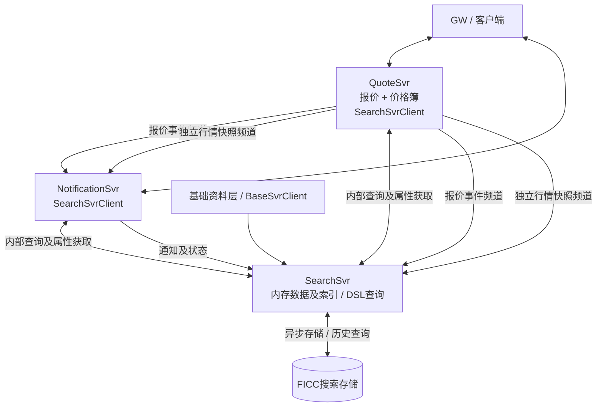

# SearchSvr设计简稿

日期：2026-09-13。与[系统架构](ficc-sales-trading-architecture.zh-CN.md)一致：QuoteSvr合并报价与行情职责，NotificationSvr独立，SearchSvr为内部搜索存储。

> 实现状态：独立 SearchSvr 尚未落地，当前使用进程内实现；见[现有搜索依赖](../iteration1/docs/search-dependency.zh-CN.md)。本文描述目标职责。

## 1．职责

SearchSvr接收QuoteSvr的报价与行情条目、NotificationSvr的通知，以及基础资料更新；维护内存数据及索引，提供内部DSL查询、搜索属性获取和历史搜索。它不直接服务前端，不保存业务订阅或结果成员，也不管理用户筛选设置。

QuoteSvr负责报价及价格API、关注债券和相关筛选设置；NotificationSvr负责通知API及个人提醒设置。两者内置SearchSvrClient，维护自己的订阅、属性缓存和结果变化，并通过GW推送客户端。SearchSvr与SearchSvrClient共用FilterEngine和字段字典；Quote/Price对外Handler、DTO及频道分别定义，不能因为代码共用而合并协议。

## 2．共享代码，不同数据模型

| 组件 | 负责内容 |
| --- | --- |
| FilterEngine | 条件语义、类型和单条记录匹配；两侧复用 |
| QuoteAdapter / MarketDataEntryAdapter / NotificationAdapter | 提供记录ID、版本、关联债券及本模型字段 |
| SearchSvr | 数据补充、索引、候选检索、DSL查询及搜索副本存储 |
| SearchSvrClient | 本地属性缓存、业务订阅、变化前后匹配、成员位置和推送合并 |
| QuoteSvr价格簿模块 | 在权限及条件过滤后分档、取最优/N档/完整行情，不由SearchSvr重写报价业务 |

债券类型、发行人类型、期限、评级和地域来自统一基础资料；价格、方向、报量及标记来自具体业务记录。筛选子分组拍平后，同字段OR、跨字段AND；多个选中筛选分组取并集，再与关注债券范围取交集。不同数据模型复用语义，运行状态和权限上下文分别维护。

## 3．查询与实时更新

1. 业务服务接收客户端条件，加入权限约束，在本地登记订阅并缓冲后续变化。
2. 调用SearchSvr取得初始结果及处理位置，安装查询结果后接续变化；行情结果由QuoteSvr完成相应过滤及分档。
3. 业务事件及基础资料变化交给本地SearchSvrClient，计算新增、修改、移除和位置变化；推送由业务服务经GW完成。
4. 相同变化送入SearchSvr维护搜索副本。报价、价格和通知的数据版本与处理位置分别管理，不能用单条Quote.revision代表整个查询结果的读取位置。

历史报价仅请求/应答，无订阅；保留原报价业务值，按当前债项评级等资料及最新可用日估值筛选和显示。不能先按旧属性筛选，再仅替换显示字段。

页面滚动浏览，报价按updateTime降序、同时间以quoteId稳定排序；客户端虚拟化并保持滚动位置。首版不提供自由排序或页码式交互。滚动加载的数据批次及缓存上限在协议中明确，不代表一次装入全部历史。

报价首次加载由quote.state.query显式请求完成，quote.events普通订阅不返回业务snapshot；价格通过独立price.snapshots频道接收当前整券行情，转成MarketDataEntry索引时按券替换旧成员。Quote事件重放与Price重新取image是不同恢复路径，详见[FICC API评审稿](ficc-api-spec.zh-CN.md)。

## 4．数据与扩展边界

- Quote及审计是QuoteSvr的业务事实；行情条目和价格簿由QuoteSvr重建，SearchSvr只持有搜索副本。
- 通知和已读状态由NotificationSvr负责；个人设置持久化于FICC业务存储，不随搜索索引重建丢失。
- 初始快照、实时变化和属性版本必须连续衔接；慢客户端通过有界队列和合并更新隔离。
- SearchSvr可独立增加查询副本，按负载分摊查询；其副本不接管QuoteSvr或NotificationSvr的订阅。超出单机数据容量后再细化数据分区。
- QuoteSvr当前同进程部署报价与价格模块；共享接口保留后续拆分可能，不预设现在就有独立行情服务。

字段目录、DSL最小语法、恢复协议及目标容量继续细化。模型见[核心ER](models/core-data-model-er.zh-CN.md)与[行情模型](models/market-data-model.zh-CN.md)。
