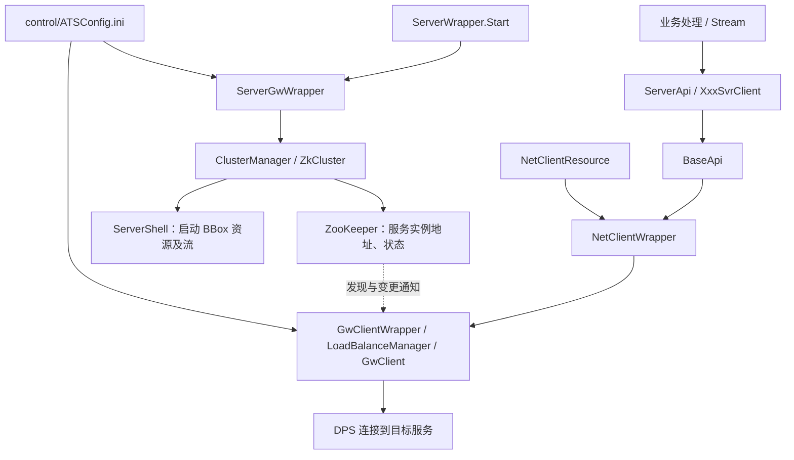

# STC 服务开发原则与实现约定

更新日期：2026-09-14。适用于 FICC 销售交易服务及公共库的后续开发。

本文记录本次阅读 STC 源码得到的机制，并据此约定实现方式。**复用 STC 已有框架，只实现业务；服务发现、连接管理、请求封装和订阅封装不另建一套。** 第 6 节记录已完成的原型改造及剩余边界。

业务职责与消息契约以 [系统架构](ficc-sales-trading-architecture.zh-CN.md)、[API 规范](ficc-api-spec.zh-CN.md)及[核心模型](models/core-data-model-er.zh-CN.md)为准。本文补充代码组织和运行机制，不修改业务接口。

## 1．已确认的 STC 调用链



- INNERSvr 入口调用 `sc.app.stc.utils.ServerWrapper.Start`；`NetType=gw` 时转到 `ServerGwWrapper`。
- `ServerGwWrapper` 根据服务配置的 `serverKey` 读取 `ATSConfig.ini`，通过集群组件启动服务及注册。
- `resource.xml` 声明 `NetClientResource`；其在 GW 模式下管理 `GwClientResource`，向业务代码提供 `NetClientWrapper`。
- `GwClient` 使用 `SERVER.BaseSvr` 等逻辑服务键获得地址，监听服务变化，移除旧连接、连接新增实例并恢复记录的订阅。连接选择由共享负载管理组件处理。
- 底层仍建立到目标服务的 DPS 连接。ZooKeeper 用于发现和状态通知，不承载业务消息，也不要求服务间经过前端使用的独立 GW 进程。

依据：[INNERSvr 入口](D:/workspace/GitHub/sc-app-stc-innersvr/src/main/java/INNERSvr.java)、[ServerWrapper](D:/workspace/GitHub/sc-app-stc/src/main/java/sc/app/stc/utils/ServerWrapper.java)、[ServerGwWrapper](D:/workspace/GitHub/sc-app-common/src/main/java/com/gw/common/utils/ServerGwWrapper.java)、[NetClientResource](D:/workspace/GitHub/sc-app-stc/src/main/java/sc/app/stc/net/NetClientResource.java)、[GwClient](D:/workspace/GitHub/sc-app-common/src/main/java/com/gw/common/utils/GwClient.java)。源码链接指向本机仓库。

## 2．服务启动、注册与配置

服务入口沿用 `ServerWrapper.Start("QuoteSvr", configFile)`，由 STC 负责集群生命周期及 BBox 启动。业务 `Main` 不直接管理注册，也不直接调用 `ServerShell` 绕过标准入口。

`ATSConfig.ini` 定义服务地址、逻辑名称、注册开关、注册模式及注册中心；服务自己的 INI 通过 `serverKey` 关联这些定义。

| 配置 | 含义 |
|---|---|
| `SERVER.QuoteSvr.Host` | 服务监听/发布地址；固定地址模式下也是客户端连接目标 |
| `SERVER.QuoteSvr.ServiceName` | 注册和查找使用的逻辑服务名 |
| `SERVER.QuoteSvr.RegisterEnable` | `1` 使用注册中心；`0` 使用配置中的固定地址 |
| `SERVER.QuoteSvr.RegisterServerList` | 引用注册中心配置，例如 `REGISTER.Svr1` |
| `SERVER.QuoteSvr.RegType` | 当前源码中 `0/1` 对应 ALL，`2` 对应 STANDBY |

注册开启时，`ZkCluster` 在 `/MDTService/<ServiceName>` 下维护临时实例节点，包含 `Host`、`Port`、`Stat`。ALL 模式使用临时顺序节点，STANDBY 使用固定名称的临时节点。客户端读取有效实例并监听变化。

**注册发现或主备选举不等于业务数据复制。** 报价事实恢复、状态一致性和切换后的补数仍由业务保证；不能仅启用注册就认定多个 QuoteSvr 可安全并行写入。

本机可使用 `RegisterEnable=0`，不要求额外启动 ZooKeeper。调用方仍通过 `NetClientResource` 和 `SERVER.QuoteSvr` 访问服务。以下为调用方固定地址配置示意；QuoteSvr 自身也需要对应定义：

```ini
NetType=gw
SERVER.QuoteSvr.Name=QuoteSvr
SERVER.QuoteSvr.Host=127.0.0.1:18680
SERVER.QuoteSvr.ServiceName=QuoteSvr
SERVER.QuoteSvr.RegType=1
SERVER.QuoteSvr.RegisterEnable=0
```

接入 STC 环境时配置注册中心并启用注册，业务调用仍使用同一服务键。业务类不得硬编码地址、端口或模拟登录凭据。

依据：[ATSROOTConfig](D:/workspace/GitHub/ats-foundation-utilities/src/main/java/ats/foundation/utils/config/ATSROOTConfig.java)、[ConfigUtils](D:/workspace/GitHub/sc-app-common/src/main/java/com/gw/common/utils/ConfigUtils.java)、[ZkCluster](D:/workspace/GitHub/sc-app-common/src/main/java/com/app/common/cluster/ZkCluster.java)、[ServerInfo](D:/workspace/GitHub/sc-app-common/src/main/java/com/app/common/cluster/ServerInfo.java)。

## 3．公共 API 与服务 Client

| 类/层 | 已有作用 | 本项目约定 |
|---|---|---|
| `ServerApi` | 服务作为调用方时的业务 API，例如订单请求、执行报告及行情订阅；继承 `BaseApi` | 参考其服务间调用方式；它不是接收请求的 Handler |
| `ClientApi` | 客户端侧业务 API；常用 `requestSync2`、`subscribe2` 等路径 | 不因名称含 Client 就误用为服务器注册发现入口 |
| `BaseApi` | 请求、反序列化、日志、类型化回调、普通订阅及带初始数据订阅 | 复用已验证的具体方法，不复制同类网络代码 |
| `BaseSvrClient` / `LoginSvrClient` / `CalSvrClient` | 各服务的主题、模型及业务访问方法 | 新服务按同样方式提供 `XxxSvrClient` |
| `NetClientWrapper` | 统一网络访问，向下选择 GW/CEDA 实现 | 由框架资源提供，不由各业务类自行创建连接 |

`BaseApi` 的调用路径必须按具体签名区分：服务间常用的 `requestSync`、`subscribe`、`subscribeWithImage` 向 `NetClientWrapper` 委派；`requestSync2` 和部分 `subscribeWithImage2` 等重载向 `BaseApi.Connect` 初始化的 `CedaWrapper` 委派。不能仅按后缀判断。

在 `cczq-app-salestrading-common` 中增加 `QuoteSvrClient`，提供查询报价状态、订阅报价事件、订阅价格等业务方法。内部复用公共 API 层，封装 `SERVER.QuoteSvr`、主题及请求/返回模型。NotificationSvr 不再自行创建 `GateWayApi`、拼接服务地址或重复封装原始请求。

业务方法示意如下，实际实现见公共库 `ficc.common.client.QuoteSvrClient`；初始化参数和会话参数以代码为准：

```java
QuoteSvrClient quoteSvrClient = new QuoteSvrClient(netClientResource.getNetClientWrapper(), 3000);
quoteSvrClient.initialize(connectionListener);
quoteSvrClient.subscribeQuoteEvents(onQuoteEvent);
quoteSvrClient.subscribePrices(onPrice);
quoteSvrClient.queryState(sessionId, request);
```

依据：[ServerApi](D:/workspace/GitHub/sc-app-stc/src/main/java/sc/app/stc/api/ServerApi.java)、[ClientApi](D:/workspace/GitHub/sc-app-stc/src/main/java/sc/app/stc/api/ClientApi.java)、[BaseApi](D:/workspace/GitHub/sc-app-stc/src/main/java/ats/app/api/BaseApi.java)、[BaseSvrClient](D:/workspace/GitHub/sc-app-stc/src/main/java/sc/app/stc/utils/BaseSvrClient.java)。

## 4．Handler、Stream、Resource 与公共库职责

| 位置 | 职责 |
|---|---|
| `handler/` | 接收主题请求，取得会话上下文，校验输入，调用业务并返回协议结果 |
| 业务服务/领域模块 | 状态转换、权限、幂等、版本检查、价格簿、提醒规则及事务 |
| `Resource` | 管理业务资源生命周期，初始化及释放存储等依赖；网络通过框架资源访问 |
| `stream/` | 消费上游消息、连接业务处理与输出流，发布复用 STC 输出机制 |
| `control/` | 装配资源、Handler 主题映射、Stream 及输出关系 |
| 公共库 | 消息模型、主题常量、字典、服务客户端、共享过滤等通用能力 |

每个服务保持独立目录、入口、`control`、构建产物及业务实现。公共库不依赖具体服务实现 JAR，服务之间通过协议交互。类名使用明确业务名称，不使用 `J` 等含义不清的缩写。

INNERSvr 的 Handler 映射位于 `resourceCfg.ini` 的 `handlerList`、`handler.<Name>.topic/class`；资源由 `resource.xml` 声明，流由 `streams.xml` 声明，并通过 `<output>` 连接 `NetRtOutputStream`。沿用实际配置结构，不另造路由注册机制。

依据：[资源配置](D:/workspace/GitHub/sc-app-stc-innersvr/control/INNERSvr/resource.xml)、[Handler 配置](D:/workspace/GitHub/sc-app-stc-innersvr/control/INNERSvr/resourceCfg.ini)、[Stream 配置](D:/workspace/GitHub/sc-app-stc-innersvr/control/INNERSvr/streams.xml)、[BaseStream](D:/workspace/GitHub/sc-app-stc-innersvr/src/main/java/sc/app/stc/inner/stream/BaseStream.java)。

## 5．请求、订阅和恢复原则

1. **请求/应答与订阅/发布分别表达。** 请求执行操作或查询；订阅持续接收变化。调用 API、请求主题、推送主题应清晰区分。
2. **Quote 与 Price 独立。** Quote 使用事件订阅，已有报价由显式查询取得；Price 使用价格簿模型，可使用带初始图像/快照订阅。框架通用能力不改变业务协议语义。
3. **连接恢复由基础层负责，数据恢复由业务负责。** 复用发现、重连和订阅重装；业务仍负责序号断档、去重、版本、初始查询与并发推送衔接。网络在线不等于数据完整，恢复完成前标识未就绪。
4. **写请求不能盲目重发。** 超时可能发生在业务提交之后；沿用 `requestId` 幂等和 `expectedRevision` 检查，不能因更换连接而生成新标识重复写入。
5. **连接身份与实际操作人分开。** 服务连接名称不是操作用户；复用 STC 会话和 `LoginSvrClient` 等机制，按契约传递、验证用户身份，审计记录实际操作人。
6. **模拟依赖独立实现。** 本机 Login/Base/CRM 模拟能力通过明确的模拟配置或适配实现提供，业务资源不内嵌固定账号登录流程。
7. **日志可追踪。** 记录服务、主题、请求标识、结果及关联 ID；完整消息日志遵循现有测试约定，凭据及会话秘密需脱敏。

### 复用前须核对的源码限制

这些是本次阅读发现的限制，不是另建通信框架的理由：

- `BaseApi` 的 `cedaClientWrapper`、`sid` 为静态字段，多个派生 Client 共享；应集中初始化，不可在并发请求中通过修改全局 `sid` 切换用户。
- 部分退订重载为空或被注释，`requestAsnc` 内实际发送语句也存在被注释的情况。采用前核对具体重载，不能以“存在方法”为已实现依据。
- `BaseApi.requestSync` 存在等待上线及较长请求超时的路径，不应在网络回调或 UI 线程中执行阻塞调用；选用符合业务时限的已实现入口。
- `ClientApi` 个别带初始数据订阅的参数顺序需要对照 `BaseApi` 签名检查，不直接复制。
- 基础库与 DPS SDK 使用兼容版本，本地兼容处理集中在基础层；业务服务不各自维护差异。

## 6．原型改造状态（2026-09-14）

| 原实现 | 已完成的改造 |
|---|---|
| 服务入口直接调用 `ServerShell` | 两个服务改用 `ServerWrapper.Start`，启用本机 ZooKeeper 注册 |
| NotificationResource 自建 DPS 连接并硬编码 QuoteSvr 地址 | 使用 `NetClientResource` + 公共 `QuoteSvrClient` + 逻辑服务键 |
| 业务类内固定账号及原始请求封装 | `LoginSessionClient` / `SimulatorLoginSvrClient` 分离模拟身份，账号移入模拟配置 |
| 缺少出站客户端资源和依赖服务配置 | 在 `resource.xml`、`ATSConfig.ini` 中装配；GW 同样启用服务发现 |

本轮使用现有 `NetClientWrapper` 的已实现入口封装实例 Client，明确传递会话和超时，不改动 `BaseApi` 的全局静态会话。原始仓库未修改，报价、价格、提醒模型及主题保持不变。

验收包括：配置切换地址不改业务代码、请求及两类订阅正常、服务重启后连接和业务状态恢复、停止时释放资源，以及 C# 原型基本功能不回归。先做少量有超时保护的功能检查；性能压力测试另行取得用户明确授权。

安装、配置、源码限制及验证结果见 [本机 ZooKeeper 与 STC 服务发现](../iteration1/docs/zookeeper-discovery.zh-CN.md)。已验证注册、变更 QuoteSvr 端口后的发现与状态恢复，以及小规模提醒/UI 功能。尚未接入真实 LoginSvr，也不据此宣称生产 HA 已完成。
