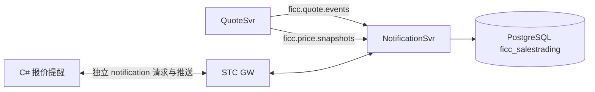

# 第一轮报价提醒

## 链路与落库



NotificationSvr 独立运行，地址由部署配置决定。复用现有 STC/BBox `ContentHandler`、`ResourceAdapter`、`StreamAdapter` 和 `NetRtOutputStream`，配置位于 `cgws-ficc-saletrading-notificationsvr/control`。13 个请求 Handler 与独立通知 report topic 已接入 GW。

启动时先订阅 QuoteSvr 两类消息，再用 `ficc.quote.internal.state.query` 加载报价与行情分组，用 `ficc.price.internal.snapshot.query` 获取价格簿。内部调用通过 STC 服务客户端完成，不登录用户账号，也不配置服务账号密码；前端请求仍验证用户会话。报价和价格分别检查处理位置；只有簿成员及引用的 quoteRevision 与当前有效报价一致，才用于判断最优。缺号或容量 128 的队列溢出触发重建，不无限增加内存。内部接口边界及升级步骤见 [STC 适配说明](stc-adapters.zh-CN.md#内部同步与用户登录的边界)。

QuoteSvr 与 NotificationSvr 共用 `ficc_salestrading` schema。通知服务使用 `notifications`、`notification_preferences`、`notification_reads`，公共存储使用 `notification_metadata`、`notification_events`、`notification_requests`、`notification_settings`，避免与报价的事件序号和幂等记录混用。通知与相应事件在同一 PostgreSQL 事务提交；写入锁按服务区分。行情分组仍来自 QuoteSvr 事件。旧双 schema 环境的升级见 [数据库初始化与迁移](qa-database.zh-CN.md)，旧 schema 仅保留作迁移备份。

源码位于 [cgws-ficc-saletrading-notificationsvr/src/main/java/ficc/notification](../cgws-ficc-saletrading-notificationsvr/src/main/java/ficc/notification)：`ficc.notification.Main` 为入口，`NotificationResource` 通过公共 `QuoteSvrClient` 处理上游订阅与业务恢复，`NetClientResource` 负责连接和 ZooKeeper 发现，`NotificationService` 实现规则与通知业务，`handler/` 和 `stream/` 分别处理请求与推送。运行时只加载通知服务 JAR、`cgws-ficc-saletrading-common.jar` 和 STC/DPS 等基础依赖。

## 四类规则

| 类型 | 条件 |
|---|---|
| 关注债券 | 当前账户、对应市场、scope=MARKET 的全部关注分组命中有效报价 |
| 筛选分组 | 当前账户全部行情筛选分组；复用 FilterEngine，同字段 OR、跨字段 AND |
| 对价提醒 | 同券、反方向、一条本人和一条他人有效报价；不要求价格交叉、相同清算或相同计价方式；每一对报价单独提醒 |
| 我的最优 | QuoteSvr 排好序的完整价格簿中，同侧首档属于本人的报价，保留全部并列；他人的操作也触发重新判断 |

非对价提醒按账户、债券合并原因和关联 quoteIds；对价保持独立。展示行与触发实例分离：triggers 按类型及来源报价版本保存独立键，对价包含双方版本。成员缩减不改变未变报价的键，不得据合并行 ID 变化重弹。通知 ID 包含所关联报价版本的稳定摘要，重复上游消息不会重复生成相同提醒；新版本产生新的当前提醒，旧提醒退出当前列表。

`alertKey` 是本轮客户端去重用的附加字段。已读按通知内容版本保存，因此关闭再开启同一规则不会清空已读；新版本不会因上一条提醒已读而被自动吞掉。客户端 read 请求中的旧 notificationId 也不会误标新版本。


## 前端接入

用户偏好、已读状态、视图查询及订阅报文统一见[API 规格](../../docs/ficc-api-spec.zh-CN.md)。当前桌面前端为 STC 客户端；旧 WinForms 原型按钮、通知弹窗及测试记录不再作为当前 UI 操作说明。

## 2026-10-18 变更驱动回归

业务规则以产品文档 §4.7.2–4.7.6 及用户确认口径为准：报价变更触发相关规则评估，其他报价提供比较上下文；列表保留当前有效提醒，弹窗仅呈现新增实例。待确认报价不参与。单笔同方向报价不能触发“我的最优”。

已读保存到独立实例键，合并行删除部分成员不把剩余已读实例改成未读；新报价版本仍未读。弹窗摘要取触发报价的价格、数量和内部归属用户，不携带对手敏感字段。

自动化用例 `62-notification-change-trigger`：真实精确报价生成两笔同券报价，逐一验证新增、修改、撤销、停留其他页面仍接收、刷新不重弹；结束删除本例报价并恢复关注分组及偏好。服务端 `NotificationProtocolSmoke` 额外验证重复事件、全局重算、双边版本键、已读保持、单笔最优排除和待确认排除。

## 提醒回归覆盖矩阵（2026-10-18 扩展）

测试分层：Java 测试直接调用正式 NotificationService 并使用独立 PostgreSQL 临时 schema；C# 集成测试验证正式客户端组件；桌面用例启动真实 STC，经本机 GW 和服务完成操作。三者不能相互冒充。断言数包含协议应答及前置条件检查，不代表独立业务用例数。

| 条件/组合 | 自动化入口 | 断言内容 |
|---|---|---|
| 四类提醒 × 生命周期 | `NotificationScenarioMatrix.lifecycle` | 每类分别检查待确认排除、确认、有效报价编辑、Refer、Unrefer、删除；新版本键变化、旧版本退出 |
| 四个规则开关全部 16 种组合 | `preferencesAndReasons` | 开启规则命中、关闭规则不命中；一个报价可有多个独立原因 |
| 重复分组与原因减少 | 同上 | 两个关注组命中只产生一个实例；移除一个组不重弹；移除关注原因仍保留筛选原因 |
| 筛选条件组合 | `filterCombinations` | Bid/Ofr × T+0/T+1 四种组合，逐笔断言准确成员；同字段 OR、跨字段 AND；scope/market 不匹配排除 |
| 最优与对价边界 | `comparisonsAndUsers` | 并列最优、竞争报价领先、单笔及不可比报价排除；side/quoteType/yieldType/settlType 各维度；对价不要求价格交叉或相同计价/清算；本人两边报价不自配对 |
| 账号与归属 | 同上及 `preferencesAndReasons` | 已确认报价共享；用户分组独立；最优只通知报价归属用户；对价双方各有实例；无相关规则的第三用户无提醒 |
| 重建/乱序/过期数据 | `recoveryAndPaging` | 数据库重建保留实例键与已读；相同快照不重发；报价缺号/epoch 变化和价格流不一致拒绝；旧价格簿不计算新版本最优，匹配快照后恢复 |
| 连续更新、分页、旧已读 | 同上 | 连续三个新版本最终只保留当前实例；limit=1 游标遍历无重无漏；旧行已读不能吞新版本 |
| 客户端组合原因/快照 | C# `notification-combined-reasons`、`notification-snapshots-paging` | 多原因分别去重；减少原因不重弹；翻页和重连基线不弹存量；客户端重新创建后首份快照不重播 |
| 客户端连续版本/账号 | C# `notification-rapid-updates-users` | 每个新版本一次、重复版本零次；两个独立 tracker 不互相消费；已读/未读切换不是报价变更 |
| 单账号真实桌面 | `14`、`62`、`63`、`64` | 新建、修改、离开提醒页仍接收、刷新不重弹；Refer/Unrefer/删除；合并行已读后移除 A 不影响 B，编辑 B 重新提醒 |
| 双账号真实桌面 | `46-realtime-alert` | test2 操作、adrian 始终停留提醒页；按具体 quoteId/triggers 核对，而非只看同券出现一行；确认/恢复各弹一次，撤销/删除不重弹；不点击刷新 |

新增管理器用例：`63-notification-restore-delete`、`64-notification-read-removal`，位置为“02 行情中心 / 06 报价提醒 / 02 变更驱动与去重”。既有 `46-realtime-alert` 增强了精确实例与弹窗断言。每例恢复偏好并清理本例报价、关注分组；不删除其他用户的数据。否定弹窗断言有持续观察窗口，避免推送尚未到达时提前判定通过。

运行 Java 功能矩阵（数据库用户需要创建和删除临时 schema 的权限）：

```powershell
powershell -NoProfile -ExecutionPolicy Bypass -File iteration1/scripts/test-notification-scenarios.ps1 -Configuration iteration1/runtime/quotesvr.local.properties
```

脚本先编译当前 NotificationSvr 测试并准备依赖；依赖的 common 应先按正常构建流程安装。`-Configuration` 指定现有测试数据库配置，`-ReferenceRoot` 可指定参考数据根目录，默认使用源码 QuoteSvr 本机参考配置。两个 Java 测试串行、各有 30 秒独立进程看门狗和 160 MB 堆上限。正常退出（包括断言失败）删除独立 schema；强制终止可能留下该次临时 schema，需要按报告检查。30 秒是功能测试进程的总运行保护，不是接口延迟指标，不是压力测试。

验证边界：服务重建和重连测试分别是服务对象/数据库重载及客户端快照语义验证；未注入真实网络断线、未重启共享 GW/NotificationSvr。分页覆盖服务端游标和客户端 tracker 基线，尚未完成超过 50 行的真实桌面分页及未加载页提醒验证。连续版本是少量顺序功能事件，不代表并发/吞吐验证。QA 环境、全部市场数据字段笛卡尔积及全量桌面套件没有在本轮验证，不得称为“所有条件全部覆盖”。

### 本轮本机验证结果

- Java：`NotificationScenarioMatrix` 245 个断言通过；既有 `NotificationProtocolSmoke` 42 个断言通过。报告：`iteration1/runtime/notification-matrix-final3/`。独立 schema 正常清理。
- C#：集成套件 39 项通过，其中新增组合原因、分页/重连快照基线、连续版本/账号独立三个测试；报告位于本机 `qa_env/client-history-ui/integration-tests.log`。
- 真实桌面：`14`、`62`、`63`、`64`、`46` 的最终相关运行均通过，夹具清理通过。`46` 使用 test2/adrian 两个真实登录会话。报告：本机 `qa_env/client-history-ui/reports/notification-matrix-render-fix/`（62/63/64/46）及 `notification-matrix-selection/`（14/64 最终选择修正验证）。
- 测试发现并修复两个驱动时序问题：关闭弹窗前等待当前分组按钮真正渲染并验证关闭；标记已读明确选择关注实例，并在操作间隔后按 notificationId 定位当前行，避免选择已被推送替换的旧对象。点击前仍断言选择未丢失，不以重试读操作掩盖产品问题。早期失败报告保留，不算通过。
- 默认 `runtime/ui-test-client` 已重建，管理器可直接运行新增 63/64。本轮只修改测试和说明，没有修改产品服务或客户端业务实现，无需重新部署 NotificationSvr。
