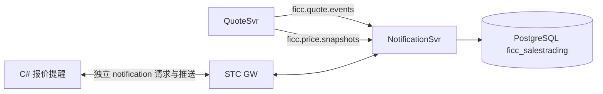

# 第一轮报价提醒

## 链路与落库

NotificationSvr 独立运行，地址由部署配置决定。复用现有 STC/BBox `ContentHandler`、`ResourceAdapter`、`StreamAdapter` 和 `NetRtOutputStream`，配置位于 `cgws-ficc-saletrading-notificationsvr/control`。13 个请求 Handler 与独立通知 report topic 已接入 GW。

启动时先订阅 QuoteSvr 两类消息，再用 `ficc.quote.internal.state.query` 加载报价与行情分组，用 `ficc.price.internal.snapshot.query` 获取价格簿。内部调用通过 STC 服务客户端完成，不登录用户账号，也不配置服务账号密码；前端请求仍验证用户会话。报价和价格分别检查处理位置；只有簿成员及引用的 quoteRevision 与当前有效报价一致，才用于判断最优。缺号或容量 128 的队列溢出触发重建，不无限增加内存。内部接口边界及升级步骤见 [STC 适配说明](stc-adapters.zh-CN.md#内部同步与用户登录的边界)。

QuoteSvr 与 NotificationSvr 共用 `ficc_salestrading` schema。通知服务使用 `notifications`、`notification_preferences`、`notification_reads`，公共存储使用 `notification_metadata`、`notification_events`、`notification_requests`、`notification_settings`，避免与报价的事件序号和幂等记录混用。通知与相应事件在同一 PostgreSQL 事务提交；写入锁按服务区分。行情分组仍来自 QuoteSvr 事件。旧双 schema 环境的升级见 [数据库初始化与迁移](qa-database.zh-CN.md)，旧 schema 仅保留作迁移备份。

源码位于 [cgws-ficc-saletrading-notificationsvr/src/main/java/ficc/notification](../cgws-ficc-saletrading-notificationsvr/src/main/java/ficc/notification)：`ficc.notification.Main` 为入口，`NotificationResource` 通过公共 `QuoteSvrClient` 处理上游订阅与业务恢复，`NetClientResource` 负责连接和 ZooKeeper 发现，`NotificationService` 实现规则与通知业务，`handler/` 和 `stream/` 分别处理请求与推送。运行时只加载通知服务 JAR、`cgws-ficc-saletrading-common.jar` 和 STC/DPS 等基础依赖。

## 四类规则

| 类型 | 条件 |
|---|---|
| 关注债券 | 当前账户、对应市场、scope=MARKET 的全部关注分组命中有效报价 |
| 筛选分组 | 当前账户全部行情筛选分组；复用 FilterEngine，同字段 OR、跨字段 AND |
| 对价提醒 | 同券、反方向、一条本人和一条他人有效报价；不要求价格交叉、相同清算或相同计价方式；每一对报价单独提醒 |
| 我的最优 | QuoteSvr 排好序的完整价格簿中，同侧首档属于本人的报价，保留全部并列；他人的操作也触发重新判断 |

非对价提醒按账户、债券合并原因和关联 quoteIds；对价保持独立。通知 ID 包含所关联报价版本的稳定摘要，重复上游消息不会重复生成相同提醒；新版本产生新的当前提醒，旧提醒退出当前列表。

`alertKey` 是本轮客户端去重用的附加字段。已读按通知内容版本保存，因此关闭再开启同一规则不会清空已读；新版本不会因上一条提醒已读而被自动吞掉。客户端 read 请求中的旧 notificationId 也不会误标新版本。

## 前端接入

用户偏好、已读状态、视图查询及订阅报文统一见[API 规格](../../docs/ficc-api-spec.zh-CN.md)。当前桌面前端为 STC 客户端；旧 WinForms 原型按钮、通知弹窗及测试记录不再作为当前 UI 操作说明。
