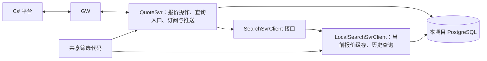

# 第一轮：SearchSvr 尚未实现时的处理

前端仍经 GW 调用 QuoteSvr。第一轮不启动独立 SearchSvr，使用进程内的 `LocalSearchSvrClient` 实现内部查询接口。

- QuoteSvr 保存报价事实、操作历史和事件；事务提交后才更新缓存与推送。
- 本地查询读取实际报价数据，历史查询读取 PostgreSQL，不返回写死的查询结果。
- 查询与实时订阅匹配复用筛选代码和基础数据。订阅仍由 QuoteSvr 管理，SearchSvrClient 不管理订阅。
- 后续增加 DPS 版本的 SearchSvrClient，替换本地实现，保持前端接口不变。跨进程索引延迟、事件补偿及查询水位需在接入独立 SearchSvr 时验证；进程内测试不能证明这些能力。

第一轮的债券与登录信息使用固定示例。历史报价按当前基础属性与最新日估值筛选、显示。历史查询的日记录粒度暂按“该日最后一次变更后的报价”实现，尚不补齐无变更日期；这是平台限制，并非新增产品约定。

本地实现已编译，并通过 C# → GW → QuoteSvr → PostgreSQL 小规模功能检查；结果与边界见 [第一轮运行说明](../README.zh-CN.md)。
