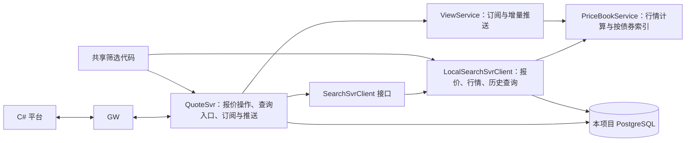

# 第一轮：SearchSvr 尚未实现时的处理

前端仍经 GW 调用 QuoteSvr。第一轮不启动独立 SearchSvr，使用进程内的 `LocalSearchSvrClient` 实现内部查询接口。

- QuoteSvr 保存报价事实、操作历史和事件；事务提交后才更新缓存与推送。
- 本地查询读取实际报价数据，历史查询读取 PostgreSQL，不返回写死的查询结果。
- 查询与实时订阅匹配复用筛选代码和基础数据。订阅仍由 QuoteSvr 管理，SearchSvrClient 不管理订阅。
- `SearchSvrClient.queryPrices(userId, PriceQueryRequest)` 返回 `List<PriceBook>`。`ficc.price.query` 经该接口查询；外部响应仍使用原有 `prices` 字段，DPS topic 与请求格式不变。
- `PriceBookService` 统一维护按债券分组的报价索引、行情版本与 FULL/BEST/DEPTH 计算。查询与订阅使用同一实例；报价变化只更新涉及的债券索引，计算单债券行情不会遍历全部报价。该实例由原有有序调度线程管理，不引入额外线程。
- 行情仅包含当前用户可见的 ACTIVE 报价，先执行可见性与条件筛选，再选择价格档位；待确认报价不进入行情。内部授权行情订阅保留原有跨用户视图。
- 行情计算直接生成 `PriceBook` / `MarketEntry`，序列化在响应及推送边界进行，不在逐条报价匹配中转换 JSON。common 的 `MarketEntry` 补齐已存在于线上协议中的 `PriceType`、`ExerciseFlag`、`UserID`、`MDPriceLevel`，发布时应一并更新 common 与 QuoteSvr。
- 后续增加 DPS 版本的 SearchSvrClient，替换本地实现，保持前端接口不变。跨进程索引延迟、事件补偿及查询水位需在接入独立 SearchSvr 时验证；进程内测试不能证明这些能力。

债券与登录信息由配置选择模拟或 STC 适配器。历史报价按当前基础属性与最新日估值筛选、显示。历史查询的日记录粒度暂按“该日最后一次变更后的报价”实现，尚不补齐无变更日期；这是平台限制，并非新增产品约定。

本地实现已编译，并通过 C# → GW → QuoteSvr → PostgreSQL 小规模功能检查；结果与边界见 [第一轮运行说明](../README.zh-CN.md)。

本次行情查询接口调整的回归入口为 `PriceSearchSmoke`，也由 `BusinessSmoke` 自动调用，覆盖行情档位、QT 用户隔离、待确认排除、报价迁移与删除、版本号及报文字段。另运行 `IncrementalViewSmoke` 检查增量订阅结果。以上均为功能检查；不能据此宣称已完成桌面/DPS 端到端验证或性能基准验证。
