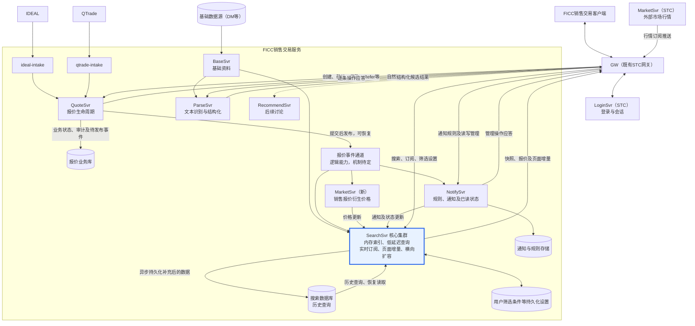
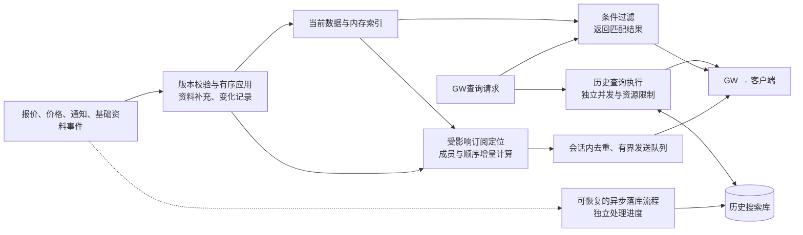

# FICC销售交易系统架构（讨论稿）

基于本轮架构图及讨论整理，日期：2026-09-10。本文确定服务职责和数据流，不展开部署规格及完整API。

## 1．总体架构

**QuoteSvr负责报价业务及其状态；SearchSvr是平台核心的实时查询与订阅引擎。** SearchSvr承担大数据量下的低延迟复杂查询、实时页面计算与推送，并可独立扩容。当前数据在内存中查询，历史搜索使用异步维护的数据库；客户端通过既有STC网关访问。

**页面统一使用滚动浏览，不提供翻页或用户自选顺序功能。报价固定按updateTime从新到旧显示**，时间相同时用quoteId保持稳定顺序。客户端采用虚拟化列表，只创建可见区域的行控件。



图中的数据库是逻辑存储职责，不要求分别部署数据库实例。报价事件通道表示可恢复的事件传递能力，不预设具体消息产品，也不表示现有DPS已经具备持久化重放保证。为保持图简洁，未画出全部请求应答及订阅控制箭头。

## 2．服务职责与数据归属

| 服务 | 负责什么 | 数据归属 |
| --- | --- | --- |
| `ideal-intake / qtrade-intake` | 外部来源适配、消息关联和重复接入处理 | 保留外部来源信息，报价状态由QuoteSvr决定 |
| `QuoteSvr` | 创建、确认、修改、Refer、Unrefer、删除；逐条结果与操作审计 | 报价业务记录是最终依据，其他服务维护其副本 |
| `BaseSvr` | 提供债券、发行人、机构等基础资料及其变化 | 供解析和搜索补充数据；QuoteSvr校验所需依赖另行明确 |
| `ParseSvr` | 根据基础资料，把包含交易信息的自然语言转为报价结构 | 识别结果是候选，识别成功不等于确认生效 |
| 新`MarketSvr` | 消费销售报价，生成衍生价格 | 与既有STC外部行情服务区分；价格口径待定 |
| `NotifySvr` | 规则配置、通知生成、基础管理及已读/未读操作 | 持久化通知和规则，是通知状态的业务负责方 |
| `SearchSvr` | 核心实时查询与订阅引擎：多源数据补充、内存索引、复杂条件查询、页面增量计算与推送；独立扩容 | 保存可重建的搜索数据；持久化保存用户筛选条件，隔离当前查询与历史查询负载 |
| `RecommendSvr` | 智能推荐 | 本轮暂不展开 |

`SearchSvr`增强查询能力，不代替业务服务修改数据。例如，标记通知已读走NotifySvr，状态变化再同步给SearchSvr；不能只修改搜索副本。

## 3．主要数据流

### 报价处理与实时页面更新

```text
客户端动作 / 外部报价接入
  → QuoteSvr校验并提交报价、审计、待发布事件
  → 报价事件送达SearchSvr，并供价格、通知服务使用
  → SearchSvr补充资料、更新内存索引、计算受影响页面
  → 通过GW推送报价数据与页面变化
  → 客户端更新共享报价缓存和UI
```

- 报价使用统一quoteId与revision；确认、Refer、Unrefer不更换quoteId。
- 操作应答报告逐条成功/失败；QuoteReport描述动作及其执行后的报价。客户端不根据应答和推送分别新增两次相同行。
- 本地新建报价用clientQuoteId关联服务端quoteId。即使报价不匹配当前面板条件，也必须保证创建结果的关联能返回发起客户端；具体回报路由还需确定。
- 多面板共用报价缓存。首次订阅取得匹配结果，后续只处理新增、更新、移除及位置变化；无需维护页边界和补位。
- 报价更新后按新updateTime调整位置，包括价格、状态及急/荐等属性变更。列表变化时保留用户当前可见内容的位置，避免滚动浏览被打断。

### 解析与持久化

已确认：ParseSvr接收自然语言文本，使用基础资料，返回结构化报价候选。

建议路径：`客户端 → GW → ParseSvr → 客户端校正 → GW → QuoteSvr保存/确认`。解析结果由客户端提交，还是由服务端编排保存为待确认报价，尚未最终确定；无论哪种方式，业务持久化及状态变化归QuoteSvr。

### 通知管理与查询

```text
客户端修改规则 / 标记已读
  → GW → NotifySvr保存
  → 发布通知变化
  → SearchSvr更新搜索数据及订阅
  → GW → 客户端
```

通知查询和实时展示通过SearchSvr；基础管理API由NotifySvr提供。若已读状态按用户区分，存储、事件和搜索数据必须包含相应用户范围。

## 4．SearchSvr：核心实时查询与订阅引擎

SearchSvr不只是数据库查询接口或数据转发服务。它维护当前可搜索状态，执行跨债券、多维条件查询，并持续计算每个订阅页面的变化。**低延迟查询、实时推送和可扩展性需要同时设计**，不能只依靠“数据放进内存”。以下为技术方向，具体实现通过小规模验证选择。

### 4.1 内部处理结构



图中为逻辑模块，不要求第一版拆成多个服务。落库流程必须使用一致的数据补充规则并记录处理位置，保存补充后的搜索数据；不意味着将上游原始报文直接当作历史搜索记录。

| 技术能力 | 设计方向 |
| --- | --- |
| 内存搜索 | 按quoteId定位对象；对发行人类型、评级、方向、状态等常用条件建立索引，维护固定的更新时间顺序，避免每次查询扫描全部对象 |
| 参考数据关联 | 维护债券/发行人/机构到报价的反向关联，资料变化时定位受影响报价；查询尽量使用已补充的本地数据，不逐行同步调用远程服务 |
| 查询与事件并发 | 查询读取一致的数据视图；事件更新不能暴露“对象已变、索引未变”的中间状态。同一报价有序应用，避免用一把全局锁长期阻塞查询 |
| 订阅计算 | 按条件依赖定位候选订阅，再结合变化前后数据判断进入、离开或移动；不能遗漏原来匹配、更新后不再匹配的订阅。相同查询可共享计算，但必须包含权限范围 |
| 结果维护 | 共享报价对象，每个面板维护匹配报价的有序ID列表；按updateTime增量调整位置，客户端保存自己的滚动位置 |
| 推送控制 | 按会话合并重复报价和页面变化；短时间合并UI更新，限制队列长度与发送字节数。慢客户端超限时明确重建，不能静默漏事件，也不能拖住事件处理 |
| 资源隔离 | 历史查询、导出、异步落库和索引恢复不与实时查询/订阅共用无限队列；各自限制并发、执行时间和内存占用 |

### 4.2 当前数据与历史数据

**实时收到报价后，先补充基础资料并更新内存搜索数据；数据库写入异步执行。** 历史查询通过搜索数据库完成，不要求全部历史长期驻留Java内存。

| 路径 | 处理方式 |
| --- | --- |
| 当前报价查询 | 内存对象与索引执行多条件过滤，按固定的更新时间顺序返回结果 |
| 历史查询 | 异步维护的搜索数据库；必要时与内存当前数据合并 |
| 筛选条件保存 | 明确持久化成功后应答；不能仅保存在内存中 |
| 基础资料变化 | 重新补充受影响记录，更新索引并重新计算相关订阅 |

需要保留的约定：

1. **可恢复。** 不能只用进程内队列承接尚未落库的数据；保留可重放事件或持久化待处理记录。数据库变慢时，记录积压并控制上限，避免无限占用内存。
2. **版本正确。** 按quoteId、revision处理重复和乱序；Refer、Unrefer、Delete都要同步落库。基础资料更新也会改变搜索内容，需要独立的资料版本或处理位置，不能只检查报价revision。
3. **初始化不丢更新。** 从一致快照恢复，接续快照位置之后的事件，避免数据库旧行覆盖刚收到的新事件。
4. **历史交接明确。** 一天的数据最终状态尚未可靠落库前，不从内存清除；跨当前/历史查询按明确时间范围和quoteId去重，避免漏行或重复。
5. **两类数据分开管理。** 搜索副本可重建，用户保存的筛选条件不可因索引重建而丢失。

异步落库意味着历史搜索可能暂时落后于实时内存。需要定义可接受的延迟及查询一致性要求，但本轮不设未经验证的性能数字。

结果较大时可以分批传输，页面仍然连续滚动；是否按滚动范围继续加载、客户端保留多少数据，留待容量验证。不把“滚动浏览”理解为一次传输全部历史或同时创建全部行控件。

### 4.3 扩容与高可用方向

优先验证**多个SearchSvr节点各持有完整的当前数据，按客户端会话分配查询和订阅**。这样保留跨所有债券查询的直接性，也符合此前先扩展查询处理能力的方向；它是当前数据规模允许时的方案，不代表历史数据也完整驻留每个节点。

- 每个查询副本必须独立接收完整的相关事件，不能放入只分摊事件的同一消费组后误认为各自拥有全量数据。节点从可恢复快照启动并补齐事件，达到可服务位置后才加入流量。
- 一个会话的页面订阅及批次序号由确定的节点负责，避免请求随机落到不同进度的副本。切换节点时重建订阅和快照，使用新streamId；不承诺跨节点无条件继续旧序号。
- 增加副本可分摊查询、订阅计算和推送负载，但每个副本仍承担完整事件处理、索引和内存成本。副本落后时必须可观测；必要时停止接收新会话，避免持续提供过旧数据。
- 历史落库设置明确的写入责任与处理进度，不能让所有查询副本无协调地重复写同一数据。可使用独立逻辑写入流程或分配写入责任，配合版本校验及重复写入保护。
- 当单机内存或完整事件应用能力成为瓶颈时，再评估分区及分布式查询。按债券分区会让全市场过滤及实时订阅需要跨节点合并，不作为第一版默认方案。

多节点本身不等于高可用；事件恢复、流量切换、订阅重建及持久化设置的可用性需要一起验证。QuoteSvr仍是报价业务状态的负责方，SearchSvr副本不能自行决定报价生命周期。

### 4.4 以端到端指标验证性能

| 观察项 | 需要记录的指标 |
| --- | --- |
| 查询延迟 | 典型及复杂条件下的p50/p95/p99；包含过滤、结果准备及首批数据返回，不能只测缓存命中 |
| 实时可见延迟 | QuoteSvr提交 → SearchSvr应用 → 页面变化发出 → 客户端应用/显示，分别记录各阶段耗时 |
| 处理能力 | 报价及基础资料更新速率、查询并发、活动会话/面板数、每次事件影响的订阅数 |
| 资源与积压 | 内存对象及索引大小、GC停顿、CPU、事件落后程度、发送队列、异步落库延迟 |
| 恢复能力 | 节点加载及追平时间、会话重建时间，以及重建后的结果完整性 |

容量不只由报价条数决定：同一报价反复更新、复杂筛选和大量订阅都会放大工作量。先定义代表性负载，再确定延迟及容量目标。性能验证须另行取得授权，从短时、小负载逐步增加，并设置自动停止条件；本次仅完善架构，不执行压测。

## 5．消息与身份约定

- 继续使用DPS请求/应答和订阅/发布；QuoteSvr新topic使用`ficc.quote.*`。
- 客户端会话推送topic为`ficc.quote.report.<sessionId>`，共享报价及页面更新，不为每个动作、每个面板重复订阅报价内容。它与服务间报价事件通道职责不同；具体由哪个组件注册发布路由待定。
- 操作者从已认证DPS会话取得，不信任客户端自填userId。操作审计及QuoteReport记录operatorUserId、operationTime；报价所属用户与操作者分开。
- 快照、推送使用streamId、sequence和订阅version处理连续性与恢复；quote.revision用于报价自身版本，不能替代整个流的序号。订阅只提交筛选条件，不提供页码及自选顺序参数。

报价消息字段及生命周期API见[报价API讨论稿](quote-entry-api-design-discussion.zh-CN.md)，共享缓存及增量消息思路参考[看板订阅草案](quote-board-subscription-protocol.zh-CN.md)。这些旧草案尚未同步本轮滚动浏览及固定更新时间顺序的决定，其页码、自选顺序和相关操作不再作为本架构要求；SearchSvr职责对应的API路由也留待对齐。本次仅更新架构文档。

## 6．待确定事项

- 新MarketSvr输出的价格定义：最优买卖价、机构维度价格或其他口径；是否改名以区别STC的MarketSvr。
- ParseSvr返回候选后的持久化编排方式。
- QuoteReport经QuoteSvr、SearchSvr和GW的准确发布路由；创建关联与页面增量如何避免遗漏或重复。
- 事件保存、重放、快照衔接及异步落库机制。
- SearchSvr当前数据保留范围、代表性查询/更新/订阅规模及目标延迟；完整副本方案的单节点容量边界和扩容策略。
- 历史搜索展示每天最终报价状态，还是任意时点状态；基础资料按历史时点还是最新值补充。完整操作审计仍保留在QuoteSvr，不能用当前搜索副本替代。

本稿不引入新的行情搜索报文、确定的分片实现、未经验证的容量承诺或推荐算法；先统一职责、数据流、性能设计方向和恢复边界。
